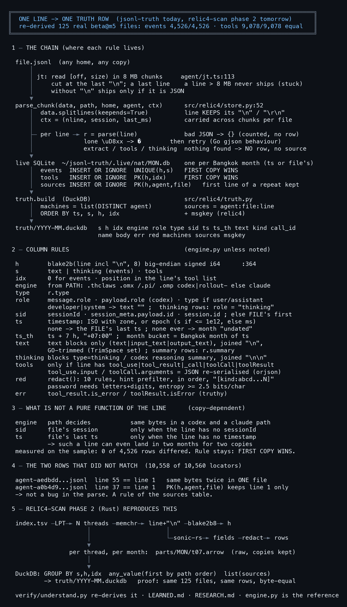

# One line becomes one truth row

What relic4-scan phase 2 must reproduce, traced through the code and checked on real data with `verify/understand.py`.



<details><summary>text</summary>

```
╔════════════════════════════════════════════════════════════════════════════════════╗
║  ONE LINE -> ONE TRUTH ROW  (jsonl-truth today, relic4-scan phase 2 tomorrow)      ║
║  re-derived 125 real beta@m5 files: events 4,526/4,526 · tools 9,078/9,078 equal   ║
╚════════════════════════════════════════════════════════════════════════════════════╝

 1 ─ THE CHAIN (where each rule lives)

  file.jsonl  (any home, any copy)
      │
      │ jt: read [off, size) in 8 MB chunks     agent/jt.ts:113
      │     cut at the last "\n"; a last line    a line > 8 MB never ships (stuck)
      │     without "\n" ships only if it is JSON
      ▼
  parse_chunk(data, path, home, agent, ctx)      src/relic4/store.py:52
      │  data.splitlines(keepends=True)          line KEEPS its "\n" / "\r\n"
      │  ctx = (nline, session, last_ms)         carried across chunks per file
      │
      ├─ per line ─► r = parse(line)             bad JSON -> {} (counted, no row)
      │              lone \uD8xx -> �        then retry (Go gjson behaviour)
      │              extract / tools / thinking  nothing found -> NO row, no source
      ▼
  live SQLite  ~/jsonl-truth/.live/nat/MON.db    one per Bangkok month (ts or file's)
      │  events  INSERT OR IGNORE  UNIQUE(h,s)   FIRST COPY WINS
      │  tools   INSERT OR IGNORE  PK(h,idx)     FIRST COPY WINS
      │  sources INSERT OR IGNORE  PK(h,agent,file)   first line of a repeat kept
      ▼
  truth.build  (DuckDB)                          src/relic4/truth.py
      │  machines = list(DISTINCT agent)         sources = agent:file:line
      │  ORDER BY ts, s, h, idx                  + msgkey (relic4)
      ▼
  truth/YYYY-MM.duckdb   s h idx engine role type sid ts ts_th text kind call_id
                         name body err red machines sources msgkey

 2 ─ COLUMN RULES                                (engine.py unless noted)

  h        blake2b(line incl "\n", 8) big-endian signed i64      :364
  s        text | thinking (events) · tools
  idx      0 for events · position in the line's tool list
  engine   from PATH: .thclaws .omx /.pi/ .omp codex|rollout- else claude
  type     r.type
  role     message.role · payload.role (codex) · type if user/assistant
           developer|system -> text "" ;  thinking rows: role = "thinking"
  sid      sessionId · session_meta.payload.id · session.id ; else FILE's first
  ts       timestamp: ISO with zone, or epoch (s if <= 1e12, else ms)
           none -> the FILE's last ts ; none ever -> month "undated"
  ts_th    ts + 7 h, "+07:00" ;  month bucket = Bangkok month of ts
  text     text blocks only (text|input_text|output_text), joined "\n",
           GO-trimmed (TrimSpace set) ; summary rows: r.summary
  thinking blocks type=thinking / codex reasoning summary, joined "\n\n"
  tools    only if line has tool_use|tool_result|_call|toolCall|toolResult
           tool_use.input / toolCall.arguments = JSON re-serialised (orjson)
  red      redact(): 10 rules, hint prefilter, in order, "[kind:abcd...N]"
           password needs letters+digits, entropy >= 2.5 bits/char
  err      tool_result.is_error / toolResult.isError (truthy)

 3 ─ WHAT IS NOT A PURE FUNCTION OF THE LINE      (copy-dependent)

  engine   path decides           same bytes in a codex and a claude path
  sid      file's session         only when the line has no sessionId
  ts       file's last ts         only when the line has no timestamp
           -> such a line can even land in two months for two copies
  measured on the sample: 0 of 4,526 rows differed. Rule stays: FIRST COPY WINS.

 4 ─ THE TWO ROWS THAT DID NOT MATCH  (10,558 of 10,560 locators)

  agent-aedbdd...jsonl  line 55 == line 1   same bytes twice in ONE file
  agent-a0b4d9...jsonl  line 37 == line 1   PK(h,agent,file) keeps line 1 only
  -> not a bug in the parse. A rule of the sources table.

 5 ─ RELIC4-SCAN PHASE 2 (Rust) REPRODUCES THIS

  index.tsv ─LPT─► N threads ─memchr─► line+"\n" ─blake2b8─► h
                      │                     │
                      │                     └─sonic-rs─► fields ─redact─► rows
                      ▼
                 per thread, per month:  parts/MON/t07.arrow  (raw, copies kept)
                      │
                      ▼
  DuckDB: GROUP BY s,h,idx  any_value(first by path order)  list(sources)
          -> truth/YYYY-MM.duckdb   proof: same 125 files, same rows, byte-equal

  verify/understand.py re-derives it · LEARNED.md · RESEARCH.md · engine.py is the reference
```
</details>
