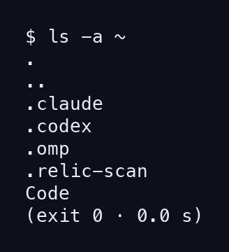
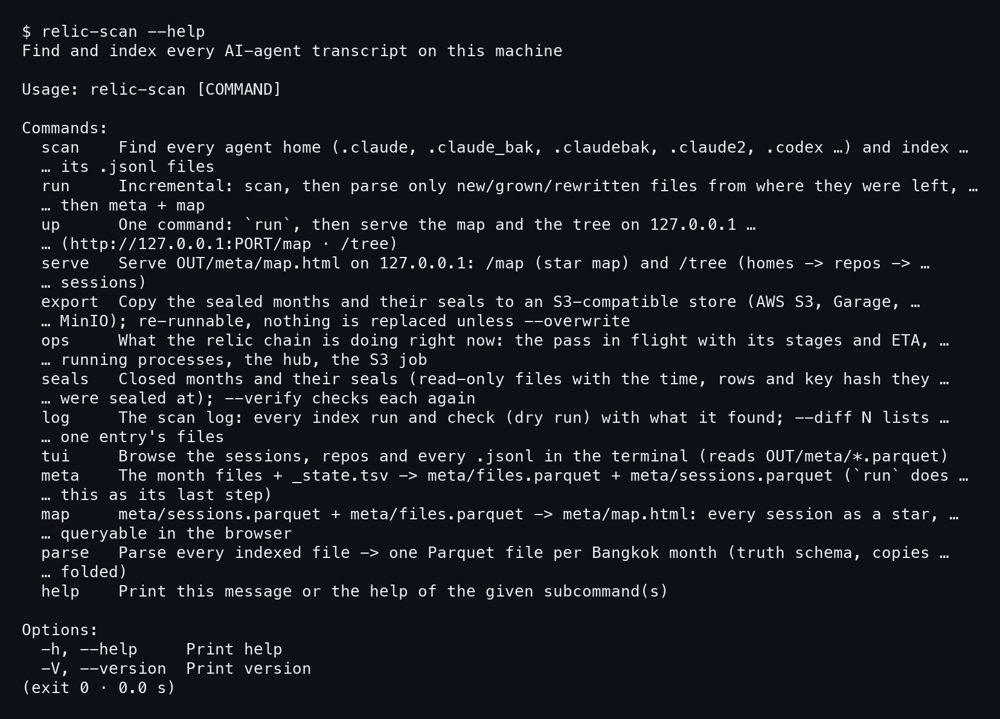
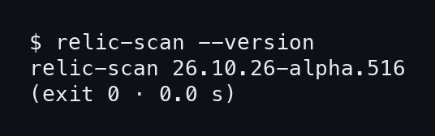
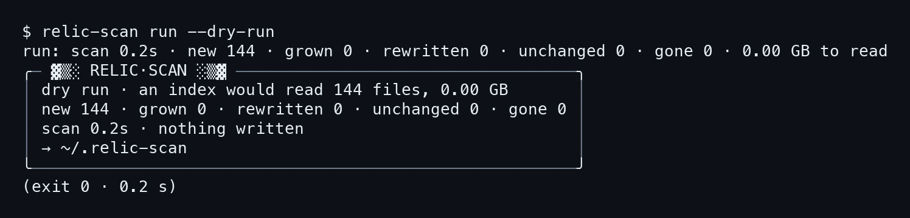
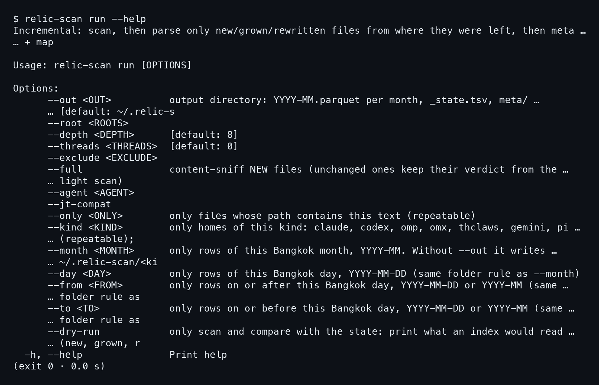
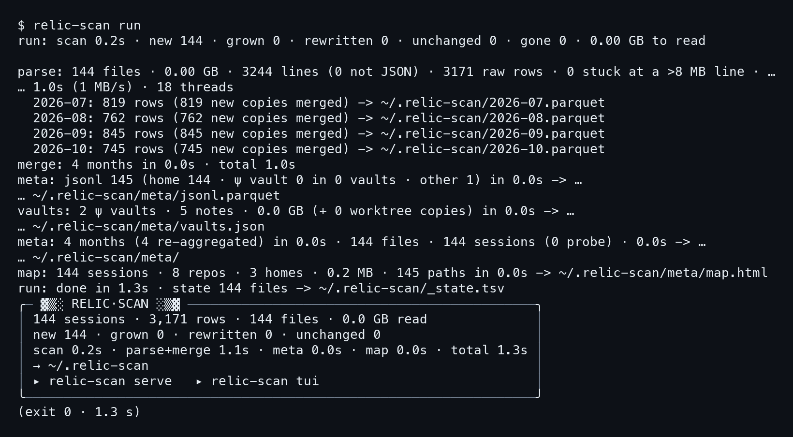
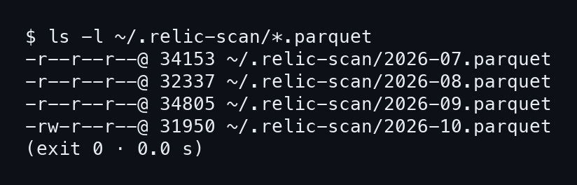
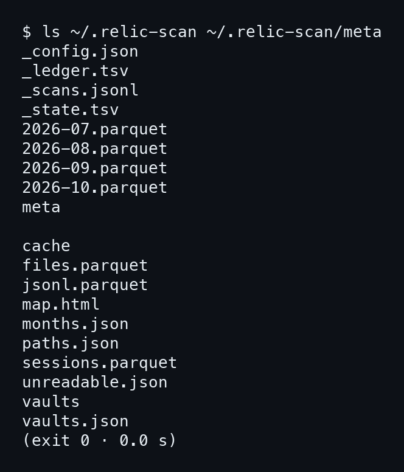
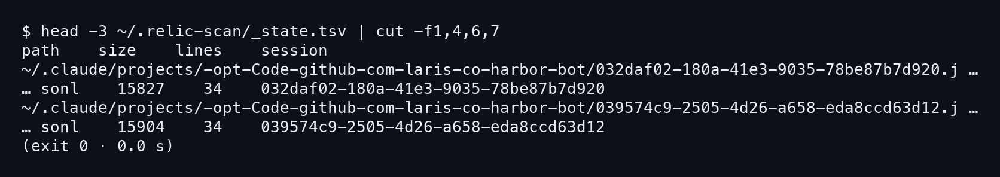
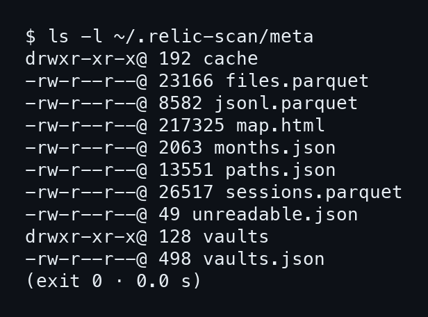

# บทที่ 1: ติดตั้งและรันครั้งแรก

เครื่องของคนที่ใช้ AI เขียนโค้ดทุกวัน มี transcript กองอยู่หลายที่ ทั้ง Claude Code, Codex, omp แต่ละตัวเก็บบทสนทนาเป็นไฟล์ `.jsonl` ไว้ในโฟลเดอร์ซ่อนของตัวเอง พอผ่านไปสามเดือนก็ไม่มีใครรู้ว่าอะไรอยู่ตรงไหน บทนี้พาติดตั้ง `relic-scan` แล้วรันครั้งแรกให้เห็นกับตาว่ามันหาของเจอได้ยังไง และเขียนอะไรลงดิสก์บ้าง

## 1.1 relic-scan คืออะไร และบ้านเดโมที่ใช้ตลอดเล่ม

`relic-scan` เป็นโปรแกรมฟรี (AGPL) ของ Soul-Brews-Studio ทำงานเดียวคือหา transcript ของเอเจนต์ทุกตัวบนเครื่อง แล้วจัดเป็นดัชนีเดียว ดัชนีนี้เป็นไฟล์ Parquet หนึ่งไฟล์ต่อหนึ่งเดือน (นับเดือนตามเวลากรุงเทพ) อยู่ใต้ `~/.relic-scan` จากนั้นเปิดดูได้สามทาง คือหน้าเว็บบน 127.0.0.1 หน้าจอในเทอร์มินัล และ DuckDB ที่ถามเป็น SQL

มีกติกาข้อหนึ่งที่ต้องรู้ก่อนเริ่ม **transcript อ่านอย่างเดียว** โปรแกรมไม่แก้ ไม่ลบ ไม่ย้ายไฟล์ของเอเจนต์ และเขียนเฉพาะใน `~/.relic-scan` เท่านั้น หน้าเว็บก็ไม่เรียกเน็ต ที่ออกเน็ตได้มีสองกรณี คือ `export --to s3://…` ที่เราสั่งเอง กับ `ops` ที่ GET สถานะของ hub หนึ่งครั้ง

เหตุที่ต้องมีสามทางเปิดดู เพราะคนใช้ต่างกัน บางคนอยากกวาดตาดูภาพรวมในหน้าเว็บ บางคนอยู่ใน ssh และต้องการแค่เทอร์มินัล ส่วนคนที่ชอบ SQL ก็อยากถามตรง ๆ ทั้งสามทางอ่านดัชนีชุดเดียวกัน เลขที่ได้จึงตรงกันเสมอ ไม่ต้องกลัวว่าทางไหนให้คำตอบต่างจากทางอื่น

ตลอดเล่มนี้ทุกคำสั่งรันจริงเมื่อ 2026-10-26 บนเวอร์ชัน `26.10.26-alpha.516` และรันบน **บ้านเดโม** ที่สร้างจากสคริปต์ `make-demo-home.py` มี transcript 144 ไฟล์ของ repo สมมติ ไม่มีของจริงปนเลย ดังนั้น `~` ในทุกภาพคือบ้านเดโม ไม่ใช่บ้านของผู้เขียน

### ขั้นที่ 1 — ติดตั้ง

ติดตั้งจากซอร์สด้วยสคริปต์บรรทัดเดียว ต้องมี Rust 1.89 ขึ้นไปในเครื่อง **สคริปต์ build ราว 30 วินาที**แล้ววางไฟล์ไว้ที่ `~/.local/bin/relic-scan` ถ้าไม่อยากคอมไพล์เอง ก็ไปโหลดแอปเดสก์ท็อปจากหน้า Releases ของ GitHub ได้

`curl -fsSL https://raw.githubusercontent.com/Soul-Brews-Studio/relic4-scan/main/install.sh | sh`

คำสั่งนี้ไม่ได้มาจากการรันในบ้านเดโม จึงไม่มีภาพประกอบ เป็นคำสั่งจากไฟล์ AGENTS.md ของโปรเจกต์ ถ้าคุณมีไบนารีอยู่แล้วก็ข้ามไปขั้นต่อไปได้เลย ตรวจแค่ว่า `~/.local/bin` อยู่ใน `PATH`

### ขั้นที่ 2 — ดูบ้านเดโมก่อนรัน

ก่อนสั่งอะไรกับ relic-scan ลองดูว่าในบ้านมีอะไร สั่ง `ls -a ~` เพื่อให้เห็นโฟลเดอร์ซ่อนด้วย

```bash
ls -a ~
```



สามโฟลเดอร์แรกคือ **บ้านของเอเจนต์** `.claude` เป็นของ Claude Code, `.codex` ของ Codex, `.omp` ของ omp ส่วน `Code` เป็นที่เก็บ repo และมี ψ vault ซ่อนอยู่ในบางโปรเจกต์ ส่วน `.relic-scan` คือโฟลเดอร์ผลลัพธ์ ตอนนี้ยังว่าง เดี๋ยวจะเห็นมันถูกเติมในหัวข้อ 1.5

## 1.2 ดูคำสั่งทั้งหมดและเวอร์ชัน

relic-scan มีคำสั่งย่อยเยอะ แต่ที่ใช้จริงบ่อยมีไม่กี่ตัว ลองไล่ดูจาก help แล้วจะเห็นว่าแต่ละตัวอยู่ตรงไหนของเล่มนี้

### ขั้นที่ 1 — อ่าน help

สั่ง `relic-scan --help` แล้วดูรายการ Commands ทีละบรรทัด

```bash
relic-scan --help
```



คำสั่งที่ต้องจำมีสี่ตัว **`run` คือคำสั่งหลัก** มันสแกน อ่านเฉพาะส่วนที่ใหม่ แล้วสร้าง meta กับหน้า map ให้ครบ `up` คือ `run` ตามด้วย serve หน้าเว็บ `tui` เปิดดูในเทอร์มินัล และ `log` ดูประวัติการรัน ส่วน `scan`, `parse`, `meta`, `map` เป็นขั้นย่อยที่ `run` เรียกต่อกันให้อยู่แล้ว ไม่ต้องสั่งเอง

สังเกตบรรทัดของ `run` ใน help ว่าเขียนไว้ว่า Incremental คือรันซ้ำได้ ไม่ต้องกลัวเสียเวลา บทที่ 2 จะพิสูจน์ข้อนี้ด้วยตัวเลข ส่วน `export` และ `seals` อยู่บทที่ 7

### ขั้นที่ 2 — ดูเวอร์ชัน

เวอร์ชันสำคัญตอนรายงานปัญหา และตอนเทียบผลกับเล่มนี้ ถ้าเลขต่างกัน ตัวเลขในผลที่คุณเห็นอาจไม่ตรงกับที่พิมพ์ไว้

```bash
relic-scan --version
```



```
relic-scan 26.10.26-alpha.516
```

เลขเวอร์ชันเป็นแบบ CalVer คือปี เดือน วัน ตามด้วยเลข alpha ของรุ่น เล่มนี้ใช้ **26.10.26-alpha.516** ตลอด

## 1.3 run --dry-run: ดูก่อนว่าจะอ่านอะไร

ครั้งแรกที่รันบนเครื่องจริง โปรแกรมจะไล่อ่าน transcript ทุกไฟล์ใต้โฟลเดอร์บ้าน และเขียนดัชนีลง `~/.relic-scan` AGENTS.md ของโปรเจกต์บอกให้ถามเจ้าของเครื่องก่อนรันครั้งแรกเสมอ เพราะบนเครื่องจริงมันกินเวลาและพื้นที่ดิสก์ ทางที่ปลอดภัยคือสั่ง dry run ก่อน

### ขั้นที่ 1 — สั่ง dry run

เติม `--dry-run` ต่อท้าย `run` ตัวโปรแกรมจะสแกนหาไฟล์เหมือนจริง แต่หยุดก่อนอ่านเนื้อหา และไม่เขียนอะไรลงดิสก์

```bash
relic-scan run --dry-run
```



บรรทัดแรกคือสรุปทั้งหมด อ่านเป็นคู่ ๆ ตามนี้

```
run: scan 0.2s · new 144 · grown 0 · rewritten 0 · unchanged 0 · gone 0 …
```

แต่ละคำคือ **สถานะของไฟล์เทียบกับครั้งก่อน** `new` คือไฟล์ที่ไม่เคยเห็น `grown` คือไฟล์ที่เคยอ่านแล้วแต่มีบรรทัดต่อท้าย `rewritten` คือไฟล์ที่เนื้อหาเดิมเปลี่ยน `unchanged` คือไม่เปลี่ยน และ `gone` คือไฟล์ที่เคยมีแต่หายไป ตอนนี้ยังไม่เคยรัน เลยเป็น new 144 ทั้งหมด

ตัวเลือกของ `run` ดูได้จาก `relic-scan run --help`

```bash
relic-scan run --help
```



ในภาพมี `--out` กำหนดโฟลเดอร์ผลลัพธ์ `--root` เพิ่มโฟลเดอร์ที่จะสแกน `--kind` เลือกเฉพาะบ้านของเอเจนต์ชนิดเดียว `--month` เลือกเฉพาะเดือน และ `--dry-run` ที่เพิ่งใช้ไป คำอธิบายบางบรรทัดถูกตัดตรงขอบภาพ ส่วนบทที่ 2 จะใช้ `--kind` กับ `--month` จริง

### ขั้นที่ 2 — อ่านกล่อง RELIC·SCAN

ท้ายผลลัพธ์มีกล่องเล็ก ๆ ที่โปรแกรมวาดไว้ ทุกคำสั่งที่รันจริงจะจบด้วยกล่องแบบนี้ รูปร่างเดียวกัน เปลี่ยนแค่ข้อความข้างใน

```
│ dry run · an index would read 144 files, 0.00 GB       │
│ scan 0.2s · nothing written                            │
│ → ~/.relic-scan                                        │
```

บรรทัดที่ควรอ่านทุกครั้งคือ **nothing written** กับลูกศรที่ชี้ปลายทาง ลูกศรบอกว่าถ้ารันจริงจะเขียนที่ไหน คือ `~/.relic-scan` ส่วน `0.00 GB` ไม่ใช่ศูนย์จริง แต่ transcript เดโมเล็กมาก ทั้งหมดรวมกันแค่ราว 1.4 MB (ตัวเลขนี้ไปเห็นอีกทีในบทที่ 2) ปัดเป็น GB เลยออกมาเป็นศูนย์

เทียบให้เห็นสเกล ในเครื่อง Mac จริงเครื่องหนึ่งที่ AGENTS.md ยกตัวอย่างไว้ มี 87,000 ไฟล์ รวม 75 GB ได้ 5.4 ล้านแถว และ index ครั้งแรกใช้ราวหนึ่งนาที เล่มนี้ไม่อ้างตัวเลขเกินไปกว่านี้

## 1.4 run ครั้งแรก: อ่านผลทีละบรรทัด

พอ dry run บอกว่าเห็นไฟล์ 144 ไฟล์ ก็ถึงเวลาลงมือจริง คำสั่งเดียวกัน ตัดแค่ `--dry-run` ออก ผลลัพธ์ยาวหน่อย แต่แต่ละบรรทัดขึ้นต้นด้วยชื่อขั้นตอน อ่านตามลำดับได้เลย

### ขั้นที่ 1 — สั่ง run

สั่ง `relic-scan run` บนบ้านเดโม ใช้เวลารวม 1.3 วินาที

```bash
relic-scan run
```



**ไล่ทีละขั้นตามที่โปรแกรมพิมพ์** ขั้น `scan` คือบรรทัดแรก เหมือนกับ dry run ทุกตัวอักษร เจอ 144 ไฟล์ใหม่ ขั้นถัดมา `parse` อ่านเนื้อไฟล์จริง

```
parse: 144 files · 0.00 GB · 3244 lines (0 not JSON) · 3171 raw rows · …
```

144 ไฟล์มี 3244 บรรทัด ไม่มีบรรทัดไหนที่ไม่ใช่ JSON พอแปลงแล้วได้ 3171 แถวดิบ ตัวเลขสองตัวนี้ไม่เท่ากันเพราะบรรทัดหนึ่งอาจให้หลายแถว หรือไม่ให้เลยก็ได้ เช่นบรรทัดที่เป็นแค่ข้อมูลกำกับ บทที่ 10 จะอธิบายว่าบรรทัดหนึ่งกลายเป็นแถวได้ยังไง

### ขั้นที่ 2 — ดู month ที่ถูกเขียน

ใต้บรรทัด parse มีสี่บรรทัดที่เยื้องเข้าไป หนึ่งบรรทัดต่อหนึ่งเดือน ตรงนี้คือจุดที่ relic-scan จัดแถวลงไฟล์ตามเวลากรุงเทพ

```
  2026-07: 819 rows (819 new copies merged) -> ~/.relic-scan/2026-07.parquet
  2026-08: 762 rows (762 new copies merged) -> ~/.relic-scan/2026-08.parquet
  2026-09: 845 rows (845 new copies merged) -> ~/.relic-scan/2026-09.parquet
  2026-10: 745 rows (745 new copies merged) -> ~/.relic-scan/2026-10.parquet
```

ไฟล์เดือนที่เขียนแล้วดูได้ด้วย `ls -l`

```bash
ls -l ~/.relic-scan/*.parquet
```



สามเดือนแรก (2026-07 ถึง 2026-09) ขึ้นต้นด้วย `-r--r--r--` คืออ่านได้อย่างเดียว เพราะเป็นเดือนที่ผนึกแล้ว ส่วน 2026-10 เป็น `-rw-r--r--` ยังเขียนต่อได้เพราะเป็นเดือนที่เปิดอยู่ (เรื่องผนึกอยู่ในบทที่ 7)

บวกสี่เดือนได้ 3171 พอดี คือ 819 + 762 + 845 + 745 วงเล็บ `new copies merged` บอกว่ามีกี่แถวที่เข้าไฟล์ใหม่ ถ้าไฟล์เดียวกันมีสำเนาในหลายบ้าน (เช่น mirror หรือ backup) มันจะถูก **พับเป็นแถวเดียว** ในเดโมไม่มีสำเนาซ้ำ ตัวเลขสองฝั่งเลยเท่ากัน

### ขั้นที่ 3 — meta, vaults, map

หลังจาก merge มีสามบรรทัดที่สร้างของเสริมสำหรับหน้าเว็บ ไล่อ่านทีละบรรทัดแล้วจะเห็นว่า relic-scan เก็บอะไรไว้นอกเหนือจากแถวข้อความ

```
meta: jsonl 145 (home 144 · ψ vault 0 in 0 vaults · other 1) in 0.0s -> …
vaults: 2 ψ vaults · 5 notes · 0.0 GB (+ 0 worktree copies) in 0.0s -> …
map: 144 sessions · 8 repos · 3 homes · 0.2 MB · 145 paths in 0.0s -> …
```

บรรทัด meta นับไฟล์ `.jsonl` ที่เห็นทั้งหมด 145 ไฟล์ เป็นของบ้านเอเจนต์ 144 ไฟล์ อีก 1 ไฟล์เป็น other คือ `.jsonl` ที่ไม่ใช่ transcript ถูกเก็บไว้ในรายการแต่ไม่นับเป็น session บรรทัด vaults พบ ψ vault 2 แห่ง รวม 5 โน้ต ส่วน map สร้างหน้าเว็บ **144 sessions จาก 8 repos ใน 3 บ้าน** ตัวเลขเหล่านี้จะกลับมาอีกในหน้าเว็บบทที่ 3

### ขั้นที่ 4 — อ่านกล่องสรุป

สุดท้ายคือบรรทัด `run: done` กับกล่องสรุป กล่องนี้คือที่ที่ควรมองก่อนอย่างอื่น เพราะมันตอบคำถามว่า รอบนี้ได้อะไรมา และใช้เวลาไปกับขั้นไหน

```
│ 144 sessions · 3,171 rows · 144 files · 0.0 GB read              │
│ new 144 · grown 0 · rewritten 0 · unchanged 0                    │
│ scan 0.2s · parse+merge 1.1s · meta 0.0s · map 0.0s · total 1.3s │
```

**3,171 แถว จาก 144 session** คือเลขที่ควรจำ มันจะตรงกับตัวเลขในหน้า Smart Scan หลังบทที่ 2 (ที่มีแถวเพิ่มอีก 2) เวลาทั้งหมด 1.3 วินาที ส่วนใหญ่หมดไปกับ scan และ parse ท้ายกล่องมีสองบรรทัดชี้ทางต่อ คือ `relic-scan serve` กับ `relic-scan tui` ทั้งสองคือทางเปิดดูผลที่เพิ่งทำเสร็จ

## 1.5 อะไรอยู่ใน ~/.relic-scan

รันเสร็จแล้ว มาดูว่าโปรแกรมวางอะไรไว้ในโฟลเดอร์ผลลัพธ์ ใช้ `ls` ชี้ทั้งโฟลเดอร์หลักและ `meta` ในคำสั่งเดียว

### ขั้นที่ 1 — ไล่ดูโฟลเดอร์

สั่ง `ls` สองโฟลเดอร์พร้อมกัน ผลจะแยกเป็นสองกลุ่มโดยมีบรรทัดว่างคั่น

```bash
ls ~/.relic-scan ~/.relic-scan/meta
```



กลุ่มแรกคือโฟลเดอร์หลัก **ไฟล์ขึ้นต้นด้วย `_` เป็นสถานะของโปรแกรม** ส่วนที่เหลือคือข้อมูล เรียงตามหน้าที่ได้ดังนี้

- `2026-07.parquet` ถึง `2026-10.parquet` คือ **แถวของข้อความทั้งหมด** หนึ่งไฟล์ต่อเดือน ถามด้วย DuckDB ได้ตรง ๆ (บทที่ 6)
- `_state.tsv` จำว่าไฟล์ transcript แต่ละไฟล์อ่านไปถึงตรงไหนแล้ว นี่คือเหตุผลที่รันซ้ำเร็ว (ดูภาพด้านล่าง)
- `_ledger.tsv` เป็นสมุดบัญชีที่ต่อท้ายทุกครั้งที่ index ไม่เคยถูกเขียนทับ
- `_scans.jsonl` คือบันทึกการรัน ที่ `relic-scan log` อ่านออกมาแสดง
- `_config.json` เก็บค่าตั้ง เช่น โฟลเดอร์ที่เดินสแกน (บทที่ 4)

`_state.tsv` เปิดดูได้ตรง ๆ เพราะเป็นข้อความคั่นด้วย tab

```bash
head -3 ~/.relic-scan/_state.tsv | cut -f1,4,6,7
```



แต่ละแถวคือหนึ่งไฟล์ transcript มี path, ขนาดเป็นไบต์, จำนวนบรรทัด และ id ของ session ในภาพทั้งสองไฟล์มี 34 บรรทัด ขนาด 15827 กับ 15904 ไบต์

### ขั้นที่ 2 — ดูใน meta

กลุ่มที่สองคือ `meta/` ซึ่งเก็บ **สรุปรายไฟล์และราย session** แยกจากแถวข้อความ ทำให้หน้าเว็บเปิดเร็วโดยไม่ต้องกวาดข้อความทั้งหมด

- `sessions.parquet` หนึ่งแถวต่อหนึ่ง session มี repo, เวลาแรกและสุดท้าย, จำนวนแถว
- `files.parquet` และ `jsonl.parquet` หนึ่งแถวต่อหนึ่งไฟล์ transcript
- `months.json` ข้อมูลของแต่ละไฟล์เดือน รวมถึงผนึกของเดือนที่ปิดแล้ว
- `vaults.json` กับโฟลเดอร์ `vaults/` คือรายการ ψ vault และโน้ตข้างใน
- `map.html` คือหน้าเว็บทั้งหน้า สร้างไว้เป็นไฟล์เดียวที่ `serve` ส่งออกไป
- `paths.json` และ `unreadable.json` รายการ path ที่เห็น และที่อ่านไม่ได้

```bash
ls -l ~/.relic-scan/meta
```



ในภาพ `map.html` ใหญ่สุด 217325 ไบต์ เพราะเป็นหน้าเว็บทั้งหน้า ส่วน `sessions.parquet` 26517 ไบต์ และ `months.json` 2063 ไบต์ มี `cache` กับ `vaults` เป็นโฟลเดอร์

ลองสังเกตว่าชื่อไฟล์เดือนเรียงตามตัวอักษรก็เรียงตามเวลาไปในตัว ทำให้เวลาใช้ DuckDB อ่านด้วย `*.parquet` ก็ได้ข้อมูลครบทุกเดือนในคำเดียว ส่วนไฟล์ใน `meta/` ไม่ใช่แถวข้อความ จึงไม่ปนเข้าไปในกลุ่มนั้น

จุดที่ควรจำคือทุกอย่างอยู่ใต้ `~/.relic-scan` ลบโฟลเดอร์นี้ทิ้งเมื่อไหร่ก็ได้ transcript ต้นทางไม่เสียอะไร แล้วสั่ง `relic-scan run` ใหม่ก็ได้ดัชนีกลับมา AGENTS.md แนะนำวิธีนี้ด้วยซ้ำ เมื่อต้องการดัชนีรูปแบบล่าสุดจากศูนย์ ให้ย้ายโฟลเดอร์เก่าไปไว้ข้างแล้วรันใหม่

## ต่อไป

ตอนนี้ดัชนีเดโมมี 3,171 แถวนอนอยู่ใน `~/.relic-scan` แล้ว คำถามถัดไปคือ ถ้ารันซ้ำทันที มันจะอ่านทุกอย่างใหม่ไหม และถ้า transcript ไฟล์หนึ่งโตขึ้นสองบรรทัด จะเกิดอะไรขึ้น บทที่ 2 ตอบสองข้อนี้ด้วยตัวเลขจากการรันจริง
