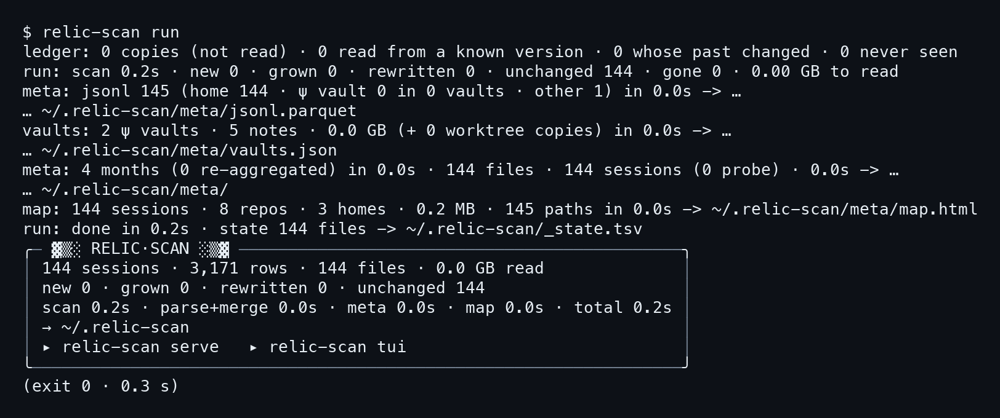
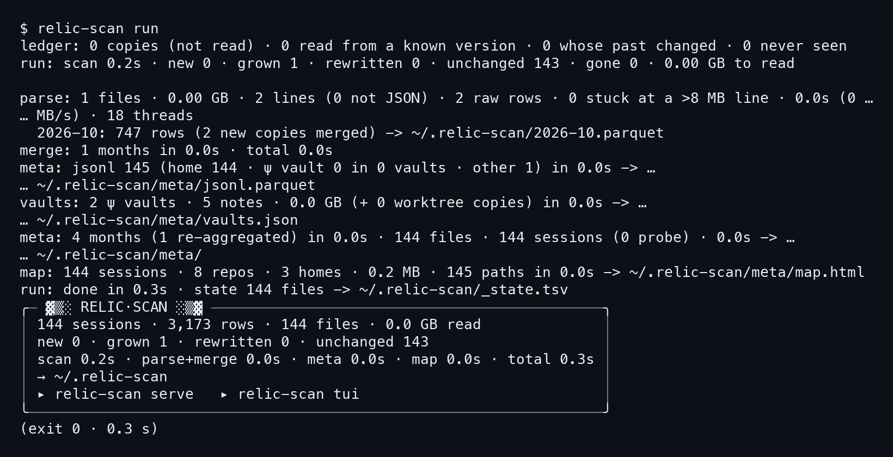
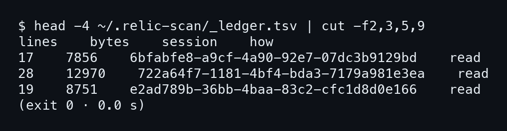
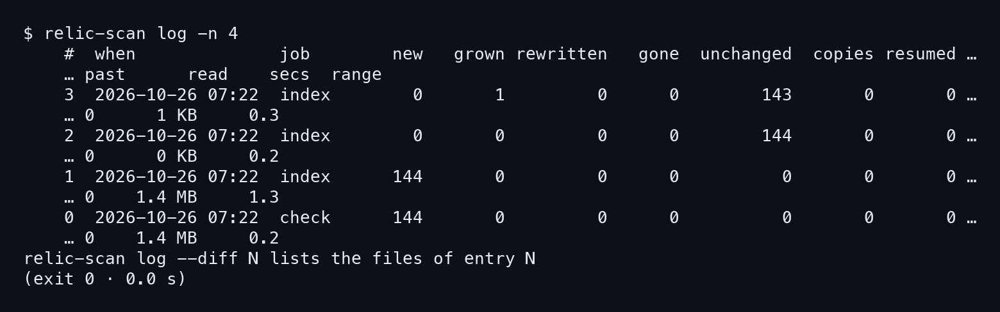
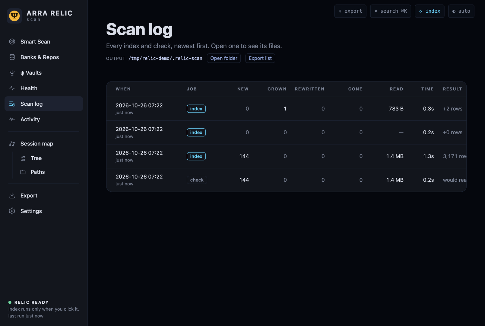
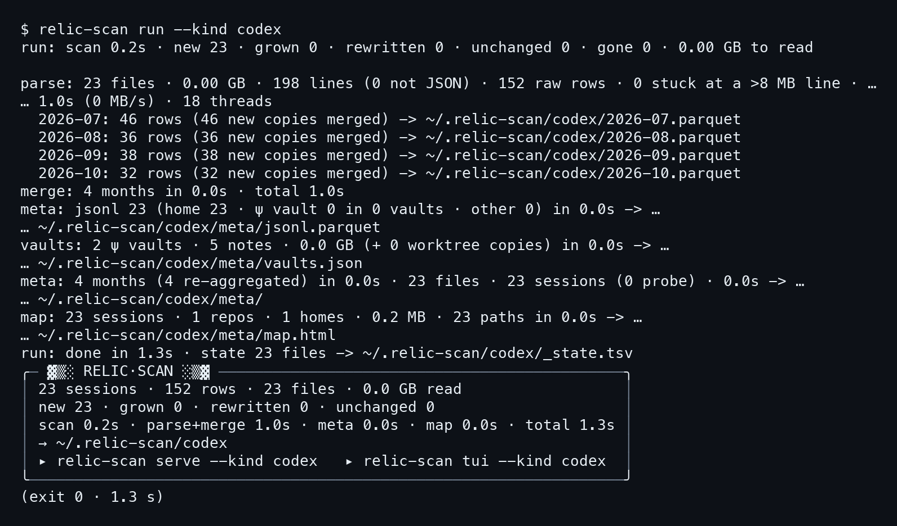
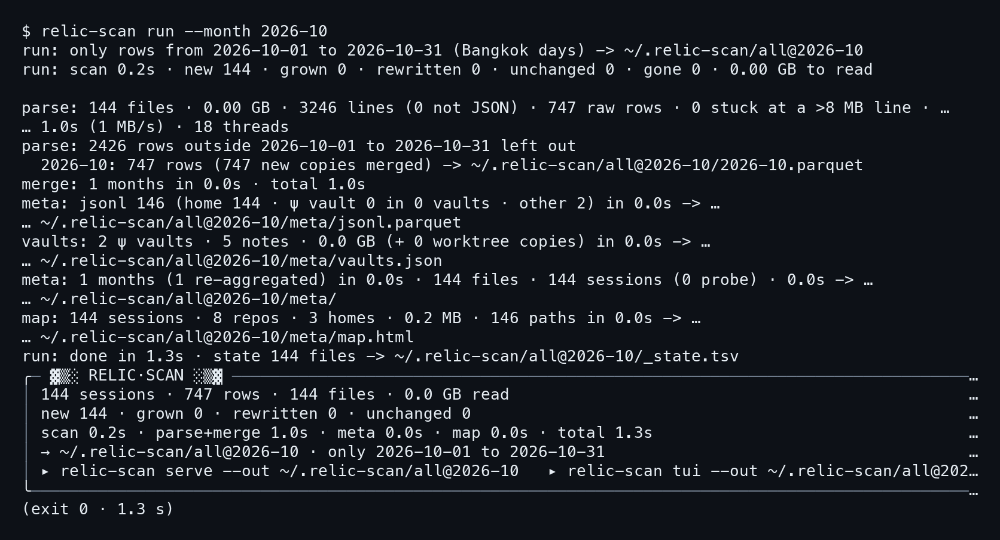

# บทที่ 2: รันซ้ำ อ่านแค่ของใหม่

ดัชนีที่สร้างครั้งแรกใช้ 1.3 วินาทีบนบ้านเดโม แต่บนเครื่องจริงที่มีข้อมูลหลายแสนบรรทัดมันกินเวลาเป็นนาที ถ้าทุกครั้งที่อยากอัปเดตต้องอ่านใหม่หมด ก็คงไม่มีใครอยากรัน relic-scan บ่อย ๆ บทนี้เลยทดลองสามอย่าง คือรันซ้ำทันทีโดยไม่มีอะไรเปลี่ยน รันหลังจาก transcript ไฟล์หนึ่งโตขึ้น และรันเฉพาะบางส่วนของเครื่อง ทั้งหมดดูจากตัวเลขในผลลัพธ์จริง

## 2.1 รันซ้ำทันที: ไม่อ่านอะไรเลย

หลักการของ `run` คือ **จำว่าอ่านไฟล์ไหนไปถึงไหนแล้ว** ไฟล์ `_state.tsv` ที่เจอในบทที่ 1 เก็บตำแหน่งนั้นไว้ พอรันรอบใหม่ โปรแกรมสแกนหาไฟล์อีกรอบเพื่อเทียบ ถ้าไฟล์ไหนเหมือนเดิมก็ข้าม เราจะพิสูจน์ข้อนี้ด้วยการสั่งซ้ำโดยยังไม่แตะอะไรเลย

### ขั้นที่ 1 — สั่ง run อีกรอบ

พิมพ์คำสั่งเดียวกับบทที่ 1 ทุกตัวอักษร ไม่ต้องใส่อะไรเพิ่ม ระหว่างรอบแรกกับรอบนี้ยังไม่มี transcript ใหม่เกิดขึ้น

```bash
relic-scan run
```



เทียบกับรอบแรก จุดที่ต่างมีสามจุด จุดแรกคือบรรทัดบนสุดที่รอบแรกไม่มี เป็นบรรทัดของ ledger ที่เป็นศูนย์ทั้งสี่ช่อง

```
ledger: 0 copies (not read) · 0 read from a known version · 0 whose past …
run: scan 0.2s · new 0 · grown 0 · rewritten 0 · unchanged 144 · gone 0 …
```

จุดที่สองคือบรรทัด scan ซึ่งตอนนี้เป็น **new 0 และ unchanged 144** ทั้งหมด ไฟล์ทุกไฟล์ถูกรู้จักแล้วและไม่มีไฟล์ไหนเปลี่ยน จุดที่สามคือหายไปทั้งก้อน ไม่มีบรรทัด `parse:` ไม่มีบรรทัดรายเดือน ไม่มี `merge:` เพราะไม่มีอะไรให้อ่าน

### ขั้นที่ 2 — ดูว่าขั้นหลังรันซ้ำอย่างไร

บรรทัด meta กับ map ยังโผล่มาให้เห็นเหมือนเดิม แต่ดูตัวเลขข้างในดีดี

```
meta: 4 months (0 re-aggregated) in 0.0s · 144 files · 144 sessions …
run: done in 0.3s · state 144 files -> ~/.relic-scan/_state.tsv
```

รอบแรกเขียนไว้ว่า `4 months (4 re-aggregated)` คือสรุปทั้งสี่เดือนใหม่ รอบนี้เป็น **0 re-aggregated** ไม่มีเดือนไหนต้องสรุปซ้ำ ส่วนแถวสุดท้ายในกล่องยังเป็น 3,171 แถวเท่าเดิม และเวลารวมเหลือ 0.3 วินาที จากที่รอบแรกใช้ 1.3 วินาที เวลาที่เหลือเกือบทั้งหมดคือ scan 0.2 วินาที คือโปรแกรมเดินดูว่าไฟล์ไหนเปลี่ยนบ้าง

บรรทัด `map:` ยังถูกสร้างใหม่ทุกครั้ง แต่ใช้เวลา 0.0 วินาที เพราะไม่ต้องอ่านข้อมูลก้อนใหญ่ ราคาของการรันซ้ำจึงเท่ากับราคาของการเดินดูไฟล์ เท่านั้นเอง

ข้อนี้สำคัญตอนตั้งให้รันอัตโนมัติ เช่นทุกคืนผ่าน cron หรือ launchd ถ้ารันซ้ำถูกแบบนี้ ก็ปล่อยให้รันบ่อยแค่ไหนก็ได้ โดยไม่ต้องห่วงว่าจะไปแย่งซีพียูกับงานของเรา และผลลัพธ์ไม่เปลี่ยนไม่ว่าจะรันกี่รอบก็ตามถ้าต้นทางไม่เปลี่ยน

## 2.2 transcript โตขึ้นหนึ่งไฟล์

รันซ้ำตอนไม่มีอะไรเปลี่ยนเป็นกรณีง่าย กรณีจริงคือเอเจนต์ยังเขียนอยู่ transcript ที่อ่านไปแล้วจะยาวขึ้นเรื่อย ๆ ตอนนั้น relic-scan ต้องอ่านเฉพาะส่วนท้ายที่เพิ่มมา ไม่อ่านทั้งไฟล์ซ้ำ ในเดโมเราต่อท้ายไฟล์ transcript ของ Claude Code หนึ่งไฟล์ด้วยสองบรรทัด แล้วรันอีกรอบ

### ขั้นที่ 1 — รันหลังไฟล์โต

คำสั่งยังเป็นตัวเดิมอีกแล้ว คนรันไม่ต้องบอกว่าไฟล์ไหนโต โปรแกรมหาเอง

```bash
relic-scan run
```



บรรทัด scan บอกสถานะใหม่ทันที

```
run: scan 0.2s · new 0 · grown 1 · rewritten 0 · unchanged 143 · gone 0 …
```

**grown 1** คือไฟล์ที่เคยอ่านแล้วและยาวขึ้น ที่เหลืออีก 143 ไฟล์ยัง unchanged ขอให้สังเกตว่าไม่ใช่ new และไม่ใช่ rewritten ด้วย โปรแกรมแยกสามกรณีนี้ออกจากกัน เพราะวิธีจัดการต่างกัน ไฟล์ใหม่อ่านทั้งไฟล์ ไฟล์ที่โตอ่านต่อจากเดิม ส่วนไฟล์ที่ถูกเขียนทับต้องอ่านใหม่

ถ้าอยากลองเอง ให้เปิด transcript ของเดโมสักไฟล์ ต่อท้ายด้วยบรรทัด JSON ที่ถูกรูปแบบสองบรรทัด แล้วสั่ง run ดู ผลจะออกมาแบบเดียวกับภาพข้างบน แต่ตัวเลขแถวอาจต่างตามสิ่งที่คุณต่อท้ายลงไป

### ขั้นที่ 2 — อ่านบรรทัด parse

ทีนี้บรรทัด `parse:` กลับมา แต่ตัวเลขเล็กมากเทียบกับรอบแรก

```
parse: 1 files · 0.00 GB · 2 lines (0 not JSON) · 2 raw rows · …
  2026-10: 747 rows (2 new copies merged) -> ~/.relic-scan/2026-10.parquet
merge: 1 months in 0.0s · total 0.0s
```

รอบแรก parse 144 ไฟล์ 3244 บรรทัด รอบนี้ parse **1 ไฟล์ 2 บรรทัด** ได้ 2 แถวดิบ ซึ่งตรงกับที่เราต่อท้ายไป และมีบรรทัดเดือนบรรทัดเดียวคือ 2026-10 เพราะสองบรรทัดนั้นลงวันที่ในเดือนตุลาคม จำนวนแถวของเดือนนั้นขยับจาก 745 เป็น 747 ส่วนสามเดือนก่อนหน้าไม่ถูกแตะเลย

### ขั้นที่ 3 — ตรวจยอดรวมและส่วนที่สรุปใหม่

ลงมาที่บรรทัด meta และกล่องสรุป ตัวเลขสองจุดนี้ยืนยันว่าอ่านแค่ของใหม่จริง

```
meta: 4 months (1 re-aggregated) in 0.0s · 144 files · 144 sessions …
│ 144 sessions · 3,173 rows · 144 files · 0.0 GB read              │
│ new 0 · grown 1 · rewritten 0 · unchanged 143                    │
```

สรุปใหม่ **1 เดือนจากสี่** คือเดือนที่ได้แถวใหม่ ส่วนยอดรวมขยับจาก 3,171 เป็น 3,173 ตรงกับสองแถวที่เพิ่ม และจำนวน session ยังเป็น 144 เพราะบรรทัดที่ต่อไปเป็นของ session เดิม ตัวเลข 3,173 นี้คือยอดที่หน้าเว็บทุกหน้าในบทถัดไปแสดง

บรรทัด ledger ด้านบนยังเป็นศูนย์ทั้งหมดในรอบนี้ ตรงกับที่ปรากฏในผลลัพธ์ ledger เป็นสมุดของ "เวอร์ชันที่เคยอ่านมาแล้ว" ซึ่งจะทำงานเมื่อมีไฟล์ใหม่ที่เนื้อหาตรงกับของเก่า เช่น โฟลเดอร์ที่ย้ายที่หรือสำเนาจากอีกเครื่อง ไฟล์ที่โตขึ้นในที่เดิมใช้ตำแหน่งที่จำไว้ใน `_state.tsv` อยู่แล้ว

ตัวสมุดคือ `_ledger.tsv` เปิดดูหัวไฟล์ได้

```bash
head -4 ~/.relic-scan/_ledger.tsv | cut -f2,3,5,9
```



หนึ่งแถวคือหนึ่งเวอร์ชันของหนึ่ง transcript ในภาพสามแถวแรกมี 17, 28 และ 19 บรรทัด ขนาด 7856, 12970 และ 8751 ไบต์ และคอลัมน์ `how` เป็น `read` ทั้งหมด คืออ่านจริงจากไฟล์ ไม่ใช่สำเนา

## 2.3 relic-scan log และหน้า Scan log

สี่รอบที่ผ่านมา (รอบ dry run, รอบแรก, รอบซ้ำ, รอบไฟล์โต) ทุกครั้งโปรแกรมต่อบรรทัดหนึ่งลงไฟล์ `_scans.jsonl` ไม่เคยเขียนทับ คำสั่ง `log` อ่านไฟล์นั้นออกมาเป็นตาราง ดูย้อนหลังได้ว่าแต่ละรอบเกิดอะไรขึ้น โดยไม่ต้องเลื่อนหาในเทอร์มินัล

### ขั้นที่ 1 — ดูสี่รอบล่าสุด

ใส่ `-n 4` เพื่อจำกัดว่าเอากี่รายการล่าสุด ในเดโมมีพอดีสี่รายการ

```bash
relic-scan log -n 4
```



ตารางเรียงใหม่ไปเก่า เลขแถว `#` เริ่มที่ 0 สำหรับรายการแรกสุด อ่านจากล่างขึ้นบนจะได้เรื่องราวตามลำดับเวลาที่เราทำ

```
    #  when              job        new   grown rewritten   gone  unch …
    3  2026-10-26 07:22  index        0       1         0      0       …
    2  2026-10-26 07:22  index        0       0         0      0       …
    1  2026-10-26 07:22  index      144       0         0      0       …
```

ตัดคอลัมน์ท้ายออกเพื่อให้พอดีบรรทัด ต้นฉบับกว้างกว่านี้ (ภาพมีครบ) รายการ 0 คือ dry run ซึ่งขึ้นเป็น job `check` ส่วนอีกสามเป็น job `index` ให้ดูคอลัมน์ **read** รอบแรกอ่าน 1.4 MB รอบที่สองอ่าน 0 KB รอบที่สามอ่านแค่ 1 KB และมันบอกด้วยว่าบนเดโมนี้ transcript ทั้งหมดรวมกัน 1.4 MB ซึ่งเป็นสาเหตุที่ GB ในกล่องออกมาเป็น 0.00

### ขั้นที่ 2 — ดูไฟล์ในรายการหนึ่ง

บรรทัดท้ายสุดของผลลัพธ์บอก **วิธีเจาะลึกต่อด้วย `--diff`**

```
relic-scan log --diff N lists the files of entry N
```

ใส่เลขแถวแทน N เช่นของรอบที่ไฟล์โตก็จะได้รายชื่อไฟล์ที่มีสถานะ grown พร้อมขนาดที่เพิ่ม ใช้ตอนอยากรู้ว่าไฟล์ไหนทำให้เลขเปลี่ยน ในเล่มนี้ไม่ได้รัน `--diff` จึงไม่มีผลลัพธ์ให้ดู

### ขั้นที่ 3 — เปิดหน้า Scan log บนเว็บ

ข้อมูลชุดเดียวกันมีให้ดูในเว็บด้วย เปิด server ด้วย `relic-scan serve` หรือ `relic-scan up` ซึ่งใช้พอร์ต 8787 ถ้าไม่ระบุ (ภาพในเล่มใช้ `--port 8791`) แล้วเปิดหน้า `/scans` ในเบราว์เซอร์ คือ `http://127.0.0.1:8787/scans`



หน้านี้เป็นตารางเดียวกับคำสั่ง log แต่คอลัมน์ท้ายสุดคือ **RESULT** ซึ่งสรุปผลเป็นประโยคสั้น ๆ เช่น `+2 rows` สำหรับรอบที่ไฟล์โต `+0 rows` สำหรับรอบซ้ำ `3,171 rows` สำหรับรอบแรก และ `would read…` สำหรับรอบ dry run ที่ไม่ได้อ่านจริง ถ้าอยากเช็กว่าช่วงนี้ nightly job ทำงานหรือเปล่า ดูหน้านี้เร็วกว่าเปิดไฟล์ jsonl เอง

## 2.4 รันแค่บางส่วน: --kind และ --month

ปกติ `run` เก็บทุกเอเจนต์ทุกเดือนไว้ในดัชนีเดียว แต่บางครั้งอยากได้ชิ้นเล็กกว่า เช่นดูเฉพาะ Codex หรือเฉพาะเดือนนี้ มีสองตัวเลือกให้ ที่เด่นคือทั้งสองแบบ **เขียนลงโฟลเดอร์แยก** ไม่ปนกับดัชนีหลัก และโฟลเดอร์แยกแต่ละอันมีไฟล์ตั้งค่า `_config.json` ของตัวเอง (ในเดโมคัดลอกจากดัชนีหลัก เพื่อให้สแกนแค่ `~`)

### ขั้นที่ 1 — รันเฉพาะ Codex

ใส่ `--kind codex` ต่อท้าย `run` โปรแกรมจะกรองเอาเฉพาะ transcript ของ Codex

```bash
relic-scan run --kind codex
```



บรรทัดแรกบอกว่าพบ 23 ไฟล์ใหม่ ซึ่งเป็นของ Codex ล้วน ๆ จากทั้งหมด 144 ไฟล์ในบ้านเดโม พอ parse เสร็จผลลัพธ์กระจายลงสี่เดือน ทุกบรรทัดเขียนลงโฟลเดอร์ `codex/` ใต้ดัชนีหลัก

```
  2026-07: 46 rows (46 new copies merged) -> ~/.relic-scan/codex/2026-0…
│ 23 sessions · 152 rows · 23 files · 0.0 GB read                  │
│ → ~/.relic-scan/codex                                            │
│ ▸ relic-scan serve --kind codex   ▸ relic-scan tui --kind codex  │
```

มีสองอย่างน่าดู อย่างแรก **ปลายทางคือ `~/.relic-scan/codex`** ไม่แตะ `2026-10.parquet` ของดัชนีหลัก อย่างที่สองคือบรรทัดล่างสุดที่บอกวิธีเปิดดูต่อ ต้องใส่ `--kind codex` ให้ `serve` และ `tui` ด้วย ไม่เช่นนั้นมันจะไปเปิดดัชนีหลัก

### ขั้นที่ 2 — รันเฉพาะเดือนตุลาคม

อีกแกนหนึ่งคือเวลา ใส่ `--month 2026-10` เพื่อเอาแถวที่ลงวันที่ในเดือนนั้น (นับตามวันของกรุงเทพ) เท่านั้น

```bash
relic-scan run --month 2026-10
```



บรรทัดแรกของผลลัพธ์บอกช่วงและปลายทางตั้งแต่ต้น

```
run: only rows from 2026-10-01 to 2026-10-31 (Bangkok days) -> …
```

ชื่อโฟลเดอร์ปลายทางคือ **`all@2026-10`** แปลว่าทุกเอเจนต์ (all) เฉพาะเดือน 2026-10 ถ้าใช้ `--kind` กับ `--month` ร่วมกัน ก็คาดได้ว่าชื่อสะท้อนทั้งสองอย่าง แต่เล่มนี้ไม่ได้รันคู่กัน จึงไม่ยืนยัน

### ขั้นที่ 3 — ดูว่าอะไรถูกทิ้ง

ตัวเลือก `--month` เปิดอ่านทุกไฟล์ แต่ทิ้งแถวที่ตกนอกช่วง

```
parse: 2426 rows outside 2026-10-01 to 2026-10-31 left out
  2026-10: 747 rows (747 new copies merged) -> …/all@2026-10/2026-10.parquet
│ 144 sessions · 747 rows · 144 files · 0.0 GB read                     │
```

เลข 747 แถว ตรงกับแถวของเดือน 2026-10 ในดัชนีหลักหลังไฟล์โต (745 บวก 2) และ 2426 ที่ถูกทิ้งก็คือ 3,173 ลบ 747 พอดี สองตัวเลขนี้ยืนยันว่าตัวเลือก `--month` ตัดถูกที่ ส่วนจำนวน session ยังเป็น 144 เพราะทั้ง 144 ไฟล์มีแถวในเดือนนี้อย่างน้อยหนึ่งแถว

ผลที่ได้จะเปิดดูด้วย `relic-scan serve --out ~/.relic-scan/all@2026-10` ตามที่กล่องบอกท้ายผลลัพธ์ ใช้ได้ดีเมื่ออยากส่งหรือดูเฉพาะเดือนหนึ่งโดยไม่ปนกับทั้งก้อน

## ต่อไป

ถึงตรงนี้ดัชนีเดโมมีครบ 3,173 แถว และรู้แล้วว่ารันซ้ำถูกแค่ไหน ยังไม่ได้ดูผลด้วยตาเลย บทที่ 3 เปิดหน้าเว็บบน 127.0.0.1 ให้เห็นแถวทั้งหมดเป็นรูปโดนัท เป็นแผนผังต้นไม้ และเป็นแผนที่ดาว
