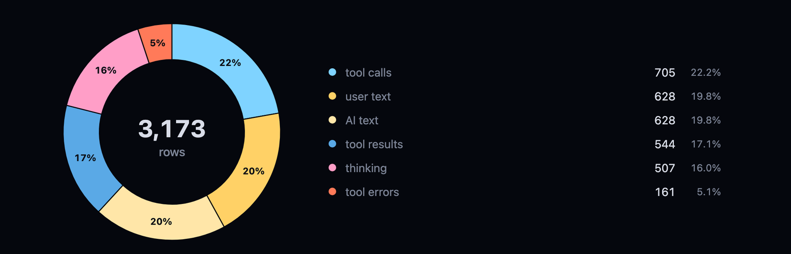
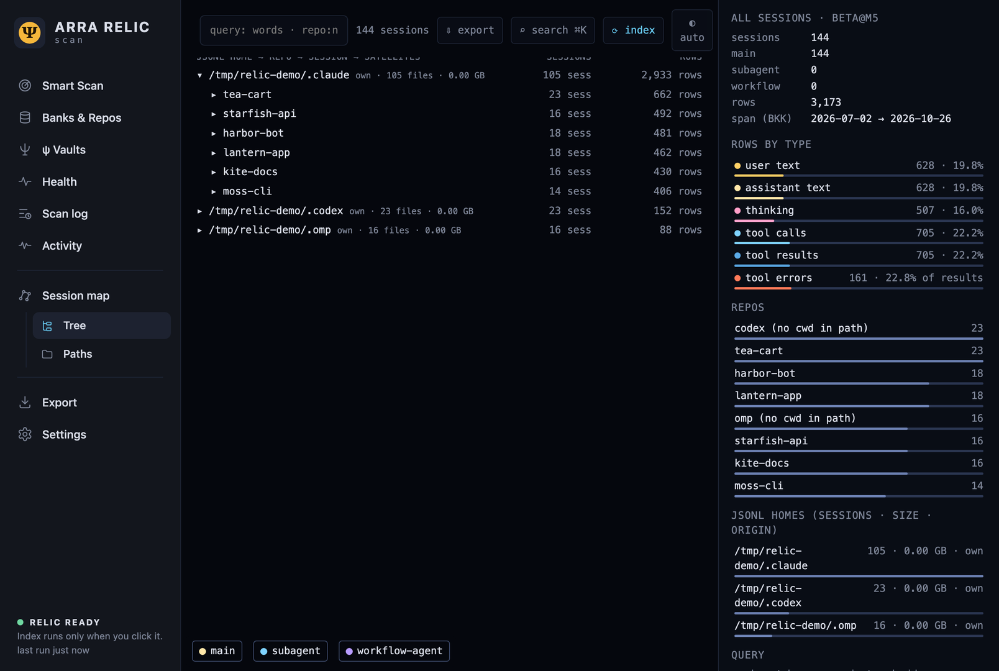
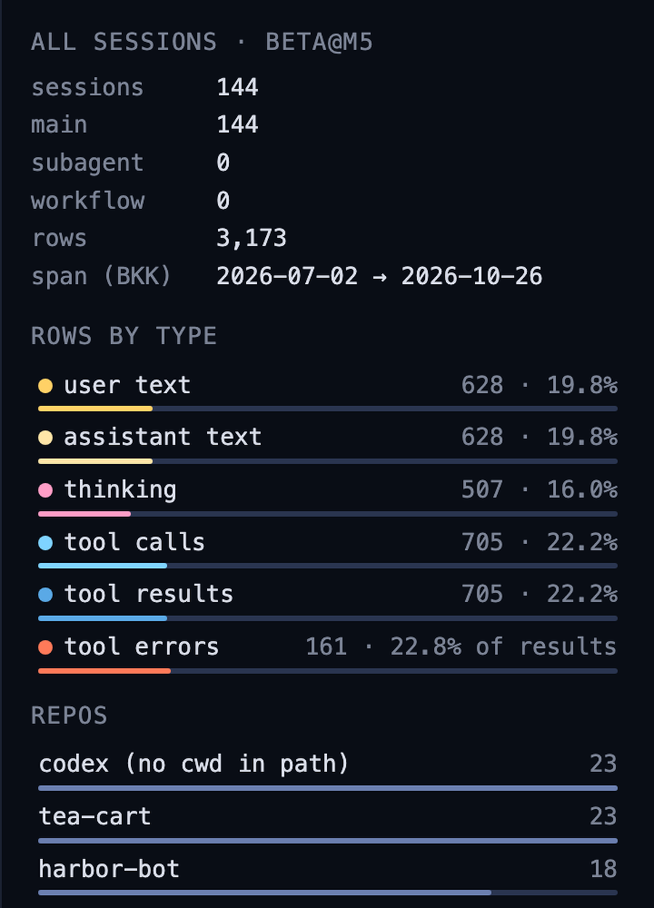
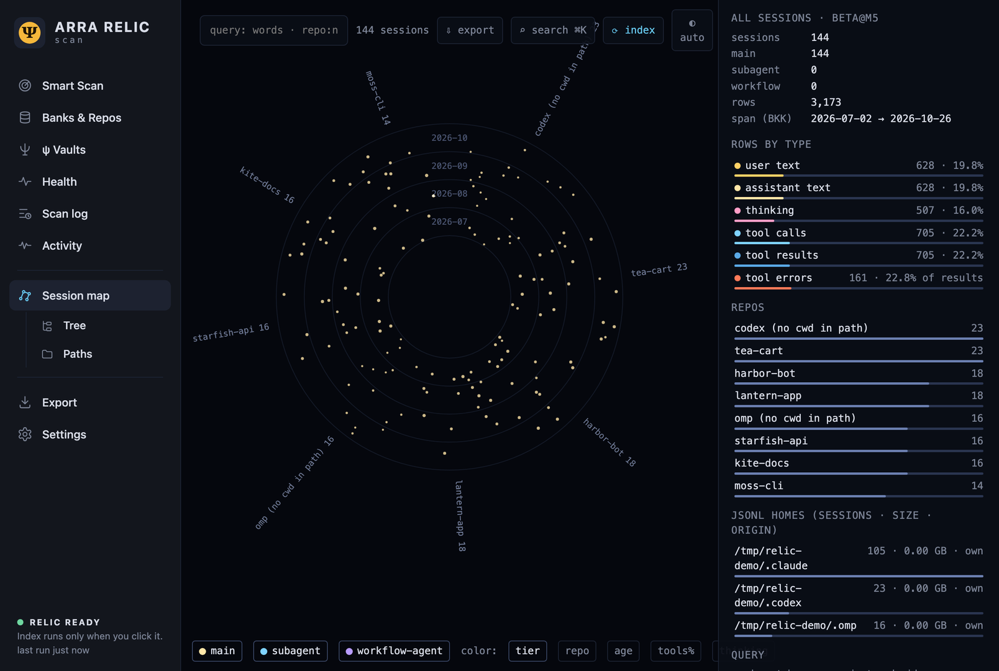
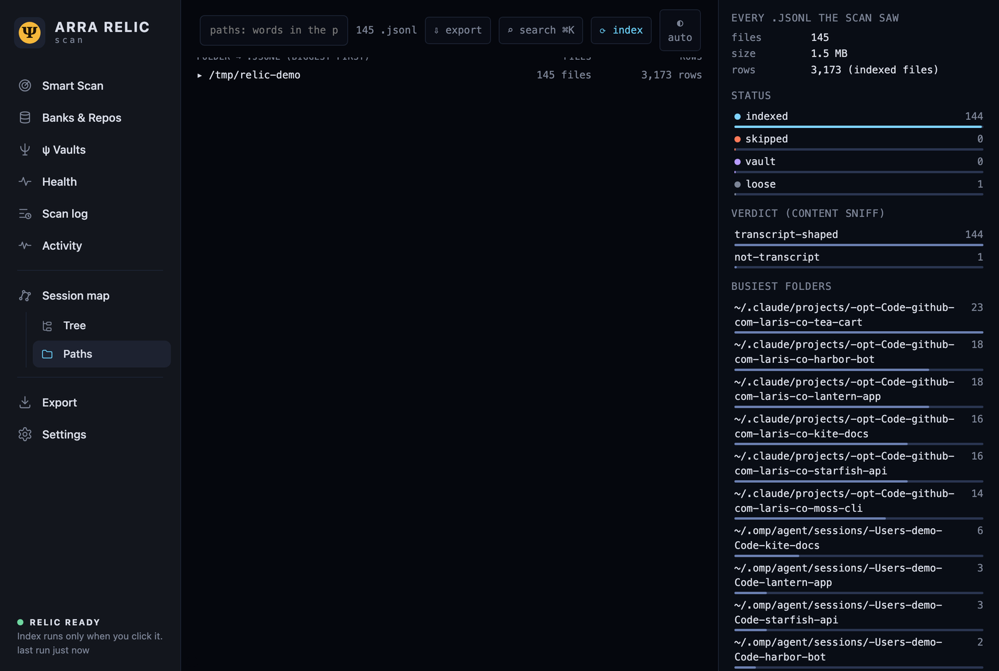

# บทที่ 3: เปิดดูในเว็บ

สองบทแรกอยู่ในเทอร์มินัลล้วน ๆ บทนี้ย้ายมาดูเป็นหน้าเว็บ relic-scan มีหน้าเว็บในตัว เสิร์ฟบน 127.0.0.1 เท่านั้น เปิดแล้วเห็นทั้งดัชนีเป็นภาพ ตั้งแต่ยอดรวม ต้นไม้ของ session ไปจนถึงแผนที่ดาว ทุกภาพในบทนี้คือหน้าจริงของบ้านเดโมที่เราสร้างไว้ตั้งแต่บทแรก ไม่มีข้อมูลจริงของใครปนอยู่

## เปิดเซิร์ฟเวอร์

### ขั้นที่ 1 — เปิดหน้าเว็บด้วย `up` หรือ `serve`

มีสองคำสั่งให้เลือก `relic-scan up` คือ `run` ก่อนแล้วค่อย `serve` ต่อ ส่วน `relic-scan serve` เสิร์ฟดัชนีที่มีอยู่เลยโดยไม่สแกนใหม่ พอ index ไว้แล้วตั้งแต่บทที่ 1 ใช้ `serve` ก็พอ ค่าเริ่มต้นคือพอร์ต 8787 เปลี่ยนได้ด้วย `--port`

```
relic-scan up                  # index แล้วเสิร์ฟ http://127.0.0.1:8787
relic-scan serve               # เสิร์ฟดัชนีที่มีอยู่
relic-scan serve --port 8791   # เปลี่ยนพอร์ต
```

ภาพทุกใบในเล่มนี้ถ่ายจากพอร์ต 8791 ส่วนคนที่ลองตามด้วยค่าเริ่มต้น ให้ใช้ 8787 แทน ที่อยู่ของแต่ละหน้าคือ `http://127.0.0.1:8787/<view>` เช่น `/scan` `/tree` `/map` `/paths` เซิร์ฟเวอร์ผูกกับ 127.0.0.1 เท่านั้น และตัวหน้าเว็บ **ไม่เรียกเน็ตเลย** ทุกอย่างอ่านจากดัชนีในเครื่อง

### ขั้นที่ 2 — รัน `run` ที่อื่นแล้ว reload

หน้าเว็บอ่านดัชนีทุกครั้งที่โหลด ถ้าเปิดเซิร์ฟเวอร์ค้างไว้แล้วไป `run` ในอีกเทอร์มินัล พอกลับมากด reload ก็เห็นของใหม่ทันที ไม่ต้องรีสตาร์ต นอกจากนั้นในหน้ายังมีปุ่ม **⟳ index** ที่สั่ง run แบบเพิ่มเฉพาะส่วนใหม่จากในเซิร์ฟเวอร์เองได้ ถ้ายังไม่เคย index เลย ทุก view จะขึ้นหน้าต้อนรับพร้อมปุ่มเดียวกัน

## Smart Scan — ภาพรวมทั้งหมด

### ขั้นที่ 1 — เปิดหน้าแรก `/scan`

เปิด `http://127.0.0.1:8787/scan` ซึ่งเป็นหน้าแรกของแอป (เปิดแค่ `/` ก็ได้) ฝั่งซ้ายคือเมนู เรียงจากบนลงล่างเป็น Smart Scan, Banks & Repos, ψ Vaults, Health, Scan log, Activity แล้วกลุ่ม Session map ที่มี Tree, Paths, Disk อยู่ข้างใน ท้ายสุดคือ Export กับ Settings กดเมนูแล้วสลับ view โดยไม่ต้องโหลดหน้าใหม่

กลางหน้ามีโดนัทใหญ่ ตรงกลางโดนัทเป็นยอดรวมของแถวทั้งหมด คือ **3,173 แถว** ใต้โดนัทมีแผ่นตัวเลขห้าอัน ROWS, SESSIONS, FILES INDEXED, NEWEST ROW และ SPAN


ตัวเลขชุดนี้คือชุดเดียวกับที่ DuckDB นับได้ในบทที่ 6 ถ้าสองที่นับไม่ตรงกันแปลว่ามีอะไรผิด เป็นวิธีเช็กที่เร็วดี

### ขั้นที่ 2 — อ่านโดนัทและคำอธิบายสี

โดนัทแบ่งแถวตามว่าแถวนั้นคืออะไร มีหกส่วน ได้แก่ tool calls, user text และ AI text ต่อด้วย tool results, thinking และ tool errors แต่ละส่วนมีจำนวนแถวกับเปอร์เซ็นต์กำกับ **หนึ่งแถวคือหนึ่งข้อความ หนึ่ง thinking block หนึ่งการเรียกเครื่องมือ หรือหนึ่งผลลัพธ์** ไม่ใช่หนึ่งบรรทัดของไฟล์

ภาพนี้ตัดมาเฉพาะโดนัทกับคำอธิบาย ขยายให้อ่านตัวเลขง่ายขึ้น



### ขั้นที่ 3 — ปุ่ม Index now และ Check changes

หน้านี้มีสองปุ่มที่ควรรู้จัก **Check changes** คือการสแกนแบบ dry run เดินดูโฟลเดอร์ เทียบขนาดกับ `_state.tsv` แล้วบอกว่าจะมีไฟล์ใหม่ ไฟล์โต ไฟล์ถูกเขียนใหม่ และไฟล์หายกี่ไฟล์ โดยไม่เขียนอะไรเลย เหมือน `run --dry-run` ในบทที่ 1

ส่วน Index now คือ `run` ที่ทำอยู่ในเซิร์ฟเวอร์ ระหว่างทำมีแถบความคืบหน้ากับปุ่ม Stop ถ้ากด Stop ตอนยังเดินดูโฟลเดอร์หรือยังอ่านอยู่ จะไม่มีอะไรถูกเขียน รอบหน้าก็อ่านไบต์ชุดเดิมซ้ำ แต่ถ้าเข้าขั้น merge แล้วมันจะทำจนจบ

### ขั้นที่ 4 — ค้นด้วย ⌘K

กด ⌘K หรือ `/` ได้จากทุกหน้า ช่องค้นหาเดียวครอบคลุม view, action, session (ค้นด้วย id, repo หรือ project) พาธของ `.jsonl` และรายการใน scan log พิมพ์ว่างไว้ก็ได้ มันโชว์ session ล่าสุดให้ เลือกผลลัพธ์แล้วเปิด view ที่เกี่ยวข้อง ช่องนี้เร็วกว่าไล่คลิกเมนูมาก

## Tree — บ้าน, repo, session

### ขั้นที่ 1 — เปิด `/tree`



เปิด `http://127.0.0.1:8787/tree` หน้านี้เรียงเป็นชั้น บ้าน (home) ของเอเจนต์ แล้ว repo แล้ว session บ้านแรกคือ `~/.claude` มี 6 repo ได้แก่ tea-cart, starfish-api, harbor-bot, lantern-app, kite-docs และ moss-cli ถัดลงไปเป็นบ้าน `.codex` กับ `.omp` **ทุกชั้นมีจำนวน session กับจำนวนแถวกำกับ** และมีแท่งแยกชนิดแถว

ฝั่งขวาคือแผงสรุป มีหัวข้อ ALL SESSIONS (ยอดรวม) ROWS BY TYPE (แท่งแยกตามชนิดแถว) REPOS (รายชื่อ repo) และ JSONL HOMES

session หนึ่งอาจอยู่ในหลายบ้าน ถ้ามีสำเนาในบ้านอื่น มันจะปรากฏใต้ทุกบ้านที่เก็บสำเนา แต่ในดัชนีนับเป็นแถวเดียว ตามที่ AGENTS.md บอกว่าสำเนาถูกพับรวมเป็นหนึ่งแถว

### ขั้นที่ 2 — อ่านแผงขวา ROWS BY TYPE

แท่ง ROWS BY TYPE คือโดนัทของ Smart Scan ในรูปแท่ง แต่ต่างกันตรงที่ **แผงนี้เปลี่ยนตามสิ่งที่เลือกอยู่** คลิก repo หนึ่งแล้วแผงก็นับเฉพาะ repo นั้น Tree กับ Map ใช้กล่องค้นหาและแผงข้างร่วมกัน คำค้นที่พิมพ์ไว้จึงตามไปอีกหน้าได้

ภาพนี้ตัดแผงขวามาให้ดูใกล้ ๆ



### ขั้นที่ 3 — กรองด้วยคำค้น

รายการใน REPOS และ JSONL HOMES ของแผงกดได้ กดแล้วคำค้นแคบลงทันที ถ้าอยากพิมพ์เอง คำค้นของ Map และ Tree รองรับตัวกรองอย่าง `repo:` `tier:main|sub|wf` `month:2026-07` และ `rows>1000` คำนำหน้า `-` กลับความหมาย และ **ทุกคำต้องตรงพร้อมกัน** (AND)

## Map — หนึ่งดาว หนึ่ง session

### ขั้นที่ 1 — เปิด `/map`

เปิด `http://127.0.0.1:8787/map` เห็นแผนที่ดาวกลม ๆ ทุก session คือจุดหนึ่งจุด วงแหวนคือเดือน นับจาก 2026-07 ถึง 2026-10 โดยเดือนเก่าสุดอยู่วงในสุด ส่วนซี่ที่แผ่ออกมาคือ repo ในเดโมมี moss-cli, codex, tea-cart, harbor-bot, lantern-app, omp, starfish-api และ kite-docs ปลายซี่แต่ละอันมีจำนวน session กำกับ



อ่านอย่างนี้ **ตำแหน่งบอกว่า session เริ่มเมื่อไรและอยู่ใน repo ไหน** ขนาดของดาวขึ้นกับจำนวนแถว (สเกล log) ซี่ที่กว้างกว่ามี session มากกว่า ส่วน subagent กับ workflow agent จะวนอยู่รอบ session แม่ของมัน ดาวที่อยู่ไกลจากศูนย์กลางจึงใหม่กว่าดาวที่อยู่วงใน

### ขั้นที่ 2 — เปลี่ยนสีจุด

แถบปุ่มด้านล่าง **เลือกสีของจุด** ได้สี่แบบ คือ tier, repo, age และ tools% แต่ละแบบตอบคำถามต่างกัน tier แยก session หลักออกจาก subagent, repo ให้สีตามซี่, age ไล่ตามอายุ และ tools% ชี้ว่า session ไหนใช้เครื่องมือหนักกว่าคุยธรรมดา

### ขั้นที่ 3 — คลิกดาวดูรายละเอียด

คลิกดาวหนึ่งดวงแล้วแผงข้างจะโชว์ session นั้น **ครบทั้งตัว** มี sid, repo, เวลา, แถวแยกตามชนิด, จำนวนสำเนา และปุ่มคัดลอก sid หรือบรรทัด `claude --resume` ไปวางต่อได้เลย นี่คือทางลัดจากการเห็นภาพ ไปสู่การกลับเข้า session จริง

## Paths — ทุก .jsonl ที่สแกนเห็น

### ขั้นที่ 1 — เปิด `/paths`

เปิด `http://127.0.0.1:8787/paths` หน้านี้ตอบคำถามที่ Tree ตอบไม่ได้ว่า ไฟล์ไหนที่สแกนเห็นแต่ **ไม่ได้ถูกอ่าน** เพราะอะไร เป็นต้นไม้ของโฟลเดอร์ ทุกโฟลเดอร์มีจำนวนไฟล์ จำนวนแถว ขนาด และแถบสถานะ โฟลเดอร์ที่มีทางเดียวจะถูกพับรวมเป็นแถวเดียว และ `~` แทนโฟลเดอร์บ้าน

ในเดโม โฟลเดอร์ที่พับอยู่มี 145 ไฟล์ 3,173 แถว แผงขวามีหัวข้อ STATUS, VERDICT และ BUSIEST FOLDERS



### ขั้นที่ 2 — อ่าน STATUS กับ VERDICT

สองกล่องนี้ดูคล้ายกันแต่ **วัดคนละอย่าง** STATUS คือสิ่งที่ relic-scan ทำกับไฟล์ ในเดโมได้ indexed 144, skipped 0, vault 0 และ loose 1 โดย indexed คือไฟล์ที่ถูกอ่านเข้าเดือน, skipped คือไฟล์ในบ้านเอเจนต์ที่ไม่ใช่ transcript, vault คือไฟล์ใน ψ vault ซึ่งแค่แสดงรายการ, และ loose คือไฟล์ที่อยู่ที่อื่นใต้ root ก็แค่แสดงรายการเช่นกัน

VERDICT คือผลการดมเนื้อหา (content sniff) ว่าหน้าตาเป็น transcript หรือไม่ ได้ transcript-shaped 144 กับ not-transcript 1 รวมกันเป็น 145 ตรงกับจำนวนไฟล์ที่เห็นข้างบน

### ขั้นที่ 3 — ใช้ตัวกรองหาไฟล์ที่ถูกข้าม

ตัวกรองของหน้านี้ใช้ได้เช่น `is:indexed|skipped|vault|loose` และ `verdict:not-transcript` ยังมี `name:agent-` `size>1e9` `rows=0` และ `after:` กับ `before:` ซึ่งนับตามเวลาแก้ไขไฟล์ ลองพิมพ์ `verdict:not-transcript` ดู จะเห็นไฟล์ที่ไม่ใช่ transcript โผล่ขึ้นมา **คลิกไฟล์เพื่อดูสถานะ ขนาด จำนวนแถว** และปุ่มคัดลอกพาธ ถ้าไฟล์ที่คิดว่าควรถูกอ่านหายไป หน้านี้คือที่แรกที่ควรมาดู

คำค้นของ Paths ไม่ได้สร้างอะไรใหม่ มันแค่กรองรายการที่หน้าโหลดมาแล้ว เปลี่ยนคำค้นกี่รอบก็ไม่กระทบดัชนี ทุกอย่างบนหน้าเว็บเป็นการอ่าน ปุ่มเดียวที่เขียนจริงคือ Index now ซึ่งเขียนลงโฟลเดอร์ดัชนีของ relic-scan เอง ไม่แตะ transcript

หน้าเว็บที่เหลือคือการ์ดของแต่ละบ้าน แผนภูมิดิสก์ ห้องนิรภัยของ oracle หน้า Health และ Settings บทหน้าไล่ต่อให้ครบ
