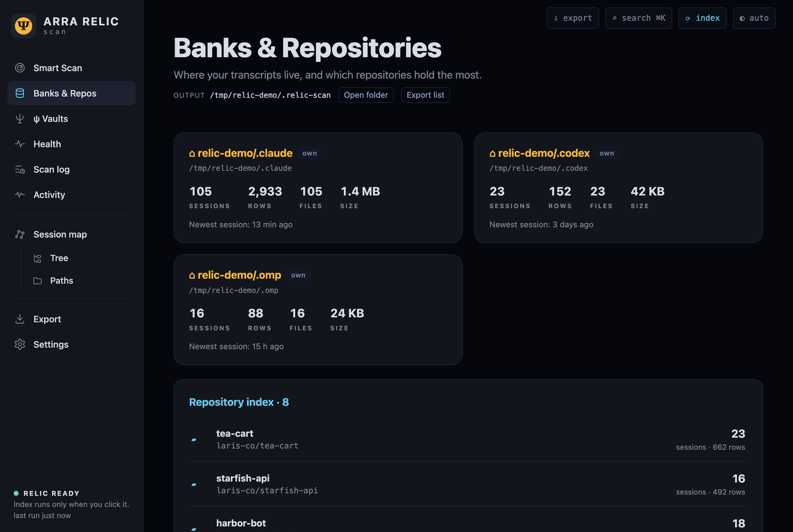
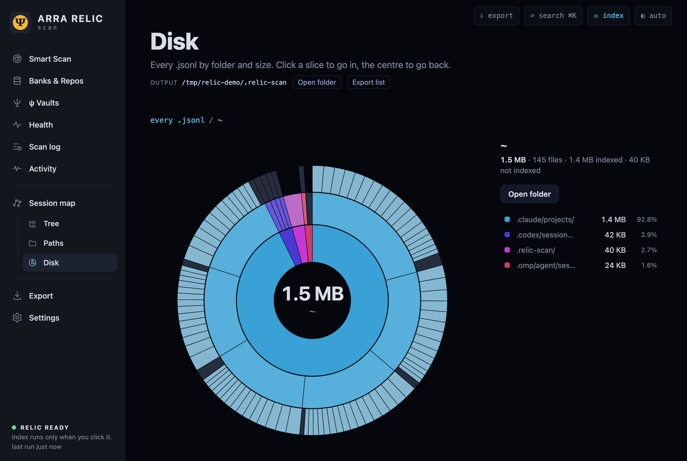
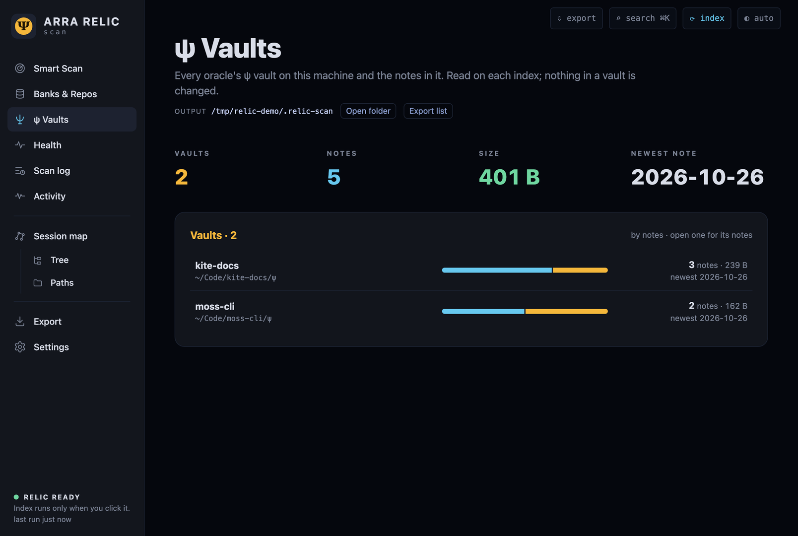
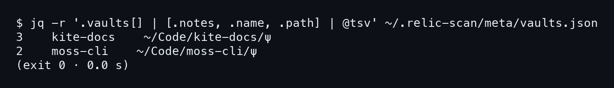
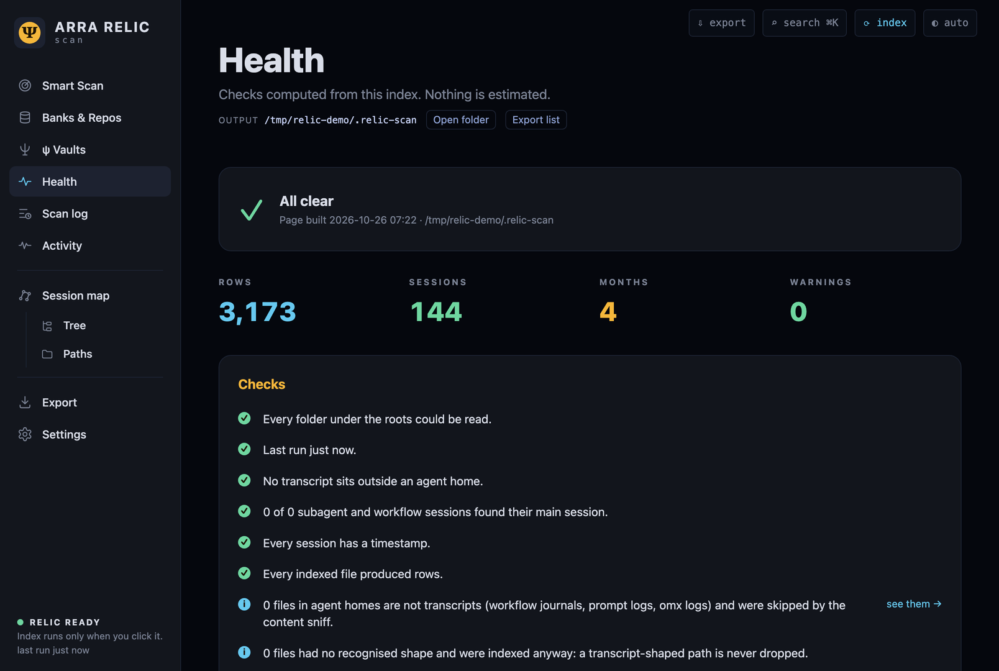

# บทที่ 4: ดิสก์ ห้องนิรภัย และการตั้งค่า

บทที่แล้วเราดูดัชนีจากมุมของแถวและ session บทนี้ดูจากมุมของ **ที่ที่ข้อมูลอยู่** บ้านของเอเจนต์แต่ละที่ ไฟล์ที่กินดิสก์ ห้องนิรภัย ψ ของ oracle แล้วปิดท้ายด้วยหน้า Health ที่บอกว่าทั้งหมดปกติดีไหม และ Settings ที่ปรับสิ่งที่สแกนเดินดู เซิร์ฟเวอร์ยังเป็นตัวเดิม ที่อยู่ยังเป็น `http://127.0.0.1:8787/<view>` ส่วนภาพในบทนี้ถ่ายจากพอร์ต 8791 เหมือนบทที่แล้ว

## Banks & Repos — การ์ดต่อหนึ่งบ้าน

### ขั้นที่ 1 — เปิด `/banks`

เปิด `http://127.0.0.1:8787/banks` หรือกด Banks & Repos ในเมนูซ้าย ด้านบนเป็นการ์ดหนึ่งใบต่อหนึ่ง **บ้านของเอเจนต์** (agent home) ในเดโมมีสามใบ คือ `.claude`, `.codex` และ `.omp` แต่ละการ์ดบอก sessions, rows, files, ขนาด และ session ล่าสุด



ใต้การ์ดเป็น Repository index มี 8 repo แต่ละบรรทัดบอกจำนวน session กับจำนวนแถวของ repo นั้น

### ขั้นที่ 2 — กดการ์ดหรือบรรทัดเพื่อไปต่อ

หน้านี้เป็นทางเข้าไปยังหน้าอื่น **กดการ์ดแล้วเปิด Tree ที่บ้านนั้น** ส่วนกดบรรทัดใน Repository index แล้วเปิด Map ที่ repo นั้น ส่วนตัวเลขในการ์ดคือยอดของบ้านนั้นทั้งบ้าน

README บอกว่าการ์ดมีช่อง origin ด้วย ซึ่งมีประโยชน์ตอนที่เครื่องมี mirror หรือ backup ของ `.claude` หลายที่ relic-scan พับแถวซ้ำให้เป็นแถวเดียว แต่ยังแสดงให้เห็นว่าบ้านไหนถือไฟล์อยู่

ถ้าอยากรู้ว่าเครื่องนี้มีเอเจนต์ตัวไหนทิ้งประวัติไว้มากที่สุด ดูที่ rows ของแต่ละการ์ดแล้วเทียบกัน จบในหน้าเดียว ไม่ต้องไปเขียน query

## Disk — ไฟล์ไหนกินที่

### ขั้นที่ 1 — เปิดตัวเลือก Disk ก่อน

README เรียก Disk ว่า gem คือ **ซ่อนไว้จนกว่าจะเปิดเอง** ใน Settings > Gems และเปิดเฉพาะเบราว์เซอร์นั้น ถ้าไม่เห็นเมนู Disk ใต้ Session map ให้ไปที่หน้า Settings (อยู่ท้ายบทนี้) แล้วเปิดตรงนั้นก่อน ภาพด้านล่างถ่ายจากการเปิดที่อยู่ `/disk` ตรง ๆ

### ขั้นที่ 2 — เปิด `/disk`

เปิด `http://127.0.0.1:8787/disk` ได้แผนภูมิวงกลมหลายชั้น (sunburst) ของ `.jsonl` ทุกไฟล์ จัดตามโฟลเดอร์และขนาด ตรงกลางวงคือยอดรวม **1.5 MB** วงในแทนโฟลเดอร์ใหญ่ วงที่ออกไปแตกเป็นโฟลเดอร์ย่อย มุมของแต่ละชิ้นคือสัดส่วนของโฟลเดอร์แม่



ใช้งานง่ายมาก คลิกชิ้นไหนก็ซูมเข้าไปในโฟลเดอร์นั้น คลิกตรงกลางเพื่อถอยออกมา ชิ้นเล็กมากที่แต่ละชิ้นไม่ถึง 0.5% ของตรงกลาง จะถูกรวมเป็นชิ้นสีเทา "smaller objects"

### ขั้นที่ 3 — อ่านคำอธิบายสี

คำอธิบายด้านข้างเรียงตามสัดส่วนในเดโม

```
.claude/projects   92.8%
.codex/sessions     2.9%
.relic-scan         2.7%
.omp                1.6%
```

ส่วนใหญ่อยู่ใน `.claude/projects` ซึ่งสมเหตุสมผล เพราะ transcript ของ Claude Code เป็น 144 ไฟล์จากทั้งหมด 145 ที่เห็น ที่น่าสนใจคือ `.relic-scan` ก็ติดมาในรายการ เพราะเป็นโฟลเดอร์ที่มี `.jsonl` อยู่ในนั้น ดังนั้นตัวเก็บดัชนีเองก็กินที่ให้เห็นในภาพเหมือนกัน

เครื่องจริงกว่านี้มาก AGENTS.md ยกตัวอย่างเครื่อง Mac เครื่องหนึ่งที่เจอ 87,000 ไฟล์ 75 GB ในเครื่องขนาดนั้น การเห็นเป็นภาพว่าโฟลเดอร์ไหนกินที่มากสุดช่วยได้เยอะ ก่อนจะลงมือจัดการอะไรก็ตาม

## ψ Vaults — ห้องนิรภัยของ oracle

### ขั้นที่ 1 — เปิด `/vaults`

ψ vault คือโฟลเดอร์ความจำของ oracle ที่อยู่ใน repo เช่น `~/Code/kite-docs/ψ` relic-scan หาเจอแล้วทำรายการให้ แต่ **อ่านอย่างเดียว** ไม่แก้และไม่ย้ายอะไรเลย เปิด `http://127.0.0.1:8787/vaults` ด้านบนเป็นแผ่นตัวเลข VAULTS 2, NOTES 5, SIZE 401 B และ NEWEST NOTE 2026-10-26

ใต้แผ่นตัวเลขเป็นรายชื่อ vault สองอัน คือ kite-docs มี 3 โน้ต และ moss-cli มี 2 โน้ต แต่ละอันมีแท่งสีและพาธ `~/Code/kite-docs/ψ`



### ขั้นที่ 2 — ดูข้อมูลชุดเดียวกันเป็น JSON

หน้าเว็บนี้อ่านจากไฟล์ `meta/vaults.json` ในโฟลเดอร์ดัชนี เลยถามด้วย `jq` ได้เลย คำสั่งนี้ดึงจำนวนโน้ต ชื่อ และพาธของแต่ละ vault ออกมาเป็นตาราง

```bash
$ jq -r '.vaults[] | [.notes, .name, .path] | @tsv' \
    ~/.relic-scan/meta/vaults.json
```



ตัวเลขตรงกับหน้าเว็บ 3 บวก 2 ได้ 5 โน้ตตามแผ่น NOTES ถ้าอยากได้โน้ตรายตัว ไฟล์ `meta/vaults/<id>.json` เก็บแต่ละโน้ตเป็น path, section, title, ขนาด และเวลาแก้ไข

## Health — ปกติดีไหม

### ขั้นที่ 1 — เปิด `/health`

เปิด `http://127.0.0.1:8787/health` ในเดโมหัวหน้าขึ้นว่า All clear ใต้นั้นเป็นแผ่นตัวเลข ROWS 3,173, SESSIONS 144, MONTHS 4 และ WARNINGS 0 **WARNINGS 0 คือตัวที่ต้องดูก่อน** ถ้ามีเลขโผล่ แปลว่ามีข้อใดข้อหนึ่งด้านล่างไม่ผ่าน



### ขั้นที่ 2 — อ่านรายการ Checks

ใต้แผ่นเป็นรายการเช็กที่คำนวณจากดัชนี แต่ละข้อติ๊กเขียวเมื่อผ่าน ในเดโม **ผ่านหมดทุกข้อ** คือ อ่านทุกโฟลเดอร์ได้, รอบล่าสุดเพิ่งรันเมื่อครู่, ไม่มี transcript อยู่นอกบ้านเอเจนต์, ทุก session มีเวลา และทุกไฟล์ที่ index ให้แถวออกมา

ข้อมูลที่ README อธิบายไว้ เช็กอื่นที่หน้านี้ดูให้ได้อีก มีอายุของรอบล่าสุด, subagent ที่ไม่มี session หลัก, ไฟล์ที่ถูกข้ามเพราะไม่ใช่ transcript, รูปทรงที่ไม่รู้จัก, mirror ที่ถูกพับ และ tool errors แต่ละข้อมีลิงก์ไปยัง view ที่เกี่ยวข้อง พอมีข้อไม่ผ่าน กดตามไปก็ถึงไฟล์หรือ session ที่เป็นต้นเรื่อง

แผ่น MONTHS 4 **ตรงกับ**สี่เดือนที่เห็นบนวงแหวนของ Map คือ 2026-07 ถึง 2026-10 และ SESSIONS 144 ตรงกับจำนวน transcript ที่ Paths นับเป็น indexed สามหน้าที่นับจากดัชนีเดียวกันจึงต้องตรงกัน ถ้าเลขไม่ตรง ให้สงสัยว่าเปิดคนละโฟลเดอร์ดัชนี เช่น ลืม `--out` หรือ `--kind`

ข้อที่ผ่านแต่มีข้อมูลประกอบจะเป็นบรรทัด info ไม่ใช่คำเตือน อ่านเป็นความรู้ ไม่ต้องแก้

## Settings — สิ่งที่สแกนเดินดู

### ขั้นที่ 1 — เปิด `/settings`

เปิด `http://127.0.0.1:8787/settings` หน้านี้ตั้งค่าว่า **การสแกนเดินดูอะไร** มีสองส่วนในภาพ ส่วนแรก What to scan คือโฟลเดอร์ที่ให้เดิน (ในเดโมคือ `~`) พาธที่ให้ข้าม และความลึก (depth) ที่ตั้งไว้ 8 ส่วนที่สอง S3 copy คือ destination, endpoint และ region

### ขั้นที่ 2 — แก้โฟลเดอร์และพาธเป็นชิป

โฟลเดอร์กับพาธที่ข้ามแสดงเป็นชิป (chip) กด × ลบทีละอัน หรือพิมพ์ในกล่องแล้วกด Enter เพิ่ม มีคำแนะนำให้เลือก และมีปุ่ม ปุ่ม Choose folder… ที่เปิดตัวเลือกโฟลเดอร์ของเครื่องผ่านเซิร์ฟเวอร์ เซิร์ฟเวอร์ตรวจให้ว่าโฟลเดอร์มีจริง และ depth อยู่ในช่วง 1 ถึง 32 ถ้าผิดมันบอกว่าผิดตรงไหน

ค่าทั้งหมดถูกเก็บใน `_config.json` ในโฟลเดอร์ดัชนี `relic-scan run` กับปุ่ม Index now ใช้ไฟล์เดียวกัน แต่ถ้าสั่งด้วยแฟลกในบรรทัดคำสั่ง **แฟลกชนะเสมอ**

### ขั้นที่ 3 — S3 copy และกุญแจ

ช่อง S3 copy ใส่ได้แค่ปลายทาง endpoint กับ region ส่วนกุญแจ **ไม่เก็บในหน้านี้เด็ดขาด** กุญแจมาจาก environment หรือไฟล์ `~/.config/relic-scan/s3.env` ที่มีสิทธิ์ 600 เท่านั้น เรื่องการส่งจริงอยู่ในบทที่ 7


ยังมีตัวเลือก Check changes อัตโนมัติทุก 15, 30 หรือ 60 นาทีตอนเซิร์ฟเวอร์ทำงานอยู่ มันแค่ตรวจ ไม่เคย index เอง และมีปุ่มเลือกธีม (auto, dark, light) ซึ่ง auto ตามระบบ

หกหน้าเว็บที่ผ่านมาทั้งสองบทครอบคลุมเกือบทั้งแอปแล้ว แต่บางคนไม่อยากเปิดเบราว์เซอร์ บทหน้าจึงพาไปดูดัชนีเดียวกันในเทอร์มินัลด้วย `relic-scan tui`
