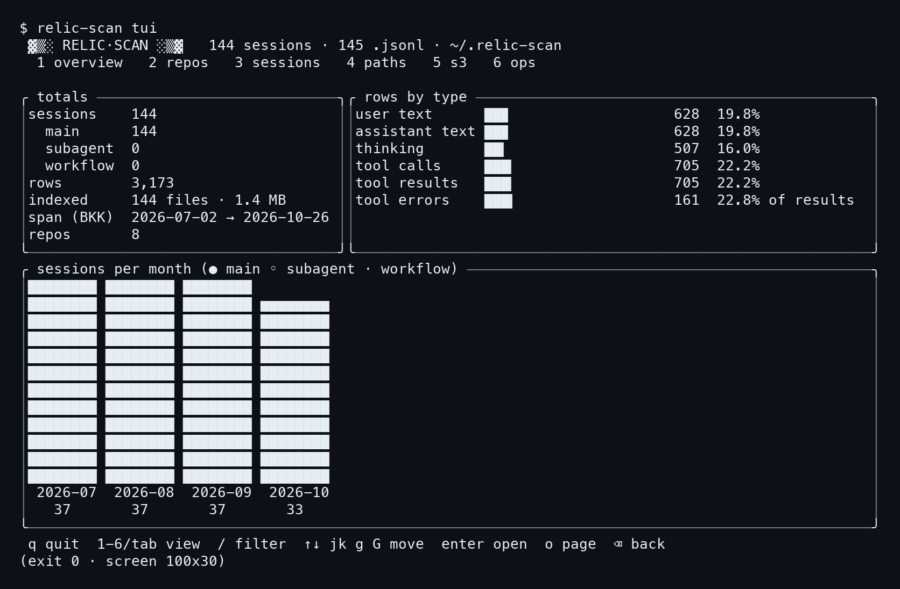
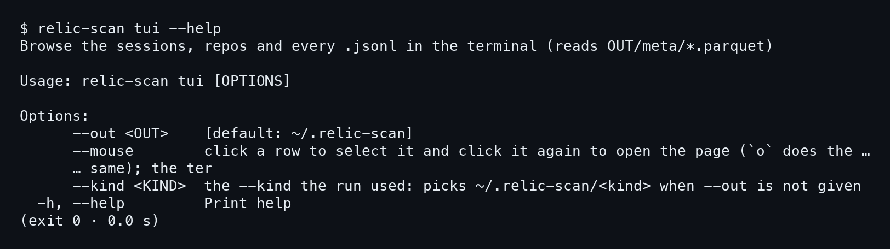
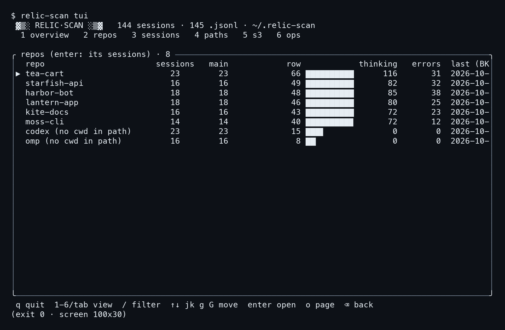
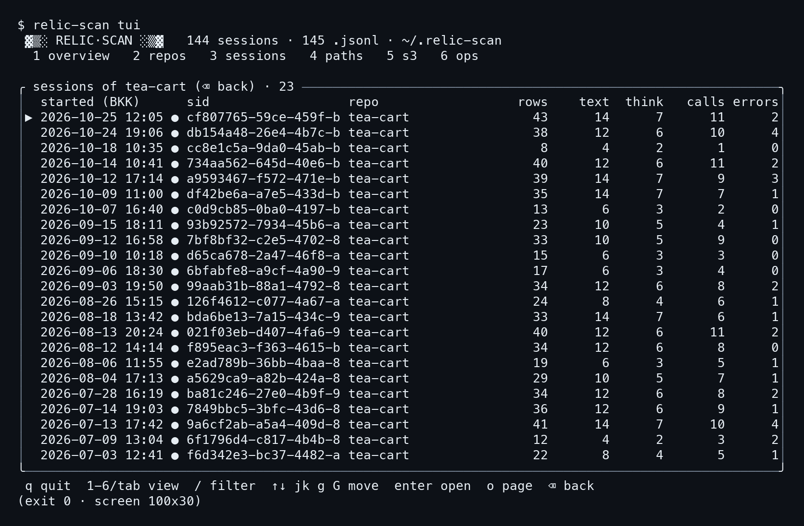
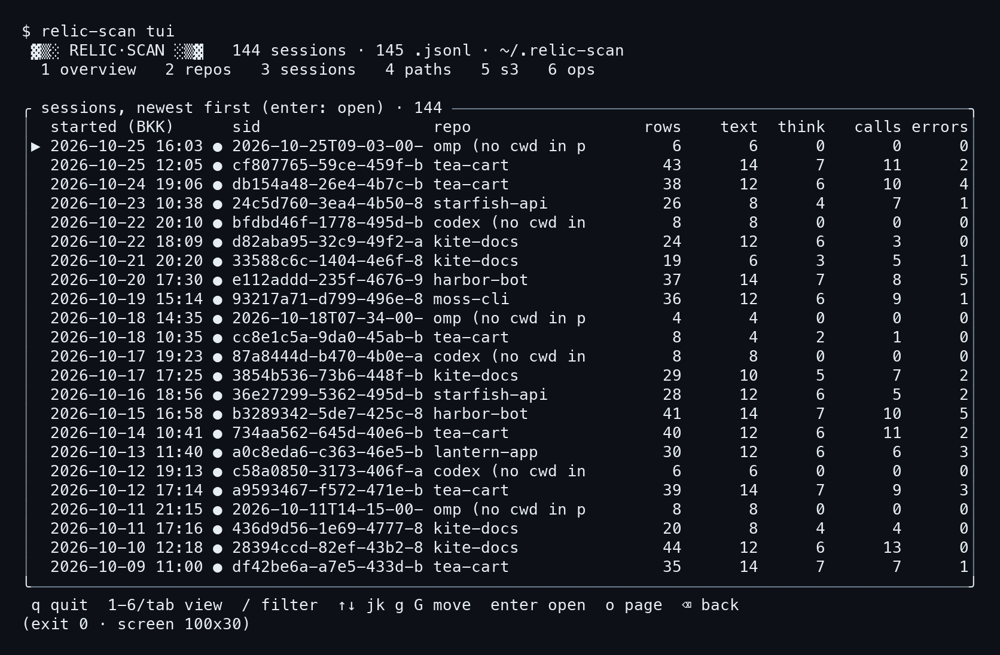
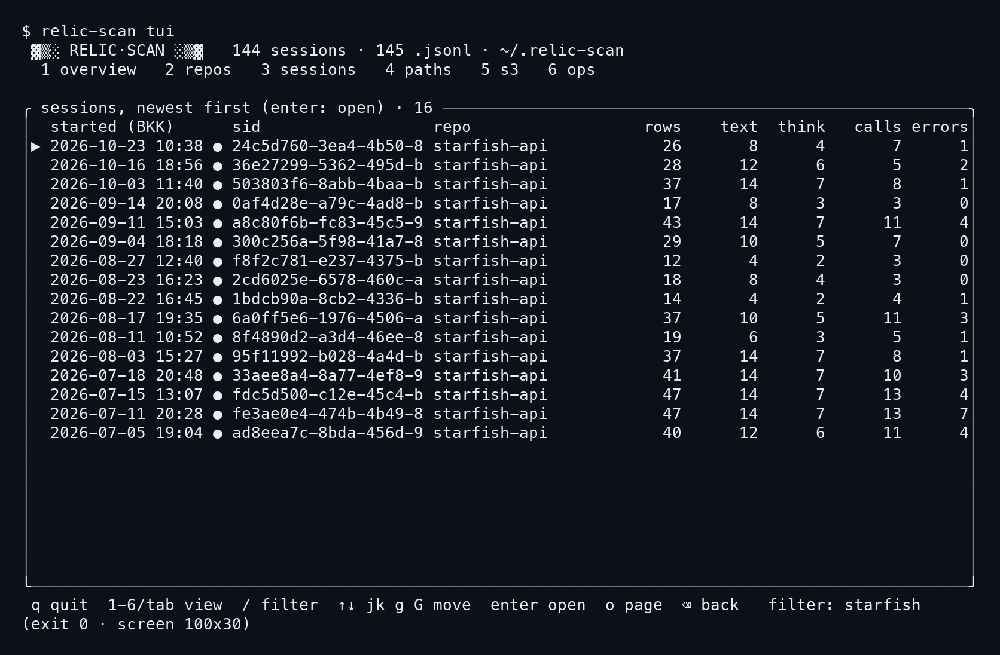
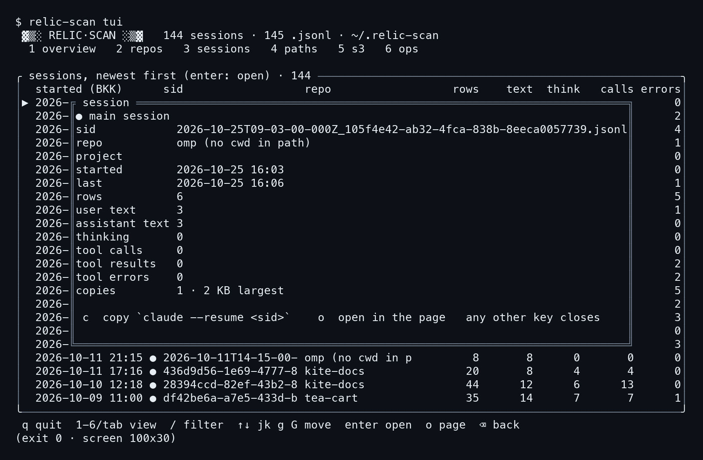
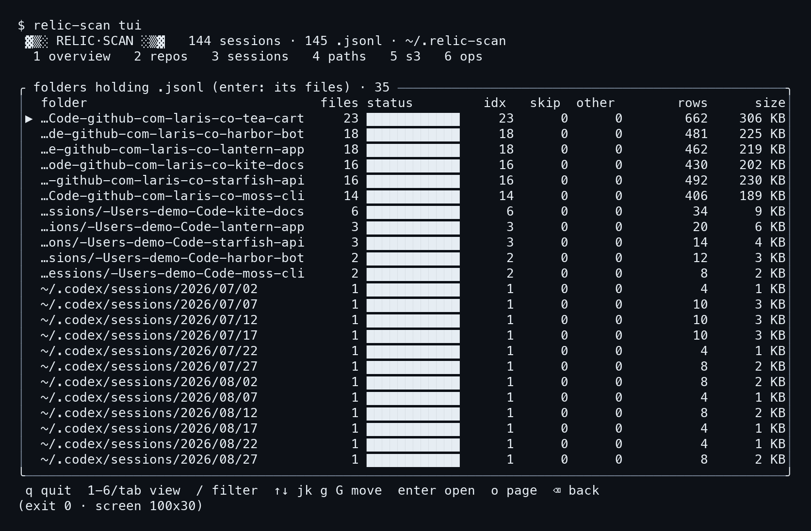
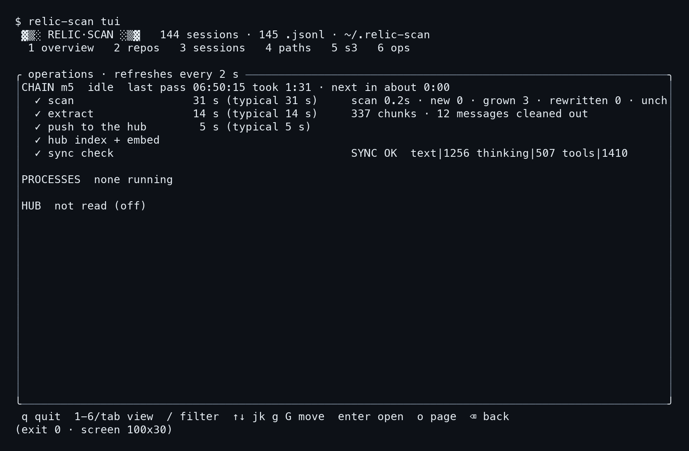

# บทที่ 5: ในเทอร์มินัล

สองบทก่อนหน้านี้เราเปิดดัชนีผ่านหน้าเว็บ แต่บางครั้งเราก็ไม่อยากออกจากเทอร์มินัล เช่น ต่อ ssh เข้าเครื่องอื่น หรือแค่อยากเช็กเร็ว ๆ ว่า session ล่าสุดของ repo นี้คืออะไร relic-scan มีหน้าจอเทอร์มินัลให้ใช้ในตัว ชื่อ `relic-scan tui` อ่านดัชนีชุดเดียวกับหน้าเว็บ ไม่ได้สร้างข้อมูลใหม่ และไม่แตะ transcript เลยแม้แต่ไฟล์เดียว

บทนี้เราจะเดินตามคีย์เป็นลำดับเดียวกับที่ใช้ถ่ายภาพ คือ เปิดโปรแกรม, กด `2`, กด Enter, กด Backspace, กด `3`, พิมพ์ `/` ตามด้วย `starfish`, กด Esc, กด Enter, กด Esc อีกครั้งเพื่อปิดกล่อง, กด `4` และกด `6` ทุกหน้าจอในบทนี้เป็นข้อความจริงของหน้าจอขนาด 100x30 บนบ้านเดโมเดิม ไม่มีอะไรตกแต่งเพิ่ม

## 5.1 เปิด relic-scan tui และอ่านแท็บแรก

### ขั้นที่ 1 — เปิดโปรแกรม

พิมพ์คำสั่งเดียวในโฟลเดอร์ไหนก็ได้ เพราะโปรแกรมหาดัชนีที่ `~/.relic-scan` เอง ถ้าเคยรันด้วย `--kind` หรือ `--month` ไว้ (บทที่ 2) ก็ใส่ตัวเลือกเดียวกันตอนเปิดเพื่อชี้ไปโฟลเดอร์แยกนั้น เช่น `relic-scan tui --kind claude` ตัวเลือกทั้งหมดดูได้ในขั้นที่ 4

```bash
relic-scan tui
```



พอเปิดมา **หน้าแรกคือ overview** เสมอ ที่หัวจอบอกว่าดัชนีนี้มีอะไรอยู่ แล้วบรรทัดถัดไปเป็นแถบแท็บทั้งหกให้เห็นตั้งแต่แรก

```
 ▓▒░ RELIC·SCAN ░▒▓   144 sessions · 145 .jsonl · ~/.relic-scan
  1 overview   2 repos   3 sessions   4 paths   5 s3   6 ops
```

### ขั้นที่ 2 — อ่านสามกล่องของ overview

กล่องซ้ายบน `totals` สรุปตัวเลขรวม กล่องขวาบน `rows by type` แยกแถวตามชนิด ส่วนกล่องล่างเป็นแผนภูมิแท่ง **sessions per month** ตัวเลขทั้งหมดตรงกับที่หน้าเว็บ Smart Scan เคยโชว์ คือ 3,173 แถว และ 144 session

```
│rows        3,173                   │
│indexed     144 files · 1.4 MB      │
│span (BKK)  2026-07-02 → 2026-10-26 │
│repos       8                       │
```

ในกล่อง `totals` มีสามบรรทัดย่อยของ sessions คือ `main 144`, `subagent 0` และ `workflow 0` บ้านเดโมมีแต่ session หลัก ไม่มี subagent เลย ส่วน `rows by type` มี user text 628, assistant text 628, thinking 507, tool calls 705 และ tool results 705 เรียงเป็นแท่งพร้อมเปอร์เซ็นต์ บรรทัดสุดท้าย tool errors 161 คิดเป็น 22.8% ของ results ไม่ใช่ของแถวทั้งหมด ตัวหารต่างกัน จึงเขียนกำกับไว้ในภาพว่า `of results`

แผนภูมิล่างแสดงสี่เดือน 2026-07 ถึง 2026-10 ใต้แท่งเขียนจำนวน session ไว้สามสิบกว่าต่อเดือน (37, 37, 37 และ 33) เดือนสุดท้ายแท่งเตี้ยกว่านิดหน่อย ถ้ารวมสี่เดือนจะได้ 144 พอดีกับกล่อง totals

### ขั้นที่ 3 — แถบคีย์ที่ท้ายจอ

บรรทัดล่างสุดเป็นความจำช่วยตลอดเวลา **ไม่ต้องจำคีย์จากบทนี้ก็ได้** เพราะมันอยู่บนจอทุกแท็บ

```
 q quit  1-6/tab view  / filter  ↑↓ jk g G move  enter open  o page  ⌫ back
```

คีย์ `1` ถึง `6` กระโดดไปแท็บตรง ๆ ส่วน Tab กับลูกศรขวาไล่ไปแท็บถัดไป Shift+Tab กับลูกศรซ้ายถอยกลับ การเลื่อนในรายการใช้ลูกศรขึ้นลง หรือ `j` `k` แบบ vim ก็ได้ `g` ไปบนสุด `G` ไปล่างสุด PgUp กับ PgDn ข้ามทีละ 20 แถว และ `q` ออกจากโปรแกรม

### ขั้นที่ 4 — ดูตัวเลือกทั้งหมดด้วย --help

ถ้าลืมว่าเปิดโปรแกรมได้แบบไหนบ้าง ให้ถาม `--help` คำสั่งนี้พิมพ์แล้วจบทันที ไม่เปิดหน้าจอเต็ม

```bash
relic-scan tui --help
```



อ่านแล้วเห็นว่า **ตัวเลือกมีแค่สามตัว** `--out` ชี้โฟลเดอร์ดัชนี (ค่าเริ่มต้น `~/.relic-scan`), `--mouse` ให้คลิกแถวเพื่อเลือกแล้วคลิกซ้ำเพื่อเปิดหน้าเว็บ และ `--kind` ใช้ชื่อ kind เดียวกับที่ตอน `run` ใช้ เพื่อเลือกโฟลเดอร์ `~/.relic-scan/<kind>` เมื่อไม่ได้ใส่ `--out`

## 5.2 จาก repo ลงไปถึง session

### ขั้นที่ 1 — กด 2 ดู repo ทั้งแปด

กด `2` เพื่อเข้าแท็บ repos แต่ละแถวคือหนึ่ง repo มีจำนวน session แยกตาม main, แถว, thinking, errors และเวลา session ล่าสุด

```
╭ repos (enter: its sessions) · 8 ──────────────
│▶ tea-cart                      23        23
│  starfish-api                  16        16
│  codex (no cwd in path)        23        23
│  omp (no cwd in path)          16        16
```



**รายการเรียงตามจำนวนแถว ไม่ใช่ตามจำนวน session** tea-cart จึงอยู่บนสุดด้วย 23 session ส่วน codex กับ omp อยู่ท้ายสุดแม้ codex จะมี 23 session เท่า tea-cart เพราะ session ของมันสั้น (ดูตัวเลข 152 และ 88 แถวในบทที่ 6) ลูกศร `▶` หน้าแถวคือแถวที่เลือกอยู่

ข้อสังเกตสองอย่าง อย่างแรก เครื่องหมาย (no cwd in path) บอกว่า Codex และ omp ไม่ได้ฝังชื่อโฟลเดอร์งานไว้ใน path ของไฟล์ relic-scan จึงจัดเป็นกลุ่มตามชื่อ agent อย่างที่สอง จอกว้างแค่ 100 ตัวอักษร คอลัมน์ขวาสุดจึงถูกตัด เช่น หัวคอลัมน์ `rows` กลายเป็น `row` และตัวเลขแถวของ tea-cart ที่ควรเป็น 662 ถูกตัดเหลือ `66` ถ้าอยากเห็นเต็ม ให้ขยายหน้าต่างเทอร์มินัลให้กว้างกว่านี้

### ขั้นที่ 2 — กด Enter ลง repo ที่เลือก

เลื่อน `▶` ไปที่ repo ที่ต้องการแล้วกด **Enter** ในภาพนี้เราไม่ได้เลื่อน จึงเข้า tea-cart ซึ่งเป็นแถวแรก

โปรแกรมสลับไปแท็บ sessions แต่กรองให้เหลือ repo เดียว ชื่อกล่องบอกไว้ชัดว่า `sessions of tea-cart (⌫ back) · 23`

```
│▶ 2026-10-25 12:05 ● cf807765-59ce-459f-b tea-cart    43   14   7  11   2│
│  2026-10-24 19:06 ● db154a48-26e4-4b7c-b tea-cart    38   12   6  10   4│
```



คอลัมน์ `started (BKK)` เป็นเวลาไทย `sid` ถูกตัดเหลือ 20 ตัวแรกของ id ส่วน `rows` คือแถวทั้งหมดของ session นั้น แล้ว `text`, `think`, `calls`, `errors` แจกแจงว่าแถวเหล่านั้นเป็นอะไร session บนสุดมี 43 แถว เป็นข้อความ 14, thinking 7, tool calls 11 และ error 2 จุดกลม `●` หลังเวลาบอกว่าเป็น session หลัก

### ขั้นที่ 3 — Backspace กลับ แล้วกด 3 ดูทุก session

กด Backspace (ในแถบคีย์เขียนว่า `⌫ back`) เพื่อถอยกลับไปแท็บ repos จากนั้นกด `3` เพื่อไปแท็บ sessions แบบไม่กรอง กดเลขสามจะล้างการเลือก repo ทิ้งให้ด้วย จึงเห็นทั้ง 144 session

```
╭ sessions, newest first (enter: open) · 144 ───
```



บรรทัดแรกคือ session ของ omp ตัวเลข `144` ท้ายชื่อกล่องคือจำนวนรายการที่เห็น **เลขท้ายชื่อกล่องเปลี่ยนตามตัวกรองเสมอ** จึงเป็นวิธีเช็กเร็วว่ากรองอยู่หรือเปล่า สังเกตด้วยว่า sid ของ omp ขึ้นต้นด้วยวันเวลา (`2026-10-25T09-03-00-`) ต่างจาก Claude ที่เป็น uuid เพราะ omp ตั้งชื่อไฟล์ด้วยเวลาเริ่ม

## 5.3 กรองรายการ เปิดรายละเอียด และข้ามไปหน้าเว็บ

### ขั้นที่ 1 — กด / แล้วพิมพ์คำที่ต้องการ

ตอนอยู่ในแท็บ sessions กด `/` แล้วพิมพ์ `starfish` จากนั้นกด Enter ระหว่างพิมพ์ รายการจะหดตามทุกตัวอักษร ส่วน Backspace ในโหมดพิมพ์ลบทีละตัวอักษร ไม่ใช่ถอยกลับ

```
╭ sessions, newest first (enter: open) · 16 ───
 …⌫ back   filter: starfish
```



เหลือ 16 session ตรงกับตัวเลข 16 ของ starfish-api ที่แท็บ repos และที่ DuckDB จะนับให้ในบทที่ 6 **ตัวกรองนับเป็นคำและใช้เงื่อนไข AND** ตาม README ถ้าพิมพ์สองคำ แถวต้องมีทั้งสองคำ ที่ท้ายจอมีบรรทัด `filter: starfish` เตือนว่าตัวกรองยังทำงานอยู่ แม้เราจะกด Enter ออกจากโหมดพิมพ์แล้ว

### ขั้นที่ 2 — Esc ล้างตัวกรอง แล้ว Enter เปิดรายละเอียด

กด Esc เพื่อล้างตัวกรอง รายการกลับมาเป็น 144 แล้วกด Enter ที่แถวบนสุด ซึ่งก็คือ session ของ omp เมื่อครู่ จะมีกล่องรายละเอียดซ้อนขึ้นมาเหนือรายการ

```
║● main session
║sid     2026-10-25T09-03-00-000Z_105f4e42-ab32-4fca-838b-8eeca0057739.jsonl
║repo    omp (no cwd in path)
║rows    6
║copies  1 · 2 KB largest
```



กล่องนี้ให้ **sid เต็ม** ซึ่งรายการตัดทิ้ง พร้อมเวลาเริ่มกับเวลาสุดท้าย (16:03 ถึง 16:06) จำนวนแถวแยกชนิด และบรรทัด `copies` ที่บอกว่าไฟล์นี้มีกี่สำเนา (1 สำเนา ใหญ่สุด 2 KB) ถ้ามี mirror หรือ backup สำเนาจะนับรวมตรงนี้ เรื่องการพับสำเนาเป็นแถวเดียวจะอธิบายในบทที่ 9

ท้ายกล่องบอกคีย์ที่ใช้ได้ในกล่องนี้ไว้ครบ

```
 c  copy `claude --resume <sid>`    o  open in the page   any other key …
```

### ขั้นที่ 3 — c, o และ --mouse

กด `c` เพื่อคัดลอกคำสั่ง `claude --resume <sid>` ไว้ในคลิปบอร์ด พร้อมวางเพื่อกลับไปคุยต่อกับ session นั้นได้เลย แต่ **เฉพาะ session ของ Claude Code เท่านั้น** ในโค้ด keys.rs session ของ agent อื่นจะคัดลอกแค่ sid เปล่า ๆ เพราะคำสั่ง resume ของ Claude ใช้กับ Codex หรือ omp ไม่ได้ session ในภาพนี้เป็นของ omp จึงได้เฉพาะ sid

กด `o` เพื่อเปิดหน้าเว็บไปที่ session เดียวกัน คีย์ `o` ใช้ได้นอกกล่องด้วย ตอนเลือกแถว repo หรือโฟลเดอร์อยู่ ก็จะเปิดหน้าเว็บตรงจุดนั้น หน้าเว็บคือหน้าเดียวกับที่เปิดด้วย `relic-scan up` ในบทที่ 3 ส่วนคีย์อื่นนอกจาก `c`, `o` และ `q` จะปิดกล่องทั้งหมด

ถ้าชอบใช้เมาส์ ให้เปิดด้วย `--mouse` คลิกหนึ่งแถวเพื่อเลือก คลิกซ้ำที่แถวเดิมเพื่อเปิด ข้อมูลนี้มาจาก README เราไม่ได้ถ่ายภาพไว้ เพราะการคลิกจับเป็นภาพนิ่งไม่ได้

## 5.4 แท็บ paths และ ops

### ขั้นที่ 1 — ปิดกล่องด้วย Esc แล้วกด 4

กล่อง session ยังเปิดค้างอยู่ และ **ทุกคีย์ที่ไม่ใช่ `c`, `o`, `q` จะแค่ปิดกล่อง** ไม่ได้ส่งต่อไปให้แท็บ ถ้ากด `4` ทันที กล่องจะปิดแล้วยังอยู่แท็บ sessions เดิม ภาพชุดนี้จึงกด Esc ปิดกล่องก่อน แล้วค่อยกด `4`

```
╭ folders holding .jsonl (enter: its files) · 35 ───
│▶ …laris-co-tea-cart     23 …     23      0      0   662    306 KB│
```



แท็บ paths แสดงโฟลเดอร์ที่มี `.jsonl` อยู่ 35 โฟลเดอร์ พร้อมจำนวนไฟล์ และตัวเลข indexed, skipped และ other โฟลเดอร์แรกคือ tea-cart 23 ไฟล์ 662 แถว 306 KB กด Enter ที่โฟลเดอร์เพื่อดูไฟล์ข้างใน และกด Enter ที่ไฟล์เพื่อคัดลอก path ของมัน Backspace ถอยจากรายการไฟล์กลับมารายการโฟลเดอร์ เนื้อหาเดียวกันดูเป็นภาพได้ที่หน้า Paths ของเว็บ (บทที่ 3)

### ขั้นที่ 2 — กด 6 ดู ops

คีย์ `6` เข้าแท็บ ops ซึ่งเป็นภาพเดียวกับคำสั่ง `relic-scan ops` แต่วาดใหม่ทุก 2 วินาที ชื่อกล่องก็บอกไว้ว่า `operations · refreshes every 2 s`

```
│CHAIN m5  idle  last pass 06:50:15 took 1:31 · next in about 0:00
│  ✓ scan                  31 s (typical 31 s)
│  ✓ extract               14 s (typical 14 s)
│  ✓ push to the hub        5 s (typical 5 s)
│  ✓ sync check            SYNC OK  text|1256 thinking|507 tools|1410
```



อ่านจากบนลงล่าง **chain คือสายงานห้าขั้น** ได้แก่ `scan`, `extract`, `push to the hub`, `hub index + embed` และ `sync check` แต่ละขั้นมีเครื่องหมายถูก เวลาที่ใช้ และเวลาปกติ (typical) ให้เทียบ ถ้าขั้นไหนช้ากว่าปกติ ตรงนี้จะเห็นก่อนที่ใครจะบ่น บรรทัดสุดท้ายคือ `SYNC OK` พร้อมจำนวนแถวที่ฝั่งเราและฝั่ง hub นับตรงกัน

ตัวเลขสามตัวใน `SYNC OK` บวกกันได้ 1256 + 507 + 1410 = 3,173 เท่ากับจำนวนแถวบนหน้า Smart Scan ส่วน `PROCESSES` ขึ้นว่า `none running` แปลว่าไม่มีโปรเซสของ chain รันอยู่ตอนนั้น และ `HUB  not read (off)` แปลว่าไม่ได้ถาม hub เลย ซึ่งเป็นค่าเริ่มต้นในภาพนี้ เรื่อง chain ทั้งเส้นจะอธิบายเต็มในบทที่ 8

### ขั้นที่ 3 — แท็บ s3 ที่เหลือ

แท็บที่ห้า **`s3`** ไม่อยู่ในชุดภาพ เพราะบ้านเดโมไม่ได้ตั้งปลายทาง S3 ไว้ ตาม README ในแท็บนี้ `c` ตรวจเทียบกับ store โดยไม่ส่งอะไร และ `s` ส่งเฉพาะเดือนที่ยังขาด โดยไม่ทับเดือนที่ต่างกัน เป็นงานเดียวกับการ์ด S3 copy ในหน้า Export ซึ่งบทที่ 7 จะพาไปดู

ตอนนี้เรามีสามทางเข้าดัชนีแล้ว คือหน้าเว็บ เทอร์มินัล และ CLI ทางที่สี่ยืดหยุ่นที่สุดคือถามด้วย SQL ตรง ๆ บทถัดไปจะเปิด DuckDB ขึ้นมาถามไฟล์ Parquet เหล่านี้ทีละคำถาม
