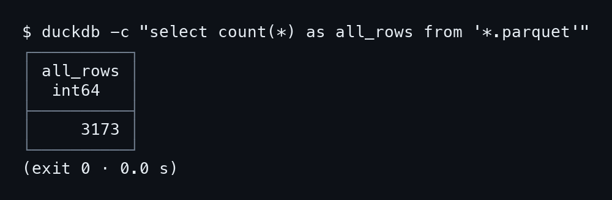
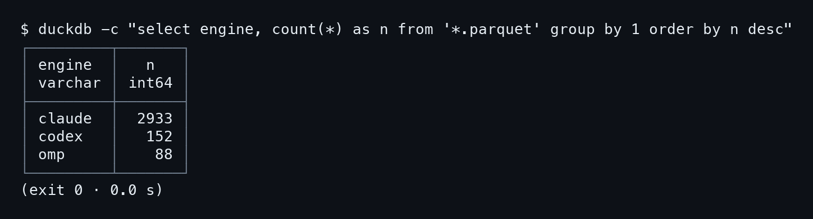
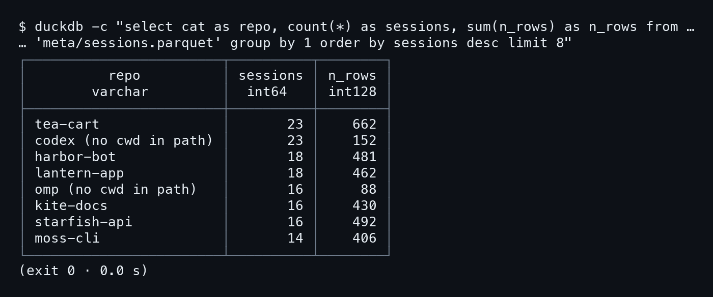
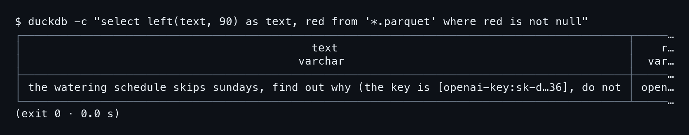
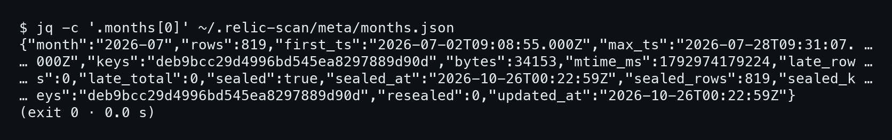
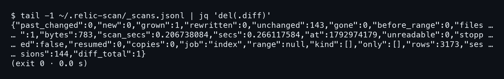

# บทที่ 6: ถามดัชนีด้วย DuckDB

หน้าเว็บกับ TUI ตอบคำถามที่คนทำ relic-scan คิดไว้ล่วงหน้า แต่คำถามของเราไม่ได้ตรงกับเขาเสมอไป เช่น โมเดลไหนตอบกี่ครั้งในเดือนไหน หรือ session ไหนกินโทเคนมากสุด พอดัชนีเป็นไฟล์ Parquet ธรรมดา เราก็เปิดด้วยเครื่องมืออะไรก็ได้ที่อ่าน Parquet เป็น บทนี้ใช้ DuckDB เพราะติดตั้งง่ายและรัน SQL บนไฟล์ได้เลย ไม่ต้องโหลดเข้าฐานข้อมูลก่อน

ทุกคำสั่งในบทนี้รันที่โฟลเดอร์ `~/.relic-scan` ของบ้านเดโม (`cd ~/.relic-scan` ก่อน) เพราะ path ใน SQL เป็น `'*.parquet'` และ `'meta/sessions.parquet'` แบบสัมพัทธ์ และก่อนเริ่มมีกฎเรื่องความเป็นส่วนตัวหนึ่งข้อจาก AGENTS.md ทรานสคริปต์เก็บงานส่วนตัว อ่านเฉพาะที่ถามหา และอย่าคัดลอกแถวออกจากเครื่อง

## 6.1 นับทุกอย่างให้ได้เลขเดียวกับแอป

### ขั้นที่ 1 — นับแถวทั้งหมด

เริ่มจากคำถามที่ง่ายที่สุด ไฟล์ `YYYY-MM.parquet` หนึ่งไฟล์ต่อเดือน ใช้ glob `'*.parquet'` รวมทุกเดือนในโฟลเดอร์ แต่ไม่รวม `meta/` เพราะอยู่ในโฟลเดอร์ย่อย

```bash
duckdb -c \
  "select count(*) as all_rows from '*.parquet'"
```



```
│     3173 │
```

ก่อนไปต่อ ลองดูว่าไฟล์เดือนหนึ่งมีคอลัมน์อะไรบ้างด้วย `describe`

```bash
duckdb -c "describe select * from '2026-10.parquet'"
```


ผลมี 24 คอลัมน์ ที่ใช้ในบทนี้คือ `role`, `kind`, `name`, `engine`, `sid`, `ts_th`, `text`, `body`, `err`, `model`, `msg_id` และคอลัมน์โทเคน `out_tokens`, `in_tokens`, `cache_read`, `cache_write` ส่วน `machines` กับ `sources` เป็นอาร์เรย์ (`VARCHAR[]`)

ผลนับแถวคือ 3173 แถว **เลขนี้ต้องตรงกับยอดบนหน้า Smart Scan** (3,173) ถ้าไม่ตรงแปลว่าเรามองคนละโฟลเดอร์ หรือดัชนีไม่ได้ถูกอัปเดตแล้ว AGENTS.md แนะนำให้นับทั้งหมดก่อนทุกครั้ง แล้วค่อยรายงานชิ้นส่วนเทียบกับยอดรวม จะได้ไม่หลงว่า "ข้อความผู้ใช้ 628" คือทั้งหมดของข้อมูล

### ขั้นที่ 2 — แยกตามว่าแต่ละแถวคืออะไร

หนึ่งแถวอาจเป็นข้อความ ความคิด คำเรียกเครื่องมือ หรือผลลัพธ์ของเครื่องมือ ดัชนีบอกด้วย **สองคอลัมน์ คือ `role` และ `kind`** ไม่ใช่คอลัมน์เดียว ข้อความกับ thinking มี `role` (user, assistant, thinking) แต่ `kind` ว่าง ส่วนการเรียกเครื่องมือมี `kind = 'call'` (ชื่อเครื่องมืออยู่ใน `name`) และผลลัพธ์มี `kind = 'result'` โดยไม่มี `role` คำสั่งข้างล่างจึงใช้ `coalesce(nullif(...))` เลือกค่าที่ไม่ว่างของสองคอลัมน์มารวมเป็นคอลัมน์เดียวชื่อ `what`

```bash
duckdb -c \
  "select coalesce(nullif(kind,''), nullif(role,''), '(none)') as what, count(*) as n from '*.parquet' group by 1 order by n desc"
```


```
│ result    │   705 │
│ call      │   705 │
│ assistant │   628 │
│ user      │   628 │
│ thinking  │   507 │
```

บวกห้าแถวได้ 705 + 705 + 628 + 628 + 507 = 3173 พอดี จึงไม่มีแถวตกหล่น และไม่มีแถว `(none)` ในบ้านเดโม ซึ่งข้อมูลจริงอาจมีประปรายได้ (AGENTS.md บอกว่าบางแถวไม่มีทั้ง role และ kind) ตัวเลขชุดนี้ตรงกับ `rows by type` ที่เห็นใน TUI บทที่ 5 ทุกตัว การจับคู่ call กับ result ที่เท่ากัน (705 ต่อ 705) ก็เป็นสัญญาณที่ดี คือทุกการเรียกเครื่องมือมีผลลัพธ์กลับมา

หนึ่งข้อควรรู้เรื่อง thinking ตั้งแต่ราวเดือนมีนาคม 2026 Claude Code เขียนบล็อก thinking ส่วนใหญ่เป็นลายเซ็นอย่างเดียว ไม่มีข้อความ แถวพวกนี้ยังนับเป็น thinking แต่ `text` ว่าง จึงไม่มีอะไรให้อ่านหรือทำ embedding

### ขั้นที่ 3 — แยกตาม engine

คอลัมน์ `engine` บอกว่าแถวมาจาก agent ตัวไหน นับด้วย `group by` ธรรมดา

```bash
duckdb -c \
  "select engine, count(*) as n from '*.parquet' group by 1 order by n desc"
```



```
│ claude  │  2933 │
│ codex   │   152 │
│ omp     │    88 │
```

**2933 + 152 + 88 ได้ 3173 อีกครั้ง** Claude Code ครองข้อมูลแทบทั้งหมด ส่วน Codex กับ omp มีนิดเดียว ตัวเลข 152 และ 88 ตรงกับคอลัมน์ rows ของ `codex (no cwd in path)` และ `omp (no cwd in path)` ที่เห็นในแท็บ repos ของ TUI

## 6.2 session ต่อ repo

### ขั้นที่ 1 — ถามจากตาราง meta

ตาราง `meta/sessions.parquet` มีหนึ่งแถวต่อหนึ่ง session จึงใช้ตอบคำถามระดับ session ได้เร็ว ไม่ต้องกวาดทุกแถวของเดือน คอลัมน์ `cat` คือชื่อ repo และ `n_rows` คือจำนวนแถวของ session นั้น

```bash
duckdb -c \
  "select cat as repo, count(*) as sessions, sum(n_rows) as n_rows from 'meta/sessions.parquet' group by 1 order by sessions desc limit 8"
```



```
│ tea-cart               │       23 │    662 │
│ codex (no cwd in path) │       23 │    152 │
│ lantern-app            │       18 │    462 │
│ omp (no cwd in path)   │       16 │     88 │
```

เลข 662 ของ tea-cart คือตัวเลขเต็มที่ TUI ตัดทิ้งเหลือ `66` ในบทที่ 5 ส่วน session รวมกัน 23 + 23 + 18 + 18 + 16 + 16 + 16 + 14 ได้ 144 ตรงกับจำนวน session ทั้งหมด **ผลรวมเป็นเครื่องมือตรวจที่ถูกที่สุด** ถ้ารวมแล้วไม่เท่ายอดที่รู้ ก็แปลว่าเราตัดแถวทิ้งไปที่ `limit` หรือมี repo เกินแปด

## 6.3 โมเดลและโทเคนต่อเดือน

### ขั้นที่ 1 — นับ API call และโทเคนที่ตอบออกมา

คำถามนี้ซับซ้อนกว่าข้อก่อนหน้า เพราะหนึ่งการตอบจาก API ไม่ใช่หนึ่งแถว Claude หนึ่งคำตอบ (หนึ่ง `msg_id`) แตกเป็นหลายแถว หนึ่งแถวต่อบล็อกเนื้อหา เช่น ข้อความหนึ่งแถว thinking หนึ่งแถว และ tool call อีกหนึ่งแถว ถ้าเรา `sum(out_tokens)` ตรง ๆ แล้วทุกแถวถือโทเคนซ้ำกัน ก็จะนับซ้ำ

ดัชนีแก้ปัญหานี้ไว้แล้ว **`out_tokens` ใส่ไว้ที่แถวเดียวต่อ `msg_id`** ดังนั้น `sum(out_tokens)` นับแต่ละคำตอบหนึ่งครั้งพอดี และ `count(distinct msg_id)` ก็นับจำนวน API call ได้ตรง ๆ ส่วน `model` ติดอยู่กับแถวข้อความ thinking และ tool call ของ assistant

```bash
duckdb -c \
  "select left(ts_th,7) as month, model, count(distinct msg_id) as calls, sum(out_tokens) as out_tokens from '*.parquet' where model is not null group by all order by month, calls desc limit 12"
```


```
│ 2026-07 │ claude-sonnet-5-5 │    52 │      70967 │
│ 2026-07 │ glm-5.3           │    10 │       4925 │
│ 2026-07 │ gpt-6-astra       │     0 │       NULL │
```

คำสั่งนี้ใช้ `left(ts_th, 7)` ตัดเวลาไทยเหลือ `ปี-เดือน` และ `group by all` จัดกลุ่มตามคอลัมน์ที่ไม่ได้เป็น aggregate ให้เอง ท้ายสุดมี `limit 12` ภาพจึงเห็นแค่สองเดือนกับครึ่ง ถ้าอยากเห็นทั้งสี่เดือนให้เอา `limit` ออก

### ขั้นที่ 2 — อ่านแถวที่เป็น 0 และ NULL

ตรงนี้คือจุดที่ควรหยุดอ่านช้า ๆ แถว `gpt-6-astra` ของ Codex แสดง **`calls` เป็น 0 และ `out_tokens` เป็น NULL** ทั้งสองเดือน ไม่ได้แปลว่า Codex ไม่เคยตอบ ซึ่งเรารู้ว่าตอบ เพราะบ้านเดโมมี 152 แถวของ Codex ในภาพ 14 แล้ว

สาเหตุอยู่ที่ AGENTS.md ข้อมูลของ Codex มี `model` (ดึงจาก `turn_context` ล่าสุด) แต่ **ไม่มี `msg_id` และยังไม่มี `out_tokens`** ดังนั้น `count(distinct msg_id)` ของแถวพวกนี้นับค่า NULL ได้ศูนย์ และ `sum` ของค่า NULL ล้วนได้ NULL ไม่ใช่ศูนย์ ส่วนเงื่อนไข `where model is not null` ผ่านเพราะแถวมีโมเดลจริง กลุ่ม `gpt-6-astra` เลยโผล่ขึ้นมาในตารางแบบมีชื่อแต่ไม่มีตัวเลข

บทเรียนคือ อย่าอ่านศูนย์ว่า "ไม่ได้ใช้" ถ้าต้องการเปรียบเทียบโมเดลข้าม agent ให้ใช้จำนวนแถว (`count(*)`) แทนสำหรับ Codex และจำไว้ว่าโทเคนของมันยังไม่มีในดัชนีรุ่นนี้ ฝั่ง omp ไม่เป็นแบบนี้ `glm-5.3` มีทั้ง call (10) และโทเคน (4925) เพราะ omp ส่ง `responseId` มาเป็น `msg_id` ให้

## 6.4 โทเคนต่อ session

### ขั้นที่ 1 — ดูคอลัมน์โทเคนใน meta/sessions

คำถามเดียวกันแต่ระดับ session ไม่ต้องคำนวณเอง เพราะ `meta/sessions.parquet` สรุปไว้ให้ในหลายคอลัมน์ **ที่ขึ้นต้นด้วยโมเดลและโทเคน** คือ `models` (รายชื่อโมเดลที่ตอบ เรียงตัวที่ตอบมากสุดก่อน), `model_msgs` (จำนวนคำตอบของแต่ละโมเดล ตามลำดับเดียวกัน), `in_tokens`, `out_tokens`, `cache_read_tokens` และ `cache_write_tokens` ทั้งหมดรวมจากการตอบของ API โดยนับแต่ละครั้งหนึ่งหน ถ้าทรานสคริปต์ไม่บันทึกไว้ (อย่างกรณี Codex) ค่าเป็น 0

```bash
duckdb -c \
  "select sid, models, model_msgs, in_tokens, out_tokens, cache_read_tokens from 'meta/sessions.parquet' where out_tokens > 0 order by out_tokens desc limit 4"
```


```
│ 95f11992 │ [claude-haiku-5-5]  │ [7]        │       121 │      11285 │
│ 28394ccd │ [claude-sonnet-5-5] │ [6]        │       135 │      11250 │
```

`models` กับ `model_msgs` เป็นอาร์เรย์ จึงเห็นวงเล็บเหลี่ยม session บนสุดตอบด้วยโมเดลเดียวคือ haiku จำนวน 7 คำตอบ ถ้า session ใช้สองโมเดลสลับกัน อาร์เรย์ทั้งสองจะมีสองช่อง เรียงคู่กัน ใช้ `unnest` ในภายหลังได้ถ้าต้องการแตกเป็นแถว

ถ้าอยากเห็นคอลัมน์ทั้งหมดของตารางนี้ ให้ `describe` เหมือนที่ทำกับไฟล์เดือน

```bash
duckdb -c "describe select * from 'meta/sessions.parquet'"
```


ภาพมี 38 คอลัมน์ ชนิดของ `models` เป็น `VARCHAR[]` และ `model_msgs` เป็น `BIGINT[]` ตรงกับที่เห็นเป็นวงเล็บเหลี่ยม ส่วนคอลัมน์โทเคนทั้งสี่เป็น `BIGINT`

### ขั้นที่ 2 — เทียบ in, out และ cache

ตัวเลขในสามคอลัมน์นี้ต่างกันมาก **cache_read_tokens คือคอลัมน์ที่ใหญ่สุดเสมอ** แถวบนสุดมี in_tokens แค่ 121 และ out_tokens 11285 แต่ cache_read_tokens ถึง 335324 เหตุผลคือ Claude Code ส่งบริบทของบทสนทนาทั้งหมดซ้ำในทุกคำขอ แล้วส่วนที่เหมือนเดิมถูกอ่านจาก cache จึงไม่นับเป็น input ใหม่ การรวมสามคอลัมน์เข้าด้วยกันเป็น "โทเคนที่ใช้" จึงทำให้เลขบวมโดยไม่ได้บอกอะไร ควรรายงานแยกสามช่อง

ข้อควรระวังจาก AGENTS.md อีกข้อ เดือนที่ถูกเขียนก่อนจะมีคอลัมน์ input และ cache จะอ่านค่าเหล่านั้นเป็น NULL และคอลัมน์โทเคนใน `meta/sessions.parquet` นับเฉพาะเดือนที่มีคอลัมน์เหล่านั้น ถ้าเจอศูนย์หรือ NULL เต็มไปหมดในดัชนีเก่า ให้ย้ายโฟลเดอร์ `~/.relic-scan` ไปเก็บ แล้วรัน `relic-scan run` สร้างใหม่ ข้อมูลในบ้านเดโมนี้สร้างด้วยรุ่นปัจจุบัน จึงไม่เจอปัญหานี้

## 6.5 อ่านบทสนทนาตามลำดับ

### ขั้นที่ 1 — เลือก session แล้วเรียงตามเวลา

ถ้าเจอ session ที่น่าสนใจ จะอ่านเนื้อหาก็กรองด้วย `sid` เรียงด้วย `ts` และเลือกเฉพาะ role ที่เป็นคนคุยกัน (`user`, `assistant`) ตัด thinking และ tool ออก ในตัวอย่างใช้ sid เต็มของ session หนึ่งใน starfish-api (ที่ TUI ในบทก่อนกรองเจอ) และตัดข้อความเหลือ 70 ตัวอักษรด้วย `left(text, 70)` เพื่อให้พอดีจอ

```bash
duckdb -c \
  "select role, left(text, 70) as text from '*.parquet' where sid = '0af4d28e-a79c-4ad8-bb26-26a0708bfab4' and role in ('user','assistant') order by ts limit 8"
```


```
│ user      │ summarise yesterday's errors from the log                  │
│ assistant │ Three kinds: two timeouts to the payment sandbox, one bad … │
│ user      │ write the tour page for new members                        │
```

**ข้อความของผู้ใช้กับ assistant สลับกันครบสี่คู่** เดโมของเรามีสี่คู่ต่อ session แปดข้อความจึงครอบคลุมทั้งหมดพอดี ใน session จริงที่ยาวกว่านี้ `limit` จะตัดกลางคัน ให้เปลี่ยนเป็น `offset` เดินต่อ หรือกรองด้วยคำสำคัญ เช่น `text ilike '%parquet%'` แบบที่ AGENTS.md ยกตัวอย่างไว้

## 6.6 บรรทัดที่ถูก redact

### ขั้นที่ 1 — หาแถวที่มีคอลัมน์ red

ถ้าทรานสคริปต์มีคีย์ลับหลุดเข้ามาในข้อความ relic-scan จะไม่เก็บค่าจริงไว้ในดัชนี แต่แทนด้วยเครื่องหมายบอกชนิด และจดชนิดนั้นไว้ในคอลัมน์ `red` แถวทั่วไปคอลัมน์นี้เป็น NULL จึงกรองหาแถวที่ถูก redact ได้ด้วย `red is not null`

```bash
duckdb -c \
  "select left(text, 90) as text, red from '*.parquet' where red is not null"
```



```
…(the key is [openai-key:sk-d…36], do not │ openai-key │
```

บ้านเดโมมีคีย์ปลอมที่ฝังไว้หนึ่งตัว (ขึ้นต้น `sk-demo-`) ในหนึ่ง prompt และผลคือมีแถวเดียวที่ `red` ไม่ว่าง ในข้อความ คีย์ถูกย่อเป็น `[openai-key:sk-d…36]` เหลือแค่ต้นกับท้ายสองสามตัวอักษร พอให้รู้ว่าเคยมีอะไรตรงนั้น แต่ไม่พอให้เอาไปใช้ต่อ **ชนิดคีย์อยู่ในวงเล็บและในคอลัมน์ red** ซึ่งช่วยให้นับได้ว่ามี secret ชนิดไหนหลุดเข้ามากี่ครั้ง เรื่องนี้บทที่ 9 จะกลับมาอธิบายเต็ม

## 6.7 months.json และ _scans.jsonl

### ขั้นที่ 1 — ดูตราผนึกของเดือนแรก

ไม่ใช่ทุกไฟล์ในดัชนีที่เป็น Parquet ไฟล์ `meta/months.json` เป็น JSON ธรรมดา เก็บ **หนึ่งรายการต่อเดือน** ใช้ `jq` ดึงรายการแรกมาดู (ต้องมี `jq` ติดเครื่อง)

```bash
jq -c '.months[0]' ~/.relic-scan/meta/months.json
```



```
{"month":"2026-07","rows":819,"first_ts":"2026-07-02T09:08:55.000Z",…
"late_rows":0,"late_total":0,"sealed":true,…
"sealed_rows":819,… "resealed":0,…}
```

สามฟิลด์ที่ควรอ่านก่อน `rows` คือ 819 แถวของเดือน 2026-07 `sealed: true` บอกว่าเดือนนี้ปิดแล้ว (อยู่ก่อนเดือนปัจจุบันตามเวลากรุงเทพ) และ `late_rows: 0` บอกว่าไม่มีแถวใหม่แทรกย้อนหลังเข้ามาในเดือนที่ปิด ส่วน `keys` กับ `sealed_keys` เป็นแฮชของกุญแจแถวทั้งหมด ในภาพสองค่าเท่ากัน (`deb9bcc2…`) แปลว่าเนื้อเดือนนี้ไม่เปลี่ยนตั้งแต่ปิด ส่วน `resealed: 0` นับจำนวนครั้งที่แถวมาสายแล้วทำให้ปิดผนึกซ้ำ การตรวจจริงทำด้วย `relic-scan seals --verify` ในบทที่ 7

### ขั้นที่ 2 — ดูบันทึกการสแกนครั้งล่าสุด

ไฟล์ `_scans.jsonl` เป็นบันทึกต่อท้ายทุกครั้งที่ index หนึ่งรอบหนึ่งบรรทัด เหมือนที่หน้า Scan log และคำสั่ง `relic-scan log` อ่าน เราเอาบรรทัดสุดท้ายมาดู และตัดฟิลด์ `diff` ซึ่งยาวทิ้งด้วย `del(.diff)`

```bash
tail -1 ~/.relic-scan/_scans.jsonl | jq 'del(.diff)'
```



```
{"past_changed":0,"new":0,"grown":1,"rewritten":0,"unchanged":143,…
"files":1,"bytes":783,"scan_secs":0.206738084,…"job":"index",…
"rows":3173,"sessions":144,"diff_total":1}
```

บรรทัดนี้เล่าเรื่องรอบที่ transcript หนึ่งไฟล์โตขึ้นในบทที่ 2 `grown: 1` กับ `unchanged: 143` รวมกันได้ 144 ไฟล์ที่ index แล้ว อ่านจริงเพียงหนึ่งไฟล์ (`files: 1`) ขนาด 783 ไบต์ ใช้เวลาสแกนราว 0.2 วินาที จบรอบด้วย `rows: 3173` และ `sessions: 144` ซึ่งเป็นยอดเดียวกับที่ DuckDB นับในขั้นแรกของบทนี้ **ตัวเลขทั้งสามทางตรงกัน ไม่ว่าจะถามผ่านเว็บ TUI หรือ SQL** นั่นแหละคือเหตุผลที่ดัชนีเดียวรองรับได้ทุกทาง

ตอนนี้เราอ่านดัชนีได้เองแล้ว แต่เดือนที่ปิดผนึกแล้วนั้นตรวจสอบกันอย่างไร และส่งสำเนาไปเก็บไว้ที่อื่นยังไง บทถัดไปว่าด้วยสองเรื่องนี้
