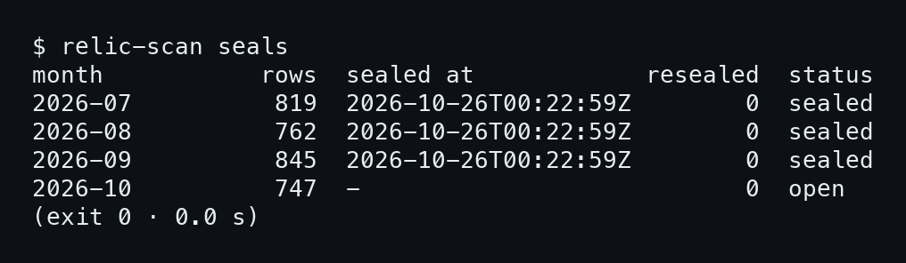
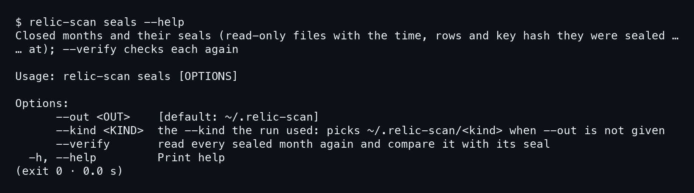
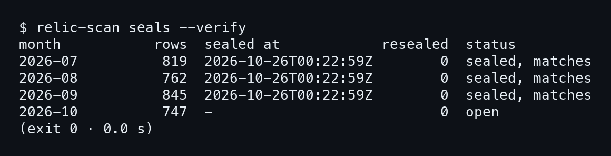
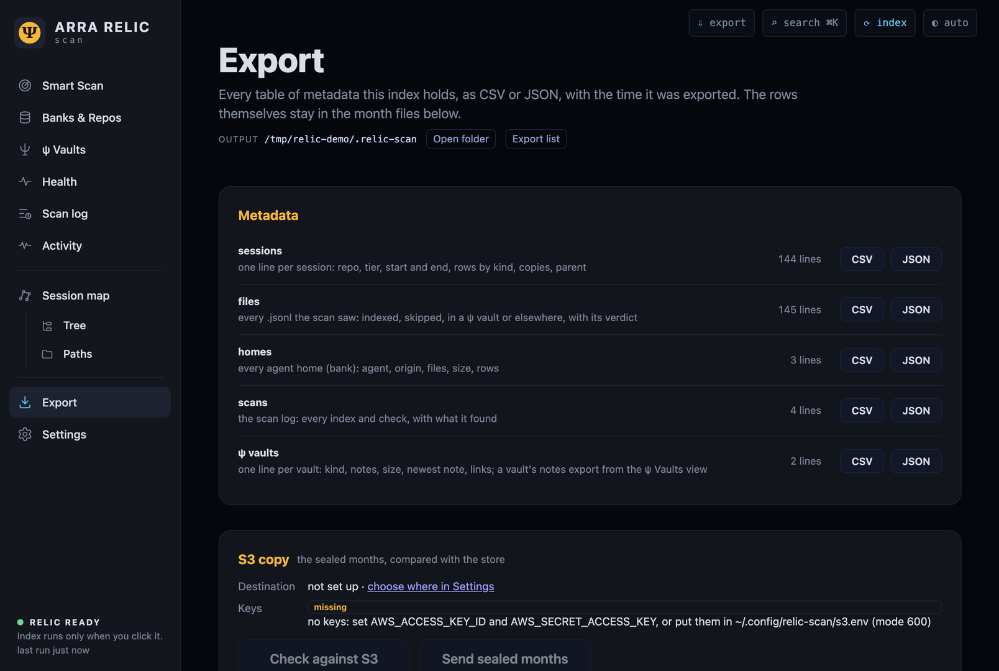
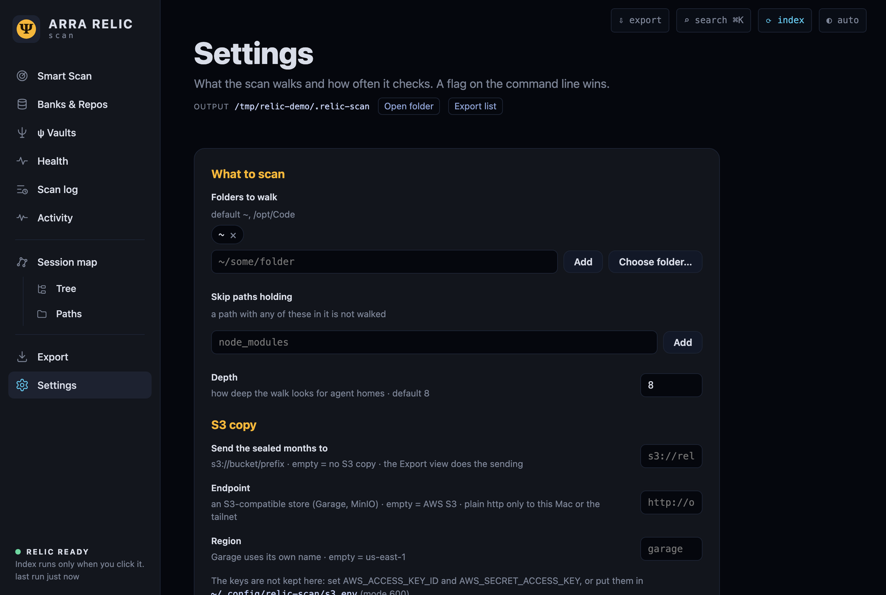
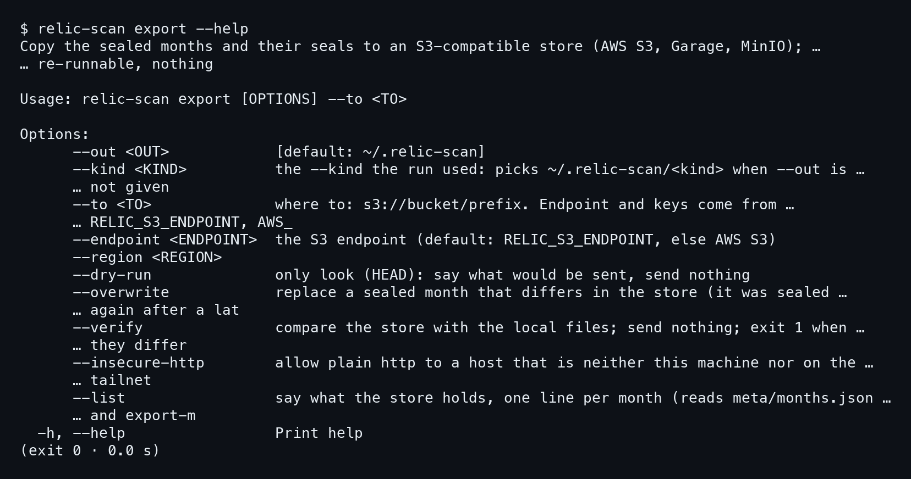

# บทที่ 7: เดือนที่ปิดผนึก และสำเนาไป S3

index ของ relic-scan แบ่งเป็นไฟล์ Parquet เดือนละหนึ่งไฟล์ ซึ่งมีจังหวะชีวิตของมันเอง เดือนปัจจุบันยังเปิดอยู่ ข้อมูลใหม่ไหลเข้ามาได้ตลอด พอเดือนนั้นผ่านไป relic-scan ก็ปิดผนึกมัน แล้วไฟล์จะกลายเป็นของที่แก้ไม่ได้ บทนี้ดูว่าผนึกคืออะไร ตรวจอย่างไรว่ายังเหมือนเดิม และส่งเดือนที่ปิดแล้วไปเก็บสำรองที่ S3 อย่างไร

ทุกอย่างในสองหัวข้อแรกรันจริงบนบ้านเดโม ส่วนหัวข้อที่สามเรื่อง S3 บนบ้านเดโมไม่มี store ให้ส่ง คำสั่งในหัวข้อนั้นจึงมาจาก AGENTS.md และไม่มีภาพผลลัพธ์

## 7.1 เดือนที่ปิดแล้วเป็นไฟล์อ่านอย่างเดียว

เดือนที่ "ปิด" คือเดือนที่อยู่ก่อนเดือนปัจจุบันตามเวลากรุงเทพ วันที่รันบ้านเดโมคือ 2026-10-26 เดือน 2026-07 ถึง 2026-09 จึงปิดแล้ว ส่วน 2026-10 ยังเปิด พอ relic-scan เห็นว่าเดือนไหนปิด มันจะจดผนึกไว้ แล้วตั้งไฟล์เดือนนั้นเป็นอ่านอย่างเดียว

### ขั้นที่ 1 — ดูสถานะผนึกของทุกเดือน

พิมพ์ `relic-scan seals` คำสั่งนี้อ่านอย่างเดียว ไม่เขียนอะไรเลย แต่ละบรรทัดคือหนึ่งเดือน บอกจำนวนแถว เวลาที่เห็นว่าปิด จำนวนครั้งที่ปิดซ้ำ และสถานะ

```bash
relic-scan seals
```



อ่านตารางแล้วได้ว่า **สามเดือนแรกเป็น sealed และเดือน 2026-10 ยังเป็น open** แถวของสามเดือนที่ปิดคือ 819, 762 และ 845 แถว ส่วนเดือนที่เปิดมี 747 แถว รวมกันได้ 3,173 แถวพอดี ตรงกับตัวเลขบนหน้า Smart Scan คอลัมน์ `sealed at` ของเดือนที่เปิดเป็นขีด `-` เพราะยังไม่มีเวลาปิดให้จด

```
2026-07          819  2026-10-26T00:22:59Z        0  sealed
2026-10          747  -                           0  open
```

คอลัมน์ `resealed` เป็น 0 ทุกเดือน ค่านี้นับว่าเดือนที่ปิดไปแล้วต้องปิดใหม่กี่ครั้ง เพราะมีแถวช้ามาถึงทีหลัง เช่น เครื่องอื่นเอา transcript เก่ามาสำรองไว้ทีหลัง ในเดโมไม่มีเหตุแบบนั้น ค่าจึงเป็นศูนย์

ถ้าอยากรู้ว่าคำสั่งนี้รับตัวเลือกอะไร ถาม `--help`

```bash
relic-scan seals --help
```



มีตัวเลือกให้ใช้ `--out`, `--kind` และ `--verify` ที่อ่านทุกเดือนที่ปิดซ้ำแล้วเทียบกับผนึก ซึ่งเป็นเรื่องของขั้นต่อไป

### ขั้นที่ 2 — ตรวจว่าเดือนที่ปิดยังเหมือนตอนปิด

ผนึกมีไว้ให้ตรวจ ใส่ `--verify` แล้ว relic-scan จะอ่านไฟล์ของแต่ละเดือนที่ปิดซ้ำอีกรอบ แล้วเทียบกับจำนวนแถวและ hash ของคีย์แถวที่จดไว้ตอนปิด

```bash
relic-scan seals --verify
```



สถานะของสามเดือนที่ปิดเปลี่ยนเป็น `sealed, matches` แปลว่า **ไฟล์วันนี้ตรงกับไฟล์ตอนปิดทุกแถว** เดือน 2026-10 ยังขึ้นแค่ `open` เพราะไม่มีผนึกให้เทียบ ถ้าไฟล์เดือนไหนถูกแก้หรือเสียหาย สถานะตรงนี้จะบอก ซึ่งเป็นเหตุผลที่ควรรัน `--verify` ก่อนส่งสำเนาไปไหน

### ขั้นที่ 3 — ดูผนึกดิบใน months.json

ตารางข้างบนอ่านมาจากไฟล์ `meta/months.json` ใช้ `jq` ดึงเดือนแรกมาดูทั้งก้อนได้ จะเห็นว่าผนึกคือข้อมูลธรรมดาไม่กี่ field

```bash
jq -c '.months[0]' ~/.relic-scan/meta/months.json
```

ผลลัพธ์ของคำสั่งนี้เป็นบรรทัด JSON เดียว ภาพเต็มอยู่ในบทที่ 6 หัวข้อ 6.7 ที่นี่อ่านเฉพาะ field ของผนึก ซึ่งเดือน 2026-07 ได้ `sealed_at` เป็น `2026-10-26T00:22:59Z` เท่ากับในตาราง seals ข้างบน

สามคู่ที่ต้องมองคือ `sealed_at` เวลาที่เห็นว่าปิด `sealed_rows` จำนวนแถวตอนนั้น และ `sealed_keys` hash ของคีย์แถวตอนนั้น **ถ้า `keys` กับ `sealed_keys` เท่ากัน แถวก็เท่ากัน** ใน JSON นั้น `keys` ของเดือน 2026-07 คือ `deb9bcc29d4996bd545ea8297889d90d` และ `sealed_keys` เป็นค่าเดียวกัน field `late_rows` คือแถวที่รอบนี้เพิ่มเข้ามาโดยมีเวลาเก่ากว่าแถวใหม่สุดเดิมของเดือน ปกติเป็น 0 ถ้าไม่เป็น 0 ก็คือเดือนที่ปิดแล้วมีของแทรกมา และ `resealed` จะขยับตาม

## 7.2 หน้า Export: metadata และสำเนา S3

พอรู้แล้วว่าเดือนไหนปิด ก็ถึงเวลาเอาออกไปข้างนอกได้ หน้า Export ของเว็บเป็นที่รวมของทั้งสองอย่าง คือ metadata ที่ดึงเป็นไฟล์ได้ทันที กับแผงสำเนา S3 เปิดหน้านี้ด้วย `relic-scan up` หรือ `relic-scan serve` แล้วเลือก Export ในเมนูซ้าย

### ขั้นที่ 1 — ดึง metadata เป็น CSV หรือ JSON

ตารางบนสุดของหน้าคือ Metadata แต่ละบรรทัดมีปุ่ม CSV กับ JSON ให้ดึงไปใช้ต่อ เช่นเอาไปเปิดใน spreadsheet



ตารางนี้ให้ **sessions 144 บรรทัด, files 145, homes 3, scans 4 และ ψ vaults 2** ตัวเลขชุดเดียวกับที่เห็นในหน้า Tree, Paths และ Vaults ของบทก่อน ๆ ข้อมูลที่ออกมาเป็นแค่ metadata ของ index ไม่ใช่เนื้อข้อความใน transcript

### ขั้นที่ 2 — อ่านแผง S3 copy

ใต้ตาราง คือแผง S3 copy ในภาพมันบอกว่ายังไม่ได้ตั้งปลายทาง และยังไม่มีคีย์ ปุ่ม Check against S3 กับ Send sealed months จึงใช้ไม่ได้ (ปุ่มส่งจางอยู่) นี่ตรงกับที่ AGENTS.md เขียนไว้ว่า **คีย์ไม่ถูกเก็บในหน้านี้เลย** หน้าเว็บตั้งได้แค่ปลายทาง

เมื่อตั้งครบแล้ว Check against S3 จะเทียบ store กับไฟล์ในเครื่อง และแสดงทีละเดือนว่า identical, older หรือ missing ส่วน Send sealed months จะส่งเฉพาะเดือนที่ปิดแล้ว คนที่ส่งคำขอไป S3 คือ server ไม่ใช่หน้าเว็บ หน้ายังคงไม่เรียกเครือข่ายเอง และการเขียนฝั่ง server ต้องมี header `X-Relic` ตามกฎของโค้ด

### ขั้นที่ 3 — ตั้งปลายทางในหน้า Settings

ปลายทางตั้งที่หน้า Settings ในส่วน S3 copy มีสามช่อง คือ destination, endpoint และ region ใน AGENTS.md ค่าเหล่านี้ถูกเก็บในไฟล์ `_config.json` ในชื่อ `s3.to`, `s3.endpoint` และ `s3.region`



ภาพนี้ยังเห็นส่วน What to scan ด้วย (โฟลเดอร์ที่เดิน skip paths และ depth 8) ซึ่งเป็นเรื่องของบทที่ 4 ส่วนที่เกี่ยวกับบทนี้คือส่วนล่าง ช่อง endpoint ใช้เมื่อ store ไม่ใช่ AWS S3 จริง เช่น Garage หรือ MinIO ที่ต้องมี endpoint แบบ path-style ถ้าไม่ตั้ง relic-scan ถือว่าเป็น AWS S3

ส่วนคีย์ AGENTS.md ให้วางไว้สองที่เท่านั้น คือใน environment (`AWS_ACCESS_KEY_ID` กับ `AWS_SECRET_ACCESS_KEY`) หรือในไฟล์ `~/.config/relic-scan/s3.env` เป็นบรรทัด `KEY=VALUE` ที่ตั้งสิทธิ์ 600 ไฟล์ที่คนอื่นอ่านได้ relic-scan จะปฏิเสธไม่ใช้ ไฟล์นี้คือที่ที่แอปซึ่งเปิดจาก Finder ใช้อ่านคีย์

## 7.3 ส่งไป S3 จากบรรทัดคำสั่ง

ในบ้านเดโมไม่มี store ให้ส่ง บล็อกในหัวข้อนี้จึงคัดมาจาก AGENTS.md ตามตัวอักษร ไม่ได้รันในการสาธิต และไม่มีภาพผลลัพธ์ให้ดู ผลลัพธ์จริงบนเครื่องของคุณอาจต่างไปจากที่คิดไว้ ให้อ่านผลบนหน้าจอของตัวเองเป็นหลัก

### ขั้นที่ 1 — ตั้งปลายทางและคีย์ในสภาพแวดล้อม

ก่อนส่ง ตั้งตัวแปรสองสามตัวใน shell **คีย์ห้ามพิมพ์ในบรรทัดคำสั่ง** เพราะจะค้างอยู่ใน history และ process list

```
export RELIC_S3_ENDPOINT=http://odin.follow-rankine.ts.net:3920
export AWS_ACCESS_KEY_ID=… AWS_SECRET_ACCESS_KEY=…
```

`RELIC_S3_ENDPOINT` ไม่ต้องตั้งถ้าใช้ AWS S3 จริง ส่วน `RELIC_S3_REGION` มีค่าเริ่มต้น us-east-1 ตัวอย่างข้างบนคือ Garage ที่ตั้งอยู่บน tailnet ตามที่ AGENTS.md ใช้อธิบาย และ **http ธรรมดาอนุญาตเฉพาะเครื่องนี้หรือ tailnet (`*.ts.net`, `100.64/10`)** นอกนั้นต้องใส่ `--insecure-http`

ตัวเลือกทั้งหมดของ `export` ดูได้จาก `--help` (ผลนี้รันจริง ต่างจากบล็อกด้านล่าง)

```bash
relic-scan export --help
```



ในภาพ `--to` เป็นตัวเลือกบังคับ (ในบรรทัด Usage) ส่วนที่เหลือที่ขั้นต่อ ๆ ไปใช้ คือ `--dry-run`, `--verify`, `--list`, `--overwrite` และ `--insecure-http` ส่วน `--endpoint` กับ `--region` ใช้แทนตัวแปร `RELIC_S3_ENDPOINT` และ `RELIC_S3_REGION`

### ขั้นที่ 2 — ลองก่อนด้วย --dry-run

คำสั่งแรกที่ควรรันคือ `--dry-run` มัน**ส่งแค่คำขอ HEAD ไปถาม store** แล้วบอกว่าจะส่งอะไร ไม่เขียนอะไรลง store

```
relic-scan export --to s3://bucket/relic --dry-run
```

ตัวอย่างนี้ไม่ได้รันในเดโม เพราะไม่มี store ผลที่ได้คือรายการเดือนที่จะถูกส่ง ถ้า store มีเดือนนั้นอยู่แล้วและ sha256 ตรง มันก็ไม่ถูกส่งซ้ำ

### ขั้นที่ 3 — ส่งจริง

พอพอใจกับรายการ ก็ตัดคำว่า `--dry-run` ออก

```
relic-scan export --to s3://bucket/relic
```

คำสั่งนี้ส่งเดือนที่ปิดแล้ว จากนั้นส่ง `meta/months.json` (ผนึก) และ `export-manifest.json` แต่ละ object เก็บ sha256 ไว้ใน `x-amz-meta-sha256` จึง **รันซ้ำแล้วไม่ส่งของที่อยู่ใน store แล้ว** เดือนที่ยังเปิดอยู่ไม่ถูกส่ง และ relic-scan ไม่ list หรือลบอะไรใน store เลย

### ขั้นที่ 4 — ตรวจและดูรายการ

หลังส่ง ใช้ `--verify` **เทียบ store กับไฟล์ในเครื่อง** ถ้าต่างกันคำสั่งจะออกด้วยรหัส 1 หรือใช้ `--list` ดูว่า store มีอะไรบ้าง

```
relic-scan export --to s3://bucket/relic --verify
relic-scan export --to s3://bucket/relic --list
```

`--list` พิมพ์หนึ่งบรรทัดต่อเดือน มีจำนวนแถว วันที่ ขนาด sha256 และผนึก โดยอ่านแค่สองไฟล์เล็ก ไม่ list ทั้ง store

### ขั้นที่ 5 — เมื่อเดือนที่ปิดแล้วต้องปิดใหม่

บางครั้งมีแถวช้ามาถึงเดือนที่ปิดไปแล้ว ผนึกจึงเปลี่ยน (`resealed` เพิ่ม) เดือนนั้นใน store ก็ต่างจากไฟล์ในเครื่อง ตอนนี้ **export จะปฏิเสธการเขียนทับ** เว้นแต่ใส่ `--overwrite` ตามที่ AGENTS.md ระบุ

```
relic-scan export --to s3://bucket/relic --overwrite
```

scripts/README.md บอกเรื่องเดียวกันถึงงานสำรองตอนกลางคืน `relic-export-nightly` ที่ timer รัน มันไม่ทับเดือนที่ปิดแล้ว ถ้าอยากทับต้องรัน `--overwrite` ด้วยมือ นี่เป็นการออกแบบที่ตั้งใจ เพื่อไม่ให้งานอัตโนมัติเขียนทับสำเนาเก่าที่ยังดีอยู่โดยไม่มีใครเห็น

เรื่องสำเนาไปข้างนอกจบแค่นี้ บทต่อไปดูทางเดินทั้งเส้นของข้อมูล ตั้งแต่ relic-scan ไปถึง hub และดูว่า `SYNC OK` บอกอะไร
