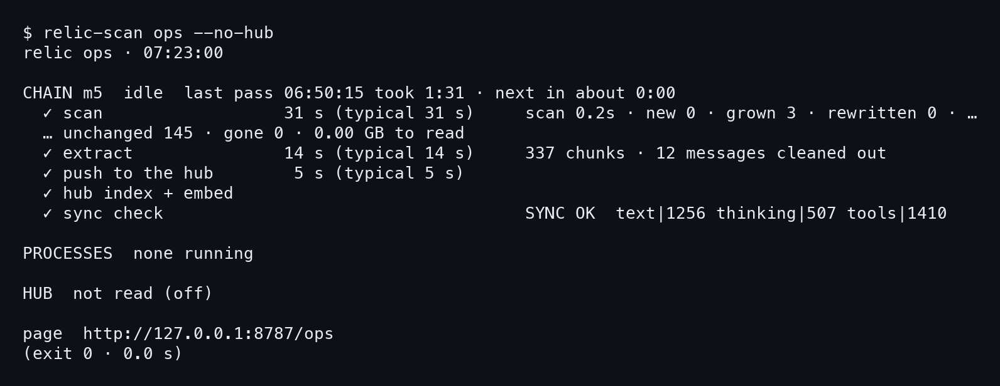
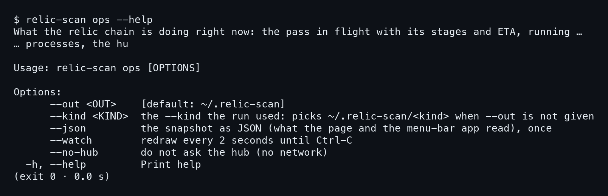
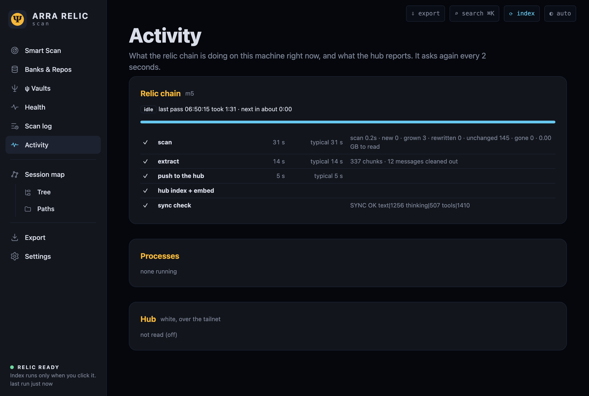
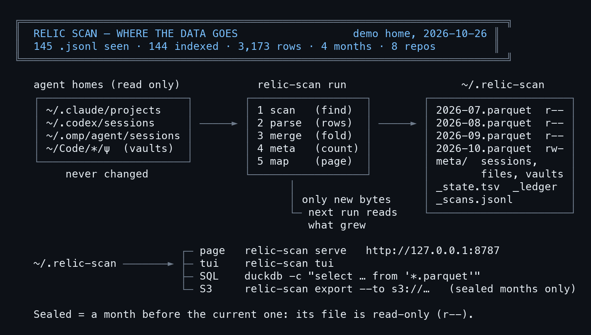

# บทที่ 8: ทางเดินของข้อมูลข้ามเครื่อง

relic-scan ไม่ได้ทำงานโดดเดี่ยว บนเครื่องของทีมเขา มันเป็นขั้นแรกของ chain สามขั้นที่ส่งข้อมูลต่อกันไปจนถึง hub ที่รวมประวัติจากหลายเครื่อง บทนี้เปิดดูว่า chain ทำอะไรอยู่ตอนนี้ด้วย `relic-scan ops` หน้า Activity และแท็บ ops ในเทอร์มินัล แล้วอธิบายว่าแต่ละขั้นคืออะไร และเส้นสุดท้าย `SYNC OK` ยืนยันอะไร

ตัวเลขทุกตัวในบทนี้มาจากการรันบนบ้านเดโมในเครื่อง m5 ของทีม ซึ่งมี chain รันอยู่จริง เนื้อหาเรื่อง relic-extract และ hub มาจาก docs/TUTORIAL.md กับ docs/TALK.md ไม่มีตัวเลขเพิ่มเติมนอกจากที่เห็นในภาพ

## 8.1 relic-scan ops: ดู chain ทั้งเส้น

`relic-scan ops` แสดงว่า chain กำลังทำอะไร ขั้นไหนใช้เวลาเท่าไร มี process อะไรรันอยู่ และ hub อยู่ในสถานะไหน มันเป็นคำสั่งอ่านอย่างเดียวเหมือน `seals`

### ขั้นที่ 1 — รัน ops โดยไม่แตะ hub

ปกติ ops อ่านสถานะของ hub ด้วยคำขอ GET หนึ่งครั้ง ซึ่งเป็นการเรียกเครือข่ายอย่างเดียวของคำสั่งนี้ ถ้าไม่อยากให้ออกไปเลย ใส่ `--no-hub` ตัวแปร `RELIC_OPS_HUB=off` ให้ผลเหมือนกัน

```bash
relic-scan ops --no-hub
```



บรรทัดแรกของ chain บอกเครื่อง สถานะ และรอบล่าสุด

```
CHAIN m5  idle  last pass 06:50:15 took 1:31 · next in about 0:00
```

อ่านได้ว่า **chain บนเครื่อง m5 ว่างอยู่ รอบล่าสุดเริ่ม 06:50:15 ใช้เวลา 1:31** `idle` แปลว่าไม่มีขั้นไหนกำลังทำงานตอนนี้ ส่วน `HUB  not read (off)` ตรงบรรทัดล่างเป็นผลของ `--no-hub` ไม่ใช่ hub ล่ม

### ขั้นที่ 2 — อ่านห้าขั้นทีละบรรทัด

ใต้บรรทัดหัวมีห้าขั้น แต่ละขั้นมีเครื่องหมายถูก เวลาที่ใช้ครั้งนี้ ตามด้วยเวลาปกติ (`typical`) ในวงเล็บ แล้วเป็นรายละเอียดด้านขวา

```
✓ scan                  31 s (typical 31 s)   scan 0.2s · new 0 · grown 3 …
✓ extract               14 s (typical 14 s)     337 chunks · 12 messages …
✓ push to the hub        5 s (typical 5 s)
✓ hub index + embed
✓ sync check                                    SYNC OK  text|1256 …
```

เวลา **ครั้งนี้เท่ากับเวลาปกติทุกขั้น** แปลว่ารอบนี้ไม่ช้ากว่าเคย ถ้าขั้นไหนช้าผิดปกติ ตัวเลขสองตัวนี้ต่างกันทันที ให้ดูขั้น scan ที่รายละเอียดเป็นสรุปของ `relic-scan run` ที่เราคุ้นจากบทที่ 2 คือ new 0, grown 3, rewritten 0, unchanged 145, gone 0 เปิดไฟล์ที่ต้องอ่านเพิ่ม 0.00 GB นั่นคือรอบนี้ transcript โตแค่ 3 ไฟล์

### ขั้นที่ 3 — ขั้นที่เหลือและ process

ขั้น extract รายงานว่า**ตัดได้ 337 chunks** และตัดข้อความออกมาได้ 337 chunks และกรองทิ้ง 12 messages ขั้น push to the hub ส่งผลไปที่ hub ขั้น hub index + embed ไม่แสดงรายละเอียดฝั่งนี้เพราะงานเกิดบน hub เอง ส่วนบรรทัดที่สี่ `PROCESSES  none running` แปลว่าขณะที่รันคำสั่ง ไม่มี process ของ chain ค้างอยู่

ท้ายเอาต์พุตมีบรรทัด `page  http://127.0.0.1:8787/ops` ที่ชี้ไปหน้า Activity ถ้าเปิดบน terminal ที่รองรับ ลิงก์ทั้งสองคลิกได้ ตัวแปร `RELIC_LINKS=off` หรือ `NO_COLOR` ปิดลิงก์ และ `RELIC_PAGE_URL` ย้ายที่อยู่ของหน้า ใส่ `--watch` เมื่ออยากให้จอรีเฟรชต่อเนื่อง และ `--json` เมื่อต้องการให้เครื่องมืออื่นอ่าน

### ขั้นที่ 4 — ดูตัวเลือกของ ops

อยากรู้ว่า ops รับอะไรได้บ้าง ให้ถาม `--help` ตัวเลือก **`--no-hub` คือทางเดียวที่ทำให้คำสั่งนี้ไม่ใช้เครือข่ายเลย**

```bash
relic-scan ops --help
```



มีตัวเลือกหกตัวรวม `--help` ตัวที่ใช้บ่อยคือ `--watch` ที่วาดจอใหม่ทุก 2 วินาทีจนกด Ctrl-C และ `--json` ที่พิมพ์สแนปช็อตเป็น JSON หนึ่งครั้งให้หน้าเว็บกับแอปเมนูบาร์อ่าน ส่วน `--out` กับ `--kind` ชี้ไปโฟลเดอร์ index ที่ run ใช้

อยากเทียบผล ให้รันแบบไม่แตะ hub อีกครั้ง

```bash
relic-scan ops --no-hub
```


ภาพนี้ซ้ำจากขั้นที่ 1 เพื่อให้เทียบกับ `--no-hub` ตรงหน้า: ได้เอาต์พุตห้าขั้นเดิม ไม่มี HUB ที่อ่านจากเครือข่าย

## 8.2 หน้า Activity

หน้า Activity แสดงข้อมูลชุดเดียวกันบนเว็บ เปิดจาก `relic-scan up` แล้วเลือก Activity ในเมนูซ้าย ที่อยู่คือ `/ops` ตามบรรทัด page ข้างบน

### ขั้นที่ 1 — เปิดหน้า Activity

หน้านี้แบ่งเป็นสามการ์ด คือ Relic chain, Processes และ Hub หน้าเว็บเองไม่เรียกเครือข่าย ส่วนการ์ด Hub อ่านสถานะด้วย GET หนึ่งครั้งตามที่ AGENTS.md ระบุ



ภาพนี้บอกเรื่องเดียวกับ `ops` **การ์ด Relic chain มีห้าขั้นเรียงจาก scan จนถึง sync check** การ์ด Processes ว่างเปล่า และการ์ด Hub ขึ้นว่าไม่ได้อ่าน เพราะปิดไว้ ข้อดีของหน้านี้คือเปิดทิ้งไว้ได้โดยไม่ต้องพิมพ์ซ้ำ และเห็นรอบใหม่เข้ามาเอง

## 8.3 จาก relic-scan ไปถึง hub

chain สามขั้นตามที่ docs/TUTORIAL.md เขียนไว้ แต่ละขั้นอ่านผลของขั้นก่อนโดยไม่เคยแก้มัน

```
 relic-scan                 relic-extract                      relic4 embed
 find + index       ──►  pick, clean, dedupe, cut  ──►  vectors, search
 ~/.relic-scan/           ~/.relic-extract/<stream>/
```



ภาพนี้เห็นสองอย่างที่ร้อยแก้วไม่ได้บอก คือ **โฟลเดอร์ต้นทางไม่ถูกแก้เลย** และไฟล์เดือนที่ปิดแล้วเป็น `r--` มีแต่เดือนปัจจุบัน `rw-` ตัวเลขบนหัวภาพคือ 145 ไฟล์ที่เห็น, 144 ที่ทำ index, 3,173 แถว, 4 เดือน และ 8 repo

ผังนี้คัดมาจากบทนำของ TUTORIAL.md คำสั่งต่อไปนี้ไม่ได้รันในการสาธิต เพราะ relic-extract กับ agent-relic-v4 เป็น repo ส่วนตัวในตอนนี้ ผู้อ่านที่ไม่มีสิทธิ์เข้าจึงรันขั้นสองและสามเองไม่ได้ ส่วน relic-scan เป็นขั้นเดียวที่เปิดสาธารณะ

### ขั้นที่ 1 — relic-scan หาและทำ index

ขั้นแรกคือสิ่งที่เล่มนี้เล่ามาตลอด คือหา transcript ของ Claude Code, Codex, OMP, OMX, Gemini, Pi และ thClaws บนเครื่อง พร้อม ψ vault ทุกแห่ง แล้วทำเป็น Parquet รายเดือนใน `~/.relic-scan` และเพราะ ledger ทำให้ **สำเนาที่มาจากเครื่องอื่นเสียแค่ค่า hash ไม่ต้องเสียค่า parse** รอบประจำวันของ chain จึงเร็ว

### ขั้นที่ 2 — relic-extract ตัดเป็น chunk

ขั้นที่สองอ่านไฟล์เดือนของ relic-scan แล้ว**ตัดเป็นหนึ่งแถวต่อหนึ่ง chunk** แล้วเขียนส่วนที่ต้องเอาไป embed ออกมาเป็นหนึ่งแถวต่อหนึ่ง chunk ไฟล์ TOML เดียวกำหนดว่าจะเอาอะไรเข้า และเครื่องมือจะทำความสะอาด ตัดข้อความซ้ำ และตัดชิ้น เอาต์พุตอยู่ใน `~/.relic-extract/<stream>/YYYY-MM.parquet` มีสาย text, thinking และ tools

บรรทัด `337 chunks · 12 messages cleaned out` ในภาพ 20-ops คือผลของขั้นนี้ในรอบล่าสุด และตัวเลข text, thinking, tools ที่ปลายบรรทัด SYNC OK ก็เป็นสายเดียวกันนี้

### ขั้นที่ 3 — push แล้ว hub ทำ index และ embed

ขั้น push **ส่งผลไปที่ hub** (repo `relic5` พอร์ต 8795 บนเครื่อง white ตาม TALK.md) ขั้น hub index + embed รันบน hub เอง ใช้ relic4 ที่ embed เฉพาะ key ที่ยังไม่มี vector ข้อความเดียวกันจึงได้ vector เดียวกันไม่ว่าอยู่เดือนไหน

TALK.md เล่าด้วยว่าสามส่วนนี้มี agent ประจำ repo ของตัวเอง relic4-scan ดูแล index relic5 ดูแล hub และ relic-extract ดูแลข้อความที่ตัดออกมา ทุกฝ่ายอยู่ใน repo ของตัวเองและขอการเปลี่ยนแปลงจากกัน ข้อควรจำจากเอกสารนั้นมีข้อเดียวที่เกี่ยวกับผู้ใช้ปกติ คือ **ถ้าตัวเลขบน hub ดูผิด ให้เช็ก index ของเครื่องเองก่อน** ด้วย DuckDB บน `~/.relic-scan/meta/sessions.parquet` ถ้าเครื่องถูก บั๊กอยู่ที่การรวมข้อมูลบน hub

## 8.4 ตรวจว่า sync ตรงกัน

บรรทัดสุดท้ายของ chain คือการยืนยันว่าสิ่งที่เครื่องส่ง กับสิ่งที่ hub ถืออยู่ ตรงกัน

### ขั้นที่ 1 — อ่านบรรทัด SYNC OK

ในภาพ 20-ops ขั้น sync check ขึ้นว่า

```
SYNC OK  text|1256 thinking|507 tools|1410
```

สามตัวเลขนี้เป็นสาย text, thinking และ tools ตามลำดับ และบวกกันได้ 1256 + 507 + 1410 = 3,173 เท่ากับจำนวนแถวบนหน้า Smart Scan ของบ้านเดโม TALK.md ระบุว่า **ทุกรอบของ chain จบด้วยบรรทัด SYNC OK แบบนี้** ที่ m5 และ mba ถูกเขียนไว้ใน `~/Library/Logs/relic-chain.log` ส่วนบน white อยู่ที่ `~/.local/state/relic-chain.log` และ `/api/status` ของ hub (`freshness.machines.*.sync`) ต้องแสดงเลขสามตัวเดียวกัน

### ขั้นที่ 2 — ดูแท็บ ops ในเทอร์มินัล

แท็บที่หกของ `relic-scan tui` คือ ops ใช้ข้อมูลเดียวกัน รีเฟรชทุก 2 วินาที และมี process ที่รันอยู่ให้ดูเพิ่ม

```bash
relic-scan tui
```

ภาพของแท็บนี้อยู่ในบทที่ 5 หัวข้อ 5.4 ห้าขั้นของ chain ที่เห็นตรงกับ `relic-scan ops` ทุกบรรทัด

ในกรอบ ops **ส่วน `PROCESSES` ขึ้นว่า `none running`** และ `HUB  not read (off)` เหมือนกับ `relic-scan ops --no-hub` ตัวเลข SYNC OK ในจอนี้ (`text|1256 thinking|507 tools|1410`) ตรงกับที่เห็นใน `relic-scan ops` ทุกตัว เพราะอ่านจากรอบเดียวกัน

### ขั้นที่ 3 — เมื่อเลขสองฝั่งไม่ตรงกัน

TALK.md ให้เกณฑ์ไว้ชัด **เลขไม่ตรงที่ค้างเกินสองรอบ**คือเรื่องที่ควรแจ้งทีม relic5 ส่วนคำเตือน `relic-scan differs between machines` ที่ขึ้นหลังติดตั้งเวอร์ชันใหม่ จะหายเองเมื่อแต่ละเครื่อง push ด้วยไฟล์ใหม่แล้ว

อีกข้อที่ทีมเจอจริงคือการเปลี่ยนไฟล์ binary ที่กำลังรันอยู่ TALK.md แนะให้ `rm -f` แล้วค่อย `cp` และทำหลังจาก build ตัวใหม่เสร็จเท่านั้น เพราะบนเครื่อง white เคยมีครั้งที่ `cp` ล้มหลัง `rm` แล้ว relic-scan หายไปหกนาที ดูรายละเอียดเรื่องนี้อีกครั้งในหัวข้อ 9.4

ถึงตรงนี้ได้เห็นแล้วว่าข้อมูลเดินไปไหนบ้าง บทสุดท้ายของภาคนี้ตอบคำถามที่ควรถามก่อนรันคำสั่งแรก คือ relic-scan แตะอะไรบนเครื่องคุณ
