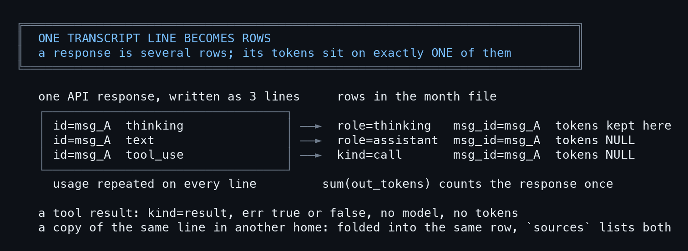
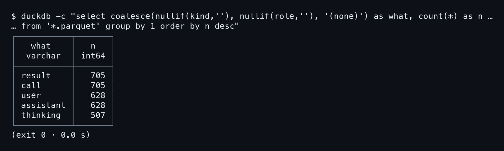
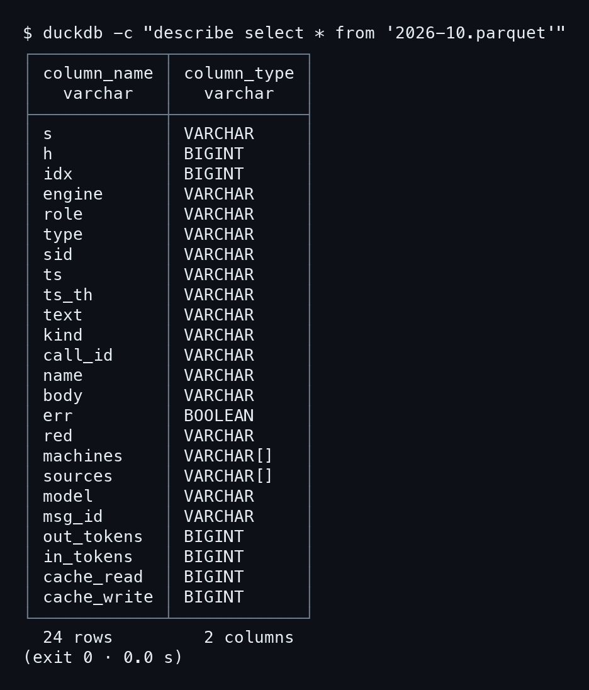
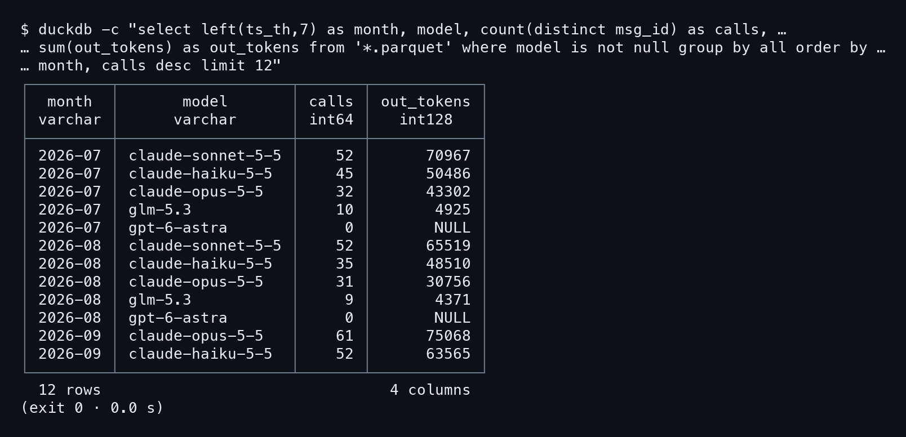
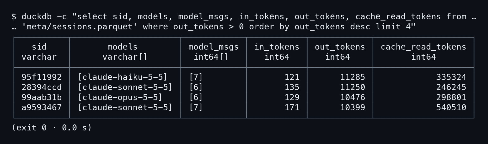
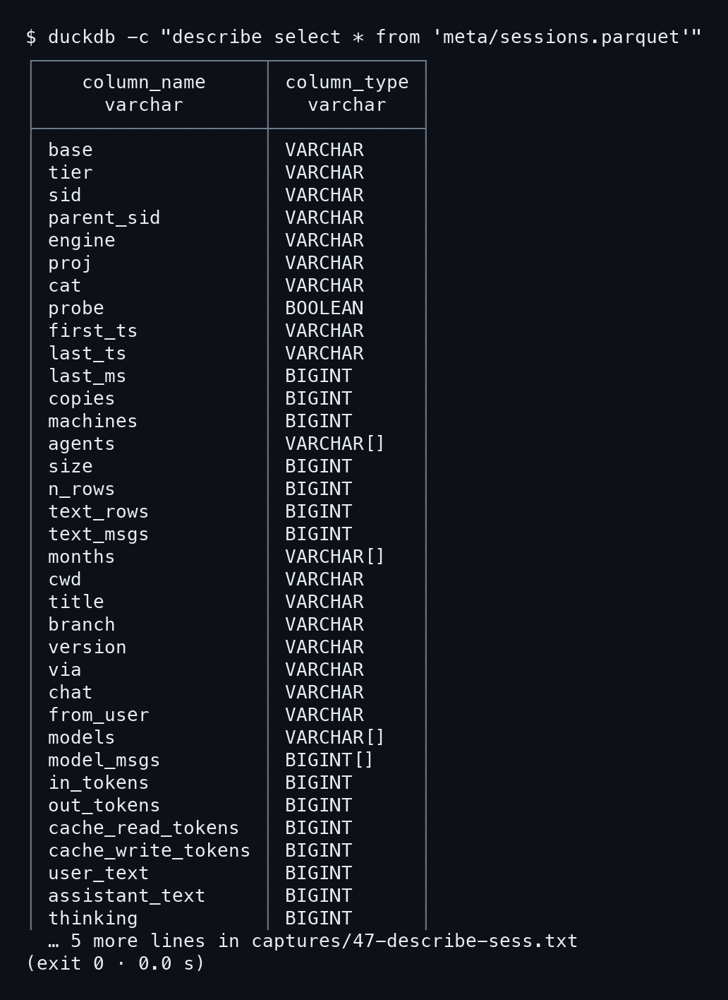
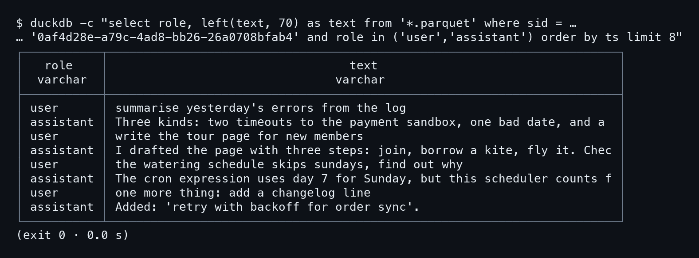

# บทที่ 10: รูปแบบของ transcript ที่ relic-scan อ่าน

บทนี้เป็นบท protocol ของหนังสือ ตอบคำถามเดียวว่า บรรทัดใน `.jsonl` หน้าตาเป็นยังไง แล้ว relic-scan หยิบ field ไหนไปทำเป็นแถวใน Parquet. ตัวอย่างทุกบรรทัดมาจาก `book/make-demo-home.py` ซึ่งสร้าง transcript ของ demo home ด้วยรูปทรงเดียวกับของจริง (ค่าในนั้นแต่งขึ้นหมด). ส่วนที่อ่านจากซอร์สคือ `src/engine.rs`, `src/meta/rules.rs`, `src/meta/agg.rs`, `src/parse/merge.rs`.

ป้ายที่ใช้ในบท: [capture] คือมีผลจริงใน `captures/` ให้เทียบ ส่วน [source] คือยืนยันจากการอ่านโค้ด ไม่ได้รันซ้ำในบทนี้.

## 10.1 Claude Code: หนึ่งบรรทัด หนึ่ง event

ไฟล์อยู่ใต้ `~/.claude/projects/<project-dir>/<session-uuid>.jsonl`. บรรทัดหนึ่งเป็น JSON object หนึ่งตัว มี `type` บอกชนิด (`user`, `assistant`, `custom-title`, `summary`) กับ `sessionId`, `timestamp`, `cwd`, `gitBranch`, `version`.

### ขั้นที่ 1 — ดูบรรทัด assistant ที่มี usage

บรรทัดข้างล่างสร้างจาก `claude_session()` ใน make-demo-home.py (ตัดให้สั้น จัดบรรทัดใหม่เป็น pretty JSON). **assistant หนึ่ง response แตกเป็นหลายบรรทัด** บรรทัดละ content block เดียว และทุกบรรทัดแปะ `message.id` กับ `usage` ชุดเดียวกันซ้ำ.

```json
{
  "type": "assistant",
  "timestamp": "2026-07-03T09:14:22Z",
  "sessionId": "0af4d28e-a79c-4ad8-bb26-26a0708bfab4",
  "cwd": "/opt/Code/github.com/laris-co/kite-docs",
  "gitBranch": "main",
  "version": "2.1.40",
  "message": {
    "id": "msg_0af4d28e_0",
    "role": "assistant",
    "model": "claude-opus-5-5",
    "usage": {
      "input_tokens": 21,
      "output_tokens": 1180,
      "cache_read_input_tokens": 4200,
      "cache_creation_input_tokens": 900
    },
    "content": [
      { "type": "tool_use", "id": "toolu_0af4d2_0_0",
        "name": "Bash", "input": { "command": "ls" } }
    ]
  }
}
```

ตัวเลขใน usage ตัวอย่างนี้แต่งเพื่อให้อ่านง่าย ไม่ใช่ค่าจาก capture. สิ่งที่ relic-scan อ่านจากบรรทัดแบบนี้ [source: engine.rs `extract`, `usage_of`, `extract_tools`]:

- `sessionId` เป็นรหัส session, `timestamp` เป็นเวลา (เก็บทั้ง UTC และ `ts_th` เวลากรุงเทพ)
- `message.role` เป็น `user` หรือ `assistant`; ถ้าเป็น `developer`, `system` หรือ `toolResult` จะไม่เป็นแถวข้อความ
- `message.content` เป็น string ธรรมดา (ข้อความของ user) หรือ array ของ block: `text`, `thinking`, `tool_use`, `tool_result`
- `message.model`, `message.id`, `usage.output_tokens`, `input_tokens`, `cache_read_input_tokens`, `cache_creation_input_tokens`
- `cwd`, `gitBranch`, `version` ไปลง `meta/sessions.parquet`; ชื่อ session มาจากบรรทัด `custom-title`

### ขั้นที่ 2 — ดูผลลัพธ์ของเครื่องมือกลับมา

ผลของ tool มาเป็นบรรทัด `type: user` ที่ content เป็น array ของ `tool_result`. คู่กับ call ด้วย `tool_use_id` ซึ่งตรงกับ `id` ของ `tool_use`. **`is_error: true` คือที่มาของคอลัมน์ `err`.**

```json
{
  "type": "user",
  "sessionId": "0af4d28e-a79c-4ad8-bb26-26a0708bfab4",
  "message": {
    "role": "user",
    "content": [
      { "type": "tool_result",
        "tool_use_id": "toolu_0af4d2_0_0",
        "content": "README.md  src",
        "is_error": false }
    ]
  }
}
```

บรรทัดไหนที่ JSON พัง หรือบรรทัดสุดท้ายที่ยังเขียนไม่จบ relic-scan จะไม่เอา: ตัดที่ `\n` ตัวสุดท้าย เว้นแต่ท้ายไฟล์ parse เป็น JSON ได้ **[source: parse/mod.rs `complete`]**. รอบหน้าไฟล์โตขึ้นก็อ่านต่อจาก offset เดิม ผลเท่ากับอ่านใหม่ทั้งไฟล์ (มี test `incremental_equals_cold` ใน parse/tests.rs).

## 10.2 Codex rollout: ห่อด้วย payload

Codex เก็บเป็น `~/.codex/sessions/YYYY/MM/DD/rollout-<เวลา>-<uuid>.jsonl` (หรือ `.jsonl.zst` ที่เก็บแล้ว ซึ่งถอดระหว่างอ่าน). ทุกบรรทัดมี `type` ชั้นนอก กับ `payload` ชั้นใน ไม่มี `message`.

### ขั้นที่ 1 — สามชนิดบรรทัดที่ต้องรู้

`session_meta` ให้รหัส session (`payload.id`) กับ `cwd`. `turn_context` ให้ชื่อโมเดล (`payload.model`). `response_item` คือเนื้อหา. **Codex ไม่เขียนโมเดลบนข้อความเอง** relic-scan จึงจำโมเดลจาก `turn_context` ล่าสุดแล้วแปะให้แถวที่ตามมา.

```json
{ "type": "session_meta", "timestamp": "2026-07-05T03:00:00Z",
  "payload": { "id": "5d1c…", "cwd": "/Users/demo/Code/moss-cli" } }
{ "type": "turn_context", "timestamp": "2026-07-05T03:00:00Z",
  "payload": { "model": "gpt-6-astra",
               "cwd": "/Users/demo/Code/moss-cli" } }
{ "type": "response_item", "timestamp": "2026-07-05T03:01:10Z",
  "payload": { "type": "message", "role": "assistant",
    "content": [ { "type": "output_text", "text": "Added." } ] } }
```

ส่วน tool ของ Codex อยู่ใน `response_item` เหมือนกัน แต่ `payload.type` เป็น `function_call` (ชื่อใน `name`, อาร์กิวเมนต์ใน `arguments`), `custom_tool_call`, และผลเป็น `function_call_output` จับคู่ด้วย `call_id`. ส่วน `reasoning` อ่านจาก `summary` เพราะเนื้อคิดจริงเข้ารหัส **[source: engine.rs `extract_tools`, `thinking_of`, `turn_model`]**.

ผลที่เห็นบนจอ **[capture 16]**: แถวของ `gpt-6-astra` นับ `calls` ได้ 0 และ `out_tokens` เป็น `NULL` ทุกเดือน เพราะไม่มี `msg_id` และไม่มี usage ให้เก็บ.

## 10.3 omp: message ชั้นเดียว ชื่อ field ต่างออกไป

omp (และ pi) เก็บใต้ `~/.omp/agent/sessions/<project>/<เวลา>_<uuid>.jsonl`. บรรทัดเป็น `type: "message"` แล้วมี `message` ข้างใน หน้าตาคล้าย Claude แต่ id กับ usage ใช้ชื่อสั้นกว่า.

### ขั้นที่ 1 — ดูชื่อ field ที่ต่าง

```json
{
  "type": "message",
  "id": "a0",
  "timestamp": "2026-07-04T10:02:31Z",
  "message": {
    "role": "assistant",
    "model": "glm-5.3",
    "responseId": "r_95f119_0",
    "usage": { "input": 412, "output": 230,
               "cacheRead": 1800, "cacheWrite": 0 },
    "content": [ { "type": "text", "text": "Done." } ]
  }
}
```

เทียบชื่อ field ของ Claude กับ omp (จาก `usage_of` ใน engine.rs **[source]**):

- response id: Claude `message.id`, omp `message.responseId`
- output: `usage.output_tokens` กับ `usage.output`
- input: `usage.input_tokens` กับ `usage.input`
- cache read: `usage.cache_read_input_tokens` กับ `usage.cacheRead`
- cache write: `usage.cache_creation_input_tokens` กับ `usage.cacheWrite`

โค้ดลองชื่อแบบ Claude ก่อน ไม่เจอก็ใช้ชื่อแบบ omp. ผลของ tool ใน omp มาเป็น `message.role == "toolResult"` พร้อม `toolCallId`, `toolName`, `isError` และ call เป็น block ชนิด `toolCall` (อาร์กิวเมนต์ใน `arguments`). แถวพวกนี้เป็น tool row อยู่แล้ว จึงไม่นับเป็นข้อความซ้ำอีก.

## 10.4 บรรทัดหนึ่งกลายเป็นแถวได้ยังไง

### ขั้นที่ 1 — อ่านกฎที่ตัดสินชนิดของแถว

บรรทัดหนึ่งแตกได้เป็นหลาย "stream": `text` (ข้อความ user/assistant), `thinking`, และ `tools` (call กับ result). ตามที่เห็นใน `types_of` ของ agg.rs ตัวเดียวนี้ตัดสินว่าแถวนั้นนับเป็นอะไร:

```rust
pub(super) fn types_of(s: &str, role: Option<&str>, kind: Option<&str>, err: bool) -> [i64; 6] {
    let mut t = [0; 6];
    match (s, role, kind) {
        ("text", Some("user"), _) => t[0] = 1,
        ("text", Some("assistant"), _) => t[1] = 1,
        ("thinking", _, _) => t[2] = 1,
        ("tools", _, Some("call")) => t[3] = 1,
        ("tools", _, Some("result")) => {
            t[4] = 1;
            t[5] = err as i64;
        }
        _ => {}
    }
    t
}
```

อ่านแล้วได้กฎตามนี้ **[source]**: ข้อความมี `role` แต่ไม่มี `kind`; tool มี `kind` (`call` หรือ `result`) แต่ไม่มี `role`; thinking ไม่ขึ้นกับ role. error คือ result ที่ `err` จริง จึงถูกนับใน results ด้วย.



ภาพนี้เห็นสิ่งที่โค้ดข้างบนไม่ได้บอกตรง ๆ คือ สามบรรทัดของ msg_A กลายเป็นสามแถว แต่ token อยู่แถว thinking แถวเดียว อีกสองแถวเป็น NULL และสำเนาจากอีก home พับเข้าแถวเดิม

### ขั้นที่ 2 — เทียบกับตัวเลขบนจอ

รันคำสั่งนับแถวตามชนิดที่ AGENTS.md แนะนำ แล้วดูว่าแต่ละบรรทัดตรงกับ `types_of`.

```bash
duckdb -c "select coalesce(nullif(kind,''), nullif(role,''), '(none)') \
  as what, count(*) as n from '*.parquet' group by 1 order by n desc"
```



ภาพนี้ซ้ำจากบทที่ 6

**[capture 13]** result 705, call 705, assistant 628, user 628, thinking 507 รวม 3,173 แถว เท่ากับตัวเลขบนหน้า Smart Scan. call กับ result เท่ากันเพราะ demo จับคู่ครบทุกตัว. thinking มี 507 แถวแม้บางแถวข้อความว่าง ตรงกับที่ Claude Code รุ่นใหม่เขียน thinking เป็นแค่ signature (แถวยังอยู่ `text` ว่าง).

บรรทัด assistant เดียวที่มี thinking, text, tool_use สามบล็อกจึงได้สามแถว. ถ้าเป็นข้อความที่ส่งต่อกันหลายเครื่อง สำเนาของบรรทัดเดียวกันถูกรวมเป็นแถวเดียว โดยกุญแจคือ hash `blake2b` แปดไบต์ของตัวบรรทัด (`engine::key`) และ `sources` เก็บทุกสำเนา.

### ขั้นที่ 3 — ดูคอลัมน์ของไฟล์เดือน

อยากรู้ว่าแถวมีคอลัมน์อะไรบ้าง ให้ `describe` ไฟล์เดือนได้เลย

```bash
duckdb -c "describe select * from '2026-10.parquet'"
```



ไฟล์เดือนมี **24 คอลัมน์** ทั้ง `role`, `kind`, `red`, `sources`, `msg_id` และคอลัมน์ token สี่ตัว `out_tokens`, `in_tokens`, `cache_read`, `cache_write` เป็น BIGINT ส่วน `machines` กับ `sources` เป็น VARCHAR[]

## 10.5 token เก็บบนแถวเดียวต่อ msg_id

### ขั้นที่ 1 — ดูว่า merge เก็บ token ที่ไหน

เพราะ response เดียวแตกเป็นหลายบรรทัดที่แปะ usage ซ้ำ ถ้าบวกตรง ๆ จะนับเกินหลายเท่า. ตอน merge relic-scan จึงเก็บ token ไว้ที่แถวแรกของแต่ละ `msg_id` เท่านั้น แถวอื่นเป็น NULL. ข้อความจาก parse/merge.rs ตรงนี้:

```rust
    // one API response is several rows (one per content block, and every copy of its lines): its output tokens stay on
    // the first of them only, the largest any copy recorded, so sum(out_tokens) counts each response once
    let mut tokens: HashMap<&str, (usize, [Option<i64>; 4])> = HashMap::new();
    for &i in &order {
        if let (Some(id), true) = (cands[i].msg_id.as_deref(), cands[i].tok[0].is_some()) {
            let e = tokens.entry(id).or_insert((i, cands[i].tok));
            for k in 0..4 {
                e.1[k] = e.1[k].max(cands[i].tok[k]);
            }
        }
    }
```

สองจุดที่ต้องจำ: **ใช้ค่ามากสุดที่สำเนาไหนบันทึกไว้** (`max`), และ `count(distinct msg_id)` คือจำนวนครั้งที่เรียก API.

### ขั้นที่ 2 — นับ call และ token ต่อเดือนต่อโมเดล

```bash
duckdb -c "select left(ts_th,7) as month, model, \
  count(distinct msg_id) as calls, sum(out_tokens) as out_tokens \
  from '*.parquet' where model is not null \
  group by all order by month, calls desc limit 12"
```



ภาพนี้ซ้ำจากบทที่ 6

**[capture 16]** เดือน 2026-07: claude-sonnet-5-5 มี 52 calls, 70967 out_tokens; claude-haiku-5-5 45 calls; claude-opus-5-5 32 calls; glm-5.3 10 calls, 4925. ส่วน `gpt-6-astra` ได้ 0 calls กับ `NULL` ตามที่อธิบายในหัวข้อ 10.2.

### ขั้นที่ 3 — รวมขึ้นระดับ session

ฝั่ง `agg.rs` มี struct `Usage` ที่บวก `out`, `inp`, `cache_read`, `cache_write` กับนับคำตอบต่อโมเดล. จากนั้นเขียนลง `meta/sessions.parquet` เป็น `models`, `model_msgs`, `in_tokens`, `out_tokens`, `cache_read_tokens`, `cache_write_tokens` **[source]**.

```bash
duckdb -c "select sid, models, model_msgs, in_tokens, out_tokens, \
  cache_read_tokens from 'meta/sessions.parquet' \
  where out_tokens > 0 order by out_tokens desc limit 4"
```



ภาพนี้ซ้ำจากบทที่ 6

[capture 17] session `95f11992` ใช้ `claude-haiku-5-5` ตอบ 7 ครั้ง ได้ `in_tokens` 121, `out_tokens` 11285, `cache_read_tokens` 335324. ลำดับ `models` เรียงจากโมเดลที่ตอบมากที่สุด (`ranked()` ใน agg.rs).

### ขั้นที่ 4 — ดูคอลัมน์ของ sessions

คอลัมน์ที่ขั้นก่อนเรียกใช้มาจากไฟล์ `meta/sessions.parquet` ซึ่ง `describe` ได้เหมือนกัน

```bash
duckdb -c "describe select * from 'meta/sessions.parquet'"
```



ไฟล์นี้มี **38 คอลัมน์** รวม `models` กับ `model_msgs` ที่เป็น array, `cwd`, `title`, `branch`, `version` และตัวนับ `user_text`, `assistant_text`, `thinking`, `tool_calls`, `tool_results`, `tool_errors`

## 10.6 แยก session ด้วยเส้นทางไฟล์

relic-scan ไม่ได้เดาจากเนื้อใน: ตัดสินจาก **path ของไฟล์** ด้วย regex ชุดเดียวใน `rules.rs`. `tier_of` ตอบว่า main, subagent, workflow-agent หรือ other:

```rust
pub fn tier_of(path: &str) -> &'static str {
    let r = rx();
    if r.wf.is_match(path) {
        "workflow-agent"
    } else if r.sub.is_match(path) || r.sub_omp.is_match(path) {
        "subagent"
    } else if r.main_uuid.is_match(path) || r.main_rollout.is_match(path) || r.main_omp.is_match(path)
        || (r.main_other.is_match(path) && !r.history.is_match(path)) {
        "main"
    } else {
        "other"
    }
}
```

ลำดับสำคัญ: เช็ก workflow ก่อน, แล้ว subagent (`/subagents/agent-….jsonl` ของ Claude หรือโฟลเดอร์ `<time>_<uuid>/<Task>.jsonl` ของ omp), แล้วถึง main (ไฟล์ชื่อ uuid, `rollout-…uuid.jsonl`, ไฟล์ omp). `history.jsonl` ของ omx/thclaws/gemini ตกเป็น `other`. subagent มี `parent_sid` ที่ดึงจาก uuid ใน path.

### ขั้นที่ 1 — repo (`cat`) มาจากชื่อโฟลเดอร์โปรเจกต์

Claude เข้ารหัส cwd เป็นชื่อโฟลเดอร์ เช่น `-opt-Code-github-com-laris-co-kite-docs`. `cat_of` ตัดส่วน `github-com-` ออก ตัดชื่อ org ที่รู้จัก ตัดหาง worktree แล้วเหลือ `kite-docs`. engine อื่นไม่มี cwd ใน path จึงได้ชื่อ engine ต่อท้ายว่า `(no cwd in path)`:

```rust
pub fn cat_of(engine: &str, proj: Option<&str>) -> String {
    let r = rx();
    if engine != "claude" {
        return format!("{engine} (no cwd in path)");
    }
    let Some(p) = proj.filter(|p| !p.is_empty()) else { return "(no project dir)".into() };
    let lp = p.to_lowercase();
    if lp.contains("oracle-probe-cwd") {
        "probe (automated)".into()
    } else if lp.contains("github-com-") {
        let x = extract(&r.gh, &lp, 1);
        let x = r.gh_org.replace(&x, "");
        let x = r.gh_wt.replace(&x, "");
        r.dashes.replace_all(&x, "").into_owned()
    } else if lp.contains("-worktrees-") {
        let x = extract(&r.wts, &lp, 1);
        r.wts_wt.replace(&x, "").into_owned()
    } else {
        "home / other".into()
    }
}
```

ข้อควรระวัง **[source]**: regex ชื่อ org (`soul-brews-studio`, `laris-co`, …) ฝังในโค้ด. repo ของ org อื่นที่ชื่อ path ขึ้นด้วย `github-com-` จะได้ชื่อยาวติด org ไว้. อีกอย่าง ชื่อโปรเจกต์ที่มีขีดอยู่แล้ว (`kite-docs`) ก็ยังอ่านออกเพราะตัดแค่ขีดหัวท้าย.

### ขั้นที่ 2 — เปิดอ่านบทสนทนาของ session หนึ่ง

พอรู้ว่า `sid` คือ uuid ใน path ก็ดึงบทสนทนาด้วย `sid` ได้เลย:

```bash
duckdb -c "select role, left(text, 70) as text from '*.parquet' \
  where sid = '0af4d28e-a79c-4ad8-bb26-26a0708bfab4' \
  and role in ('user','assistant') order by ts limit 8"
```



ภาพนี้ซ้ำจากบทที่ 6

**[capture 18]** แถวแรกเป็น `user` ข้อความ `summarise yesterday's errors from the log` แล้วตามด้วย `assistant` ที่ตอบ สลับกันครบแปดแถว. ผลนี้ยืนยันว่า `role` กับ `text` ที่ relic-scan ถอดจากบรรทัด `user`/`assistant` ตรงกับที่คนพิมพ์จริงใน transcript.

## ข้อสังเกตเรื่องความเชื่อถือได้

ทั้งหมดนี้เป็นการอ่านแบบอ่านอย่างเดียว relic-scan ไม่แก้ transcript. ไฟล์ที่ไม่เข้ารูปทรงข้างบนไม่ทำให้รอบสแกนล้ม: บรรทัดที่ parse ไม่ได้ถูกนับเป็น `bad_json` ใน `Stats` แล้วข้ามไป [source: parse/mod.rs]. ส่วนไฟล์ที่ไม่ใช่ transcript เลยจะติดป้าย verdict ว่า not-transcript ในหน้า Paths แทนที่จะถูกอ่านเป็นแถว.

ถ้าอยากเพิ่มรูปทรงใหม่ (agent ตัวอื่น) ทางสั้นสุดคือดูว่ามัน "คล้าย" ตัวไหนใน `extract` ก่อน: engine ที่เข้าตระกูล `message` ใช้ได้เลย ส่วนที่ห่อด้วย `payload` ต้องดูตัวอย่างของ Codex. ชื่อ field ของ usage ที่ต่างกันแก้จุดเดียวที่ `usage_of`.

## ต่อไป

ตอนนี้รู้แล้วว่าบรรทัดดิบเป็นแถวได้ยังไง บทถัดไปคือโค้ดตัวจริงที่เลือกมาพิมพ์ไว้ท้ายเล่ม ให้เปิดดูตรงกับที่ยกมาในบทนี้.
