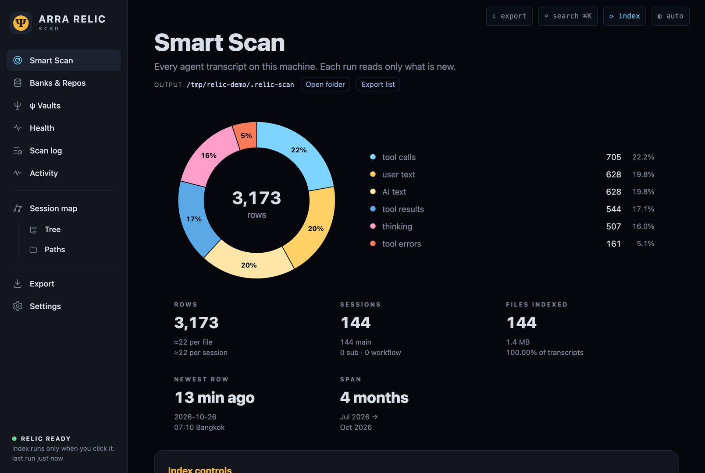

# ARRA Relic Scan

**คู่มือทีละขั้น: จากทรานสคริปต์ของเอเจนต์ ไปถึงดัชนีที่ถามได้**

ทุกคำสั่งรันจริง ทุกภาพในเล่มคือเทอร์มินัลจริง ยกเว้นภาพปกที่ AI วาด — 2026-10-26 · เขียนโดย Claude (AI) กับ Nat

| | บท |
|---|---|
| | [คำนำ](00-frontmatter.md) |
| ภาค 1 | [1. ติดตั้งและรันครั้งแรก](01-intro.md) |
|  | [2. รันซ้ำ อ่านแค่ของใหม่](02-again.md) |
|  | [3. เปิดดูในเว็บ](03-web.md) |
|  | [4. ดิสก์ ห้องนิรภัย และการตั้งค่า](04-more-pages.md) |
|  | [5. ในเทอร์มินัล](05-tui.md) |
| ภาค 2 | [6. ถามดัชนีด้วย DuckDB](06-duckdb.md) |
|  | [7. เดือนที่ปิดผนึก และสำเนาไป S3](07-seals.md) |
| ภาค 3 | [8. ทางเดินของข้อมูลข้ามเครื่อง](08-chain.md) |
|  | [9. ความเป็นส่วนตัว และข้อควรระวัง](09-privacy.md) |
| ภาคผนวก | [10. รูปแบบของ transcript](10-formats.md) |
|  | [11. โค้ดที่เลือก](11-code.md) |

PDF: `book.pdf` (build with `make pdf`).

## How this book was made (/oracle-write-proof-book)
- `make-demo-home.py` builds the demo home (made-up repos, fixed seed); `capture.sh` ran every command on it for real and kept the output verbatim in `captures/`; `shots.sh` took the page screenshots (headless Chrome) and `tui-shot.py` the terminal-UI screens.
- `cards.py` + `/ascii-diagram --png` rendered each capture to `images/NN-slug.png`; diagram cards
  in `diagrams/*.txt` became `images/Dn-*.png`. The text files are the source of truth.
- Chapters drafted in parallel from `BRIEF.md` + `OUTLINE.md`, reviewed 3 ways, fixed per `FIX-RULES.md`.
- `make pdf` → PyThaiNLP → pandoc → fixdash → imgwidth → typst 0.15.1 · `make check` gates.

## Cover art
`images/cover-art.jpg` is AI-generated (Codex `codex exec`, via `scripts/make-cover-art.sh`; subject: an antique brass reliquary box with glowing paper strips rising from it). It is not a photograph and not a capture.
