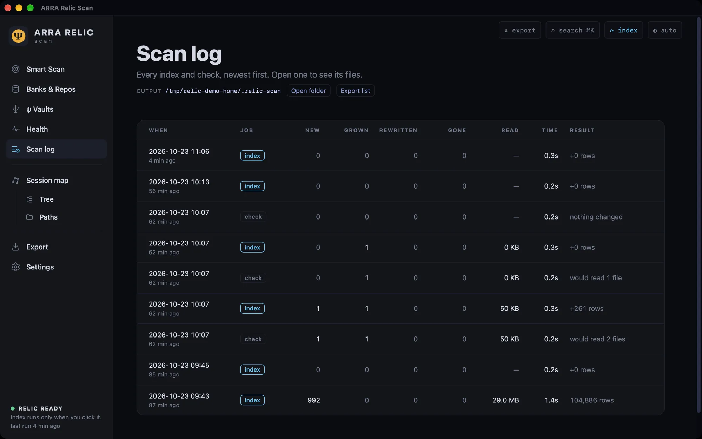
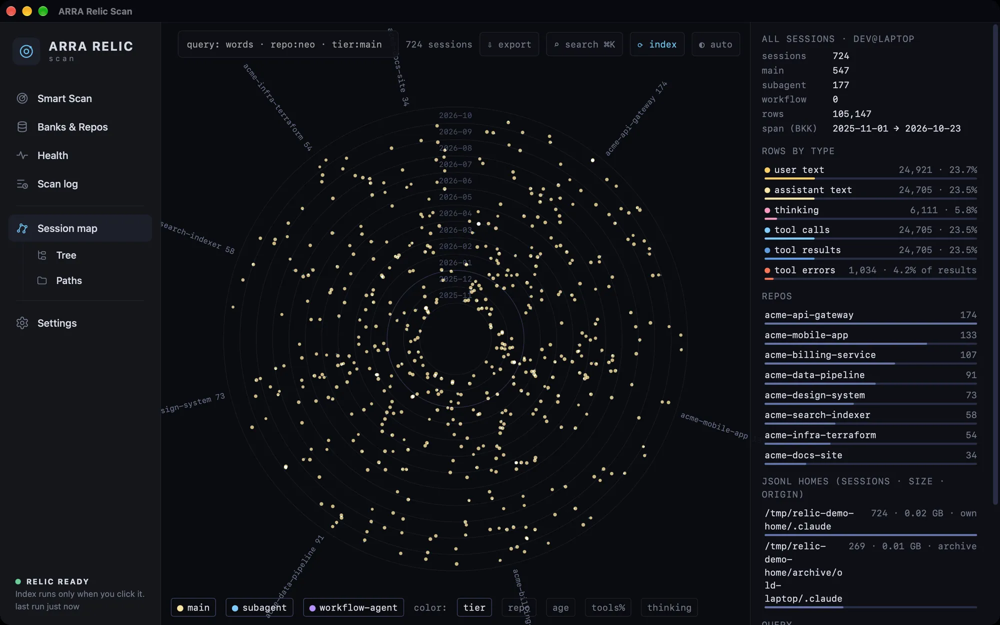
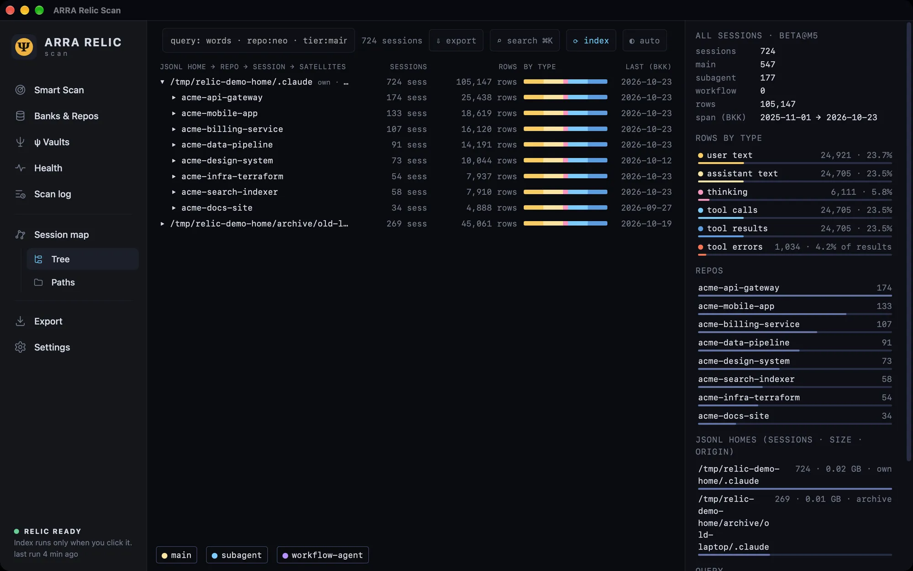
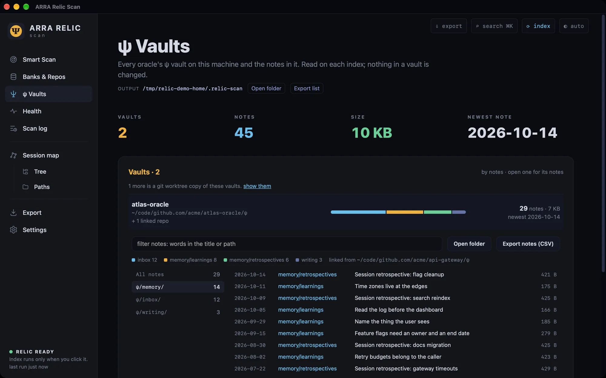
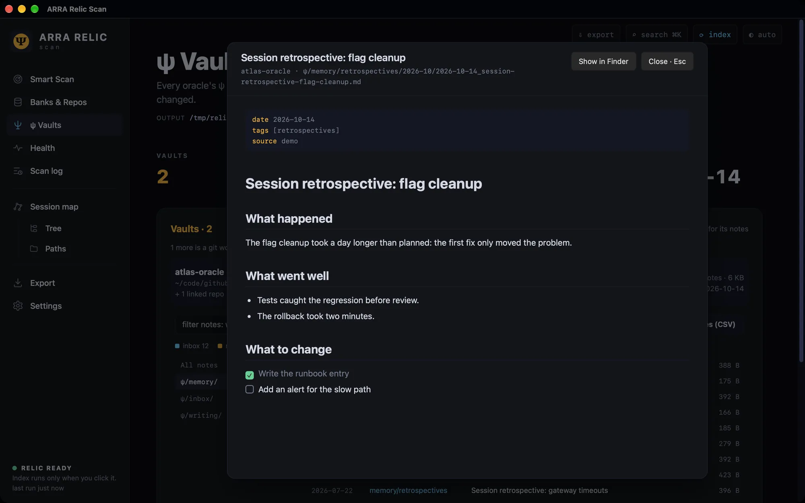
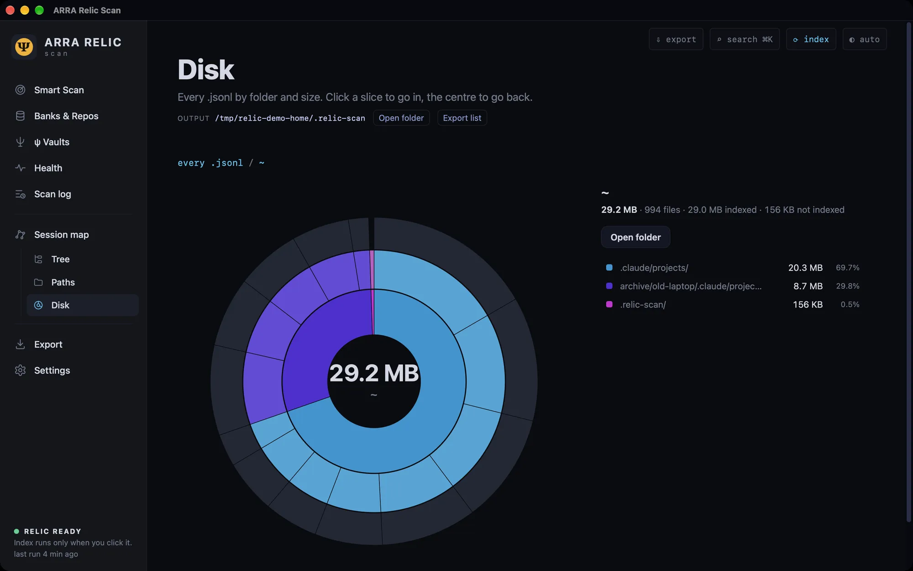
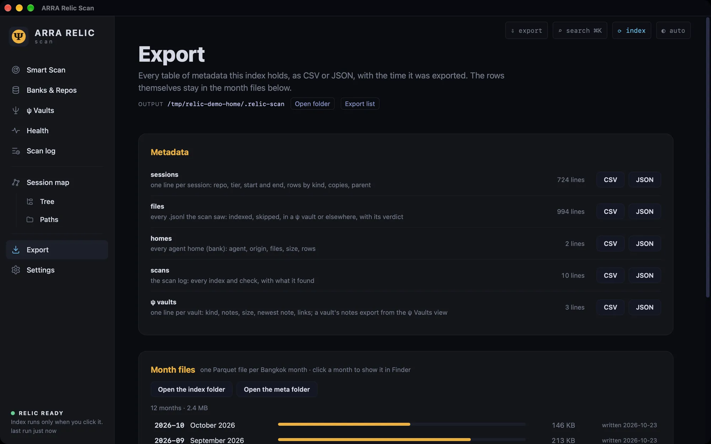
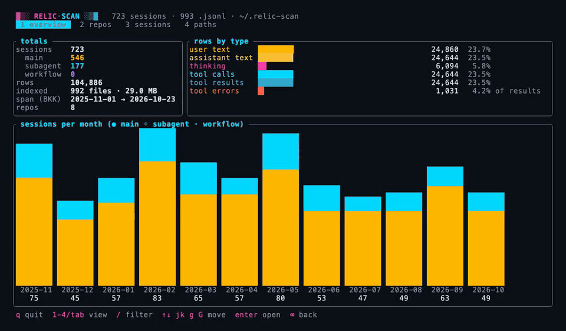

# Tutorial: from agent transcripts to chunks ready to embed

The relic chain has three steps. Each tool reads the previous one's output and never changes it.

```
 relic-scan                 relic-extract                      relic-embed (next)
 find + index         ──►   pick, clean, dedupe, cut     ──►   vectors, search
 ~/.relic-scan/             ~/.relic-extract/<stream>/
   YYYY-MM.parquet            YYYY-MM.parquet
   meta/sessions.parquet    settings: ~/.arra/relic.toml
```

1. **relic-scan** finds every transcript Claude Code, Codex, OMP, OMX, Gemini, Pi and thClaws left on the machine, plus
   every ψ vault. It indexes them into one Parquet file per Bangkok month.
2. **relic-extract** reads those month files and writes the parts to embed: one row per chunk. A TOML file sets what goes
   in, and the tool cleans, dedupes and cuts the text.
3. **relic-embed** (next) turns the chunks into vectors.

Every output below comes from a real run on a demo home of made-up repositories: 993 transcripts, 33 MB. The home folder
is shortened to `~`. On a real machine, expect bigger numbers: one Mac has 87,000 files, 75 GB and 5.4 M rows, indexed
cold in about a minute.

---

## Part 1: relic-scan

### 1. Install

```sh
curl -fsSL https://raw.githubusercontent.com/Soul-Brews-Studio/relic4-scan/main/install.sh | sh
```

This needs Rust 1.89 or newer. It builds in about 30 s and installs `~/.local/bin/relic-scan`. Run the same line again
to upgrade. You can also:
- download the desktop app (macOS `.dmg`, Linux `.deb` and `.AppImage`) from
  [Releases](https://github.com/Soul-Brews-Studio/relic4-scan/releases);
- build from a checkout with `just install`.

### 2. Look before you index

With no command, `relic-scan` says what is indexed already and lists the commands:

```
$ relic-scan

  ▓▒░ RELIC·SCAN ░▒▓  v26.10.23-alpha.1858 · every AI-agent transcript on this machine

  ○ nothing indexed yet

  relic-scan up --kind claude         index Claude transcripts, then serve the map on 127.0.0.1:8787
  relic-scan up                       the same over every agent (claude, codex, omp, omx, …)
  relic-scan tui [--kind claude]      browse sessions, repos and paths in the terminal
  relic-scan serve [--kind claude]    serve /map /tree /paths without indexing again
  relic-scan run [--kind claude]      index only (incremental: new bytes only)
  relic-scan run --dry-run            only check: what an index would read, nothing written
  relic-scan run --month 2026-10      only one month (or --day, --from/--to), in a folder of its own
  relic-scan --help                   every command and flag
```

A dry run walks the folders and prints what an index would read. It writes nothing:

```
$ relic-scan run --dry-run
run: scan 0.2s · new 993 · grown 0 · rewritten 0 · unchanged 0 · gone 0 · 0.03 GB to read
╭─ ▓▒░ RELIC·SCAN ░▒▓ ───────────────────────────────────╮
│ dry run · an index would read 993 files, 0.03 GB       │
│ new 993 · grown 0 · rewritten 0 · unchanged 0 · gone 0 │
│ scan 0.2s · nothing written                            │
│ → ~/.relic-scan                                        │
╰────────────────────────────────────────────────────────╯
```

The walk covers `~` and `/opt/Code`, eight folders deep. To change that:
- pass `--root DIR` (repeatable), `--exclude TEXT` or `--depth N` on the command line;
- or set them once in the page's Settings (the gear icon), which saves `~/.relic-scan/_config.json`.

### 3. Index

```
$ relic-scan run
run: scan 0.2s · new 993 · grown 0 · rewritten 0 · unchanged 0 · gone 0 · 0.03 GB to read

parse: 993 files · 0.03 GB · 106156 lines (0 not JSON) · 150213 raw rows · 0 stuck at a >8 MB line · 1.0s (29 MB/s) · 18 threads
  2025-11: 11590 rows (15698 new copies merged) -> ~/.relic-scan/2025-11.parquet
  …
  2026-10: 6346 rows (8916 new copies merged) -> ~/.relic-scan/2026-10.parquet
merge: 12 months in 0.1s · total 1.1s
vaults: 3 ψ vaults · 74 notes · 0.0 GB (+ 1 worktree copy) in 0.0s -> ~/.relic-scan/meta/vaults.json
meta: 12 months (12 re-aggregated) in 0.0s · 993 files · 724 sessions (0 probe) · 0.0s -> ~/.relic-scan/meta/
map: 724 sessions · 8 repos · 2 homes · 0.3 MB · 993 paths in 0.0s -> ~/.relic-scan/meta/map.html
run: done in 1.4s · state 993 files -> ~/.relic-scan/_state.tsv
╭─ ▓▒░ RELIC·SCAN ░▒▓ ─────────────────────────────────────────────╮
│ 724 sessions · 105,147 rows · 993 files · 0.0 GB read            │
│ new 993 · grown 0 · rewritten 0 · unchanged 0                    │
│ scan 0.2s · parse+merge 1.1s · meta 0.0s · map 0.0s · total 1.4s │
│ → ~/.relic-scan                                                  │
│ ▸ relic-scan serve   ▸ relic-scan tui                            │
╰──────────────────────────────────────────────────────────────────╯
```

"New copies merged" are lines the demo holds twice: the same transcript in `~/.claude` and in an archive folder. Each
message becomes one row, and its `sources` column lists every copy.

What is in `~/.relic-scan` now:

| file | what it holds |
|---|---|
| `2025-11.parquet` … `2026-10.parquet` | the rows: one per message, thinking block, tool call or tool result |
| `meta/sessions.parquet` | one row per session: repository, tier, first and last time, counts by kind |
| `meta/files.parquet`, `meta/jsonl.parquet` | one row per transcript file, and every `.jsonl` the scan saw |
| `meta/vaults.json`, `meta/vaults/<id>.json` | every ψ vault and its notes, as plain JSON |
| `_state.tsv`, `_ledger.tsv`, `_scans.jsonl` | where each file was read up to, every version read, and the scan log |

To index one agent only, use `--kind claude`; it writes `~/.relic-scan/claude`. To index one month only, use
`--month 2026-10` (or `--day`, `--from`, `--to`); it writes a folder of its own, such as `~/.relic-scan/all@2026-10`.

### 4. Browse it

```
$ relic-scan serve
serve: http://127.0.0.1:8787/map · /tree · /paths  (~/.relic-scan)  ctrl-c to stop
```

`relic-scan up` does both steps: it indexes, then serves. The page is served on 127.0.0.1 only, and it makes no
network calls. Its views:

| | |
|---|---|
| <br>**Smart Scan.** The totals, rows by kind, and the Check changes and Index now buttons. | <br>**Scan log.** Every index and check, with the files each one read. |
| <br>**Map.** Every session as a star: months as rings, repositories as sectors. ⌘K searches. | <br>**Tree.** Home, repository, session, newest first. |
| <br>**ψ Vaults.** Every oracle vault and its notes, grouped by folder. | <br>**Reader.** A markdown note rendered where it lives. |
| <br>**Disk.** Every `.jsonl` by folder and size. | <br>**Export.** Every meta table as CSV or JSON, and each month file one click from Finder. |

The same index is also available in the terminal, with `relic-scan tui`:



### 5. Run it again: only new bytes are read

The next run reads only what changed. To show this, the demo home gets a mirror of `~/.claude` (as if copied from a
laptop), and one session grows by two lines:

```
$ cp -R ~/.claude ~/mirrors/laptop/.claude
$ relic-scan run
ledger: 724 copies (not read) · 0 read from a known version · 0 whose past changed · 0 never seen
run: scan 0.2s · new 724 · grown 1 · rewritten 0 · unchanged 992 · gone 0 · 0.00 GB to read
parse: 1 files · 0.00 GB · 2 lines (0 not JSON) · 3 raw rows · 0 stuck at a >8 MB line · 0.0s (0 MB/s) · 18 threads
…
╭─ ▓▒░ RELIC·SCAN ░▒▓ ─────────────────────────────────────────────╮
│ 724 sessions · 105,147 rows · 1,717 files · 0.0 GB read          │
│ new 724 · grown 1 · rewritten 0 · unchanged 992                  │
│ scan 0.2s · parse+merge 0.1s · meta 0.1s · map 0.0s · total 0.4s │
```

The 724 mirrored files are new paths, but the **ledger** knows their content. It keeps a hash chain over every line of
every version it has read, so a copy costs a hash, not a parse. The grown file is read from where the last run
stopped. Before a new or changed path is read, the ledger gives one of four answers:

| answer | meaning | what the index does |
|---|---|---|
| same | this content was read before, at any path | nothing to read |
| update | a version read before is the start of this file | reads only the lines after it |
| past changed | the first line is known, but the earlier lines differ | reads it all and keeps the old rows |
| never | the first line was never seen | reads it all |

`relic-scan log` lists every index and check, and `--diff N` lists the files of one entry:

```
$ relic-scan log
    #  when              job        new   grown rewritten   gone  unchanged  copies resumed   past      read    secs
    1  2026-10-23 19:25  index      724       1         0      0        992     724       0      0      1 KB     0.4
    0  2026-10-23 19:25  index      993       0         0      0          0       0       0      0   29.0 MB     1.4

$ relic-scan log --diff 1
#1 2026-10-23 19:25 index · 1 files read · 0.00 GB · ledger: 724 copies, 0 resumed, 0 past changed
grown               +1 KB  ~/.claude/projects/-Users-dev-code-github-com-acme-data-pipeline/123fb42a-….jsonl
copy             not read  ~/mirrors/laptop/.claude/projects/-Users-dev-code-github-com-acme-api-gateway/038dfcd8-….jsonl
…
```

**Several machines.** Copy the other machine's agent homes into a folder under a scan root, then run again:

```sh
rsync -a --include='*/' --include='*.jsonl' --exclude='*' you@laptop:.claude/ ~/.relic-mirrors/laptop/.claude/
relic-scan run
```

Anything the ledger has seen before, from this machine or an earlier mirror, is not read again. Only the new lines go
into the index.

### 6. Query it

The month files are plain Parquet, so DuckDB, Polars or pandas can read them. Count everything once, by what each row
is:

```
$ cd ~/.relic-scan
$ duckdb -c "select coalesce(nullif(kind, ''), nullif(role, ''), '(none)') as what, count(*) as n from '*.parquet' group by 1 order by n desc"
┌───────────┬───────┐
│   what    │   n   │
├───────────┼───────┤
│ user      │ 24854 │
│ result    │ 24644 │
│ call      │ 24644 │
│ assistant │ 24628 │
│ thinking  │  6094 │
└───────────┴───────┘

$ duckdb -c "select cat as repo, count(*) as sessions, sum(n_rows) as n_rows from 'meta/sessions.parquet' group by 1 order by sessions desc limit 3"
┌──────────────────────┬──────────┬────────┐
│         repo         │ sessions │ n_rows │
├──────────────────────┼──────────┼────────┤
│ acme-api-gateway     │      174 │  25438 │
│ acme-mobile-app      │      133 │  18619 │
│ acme-billing-service │      107 │  16120 │
└──────────────────────┴──────────┴────────┘
```

A message or thinking block has a `role` (`user`, `assistant`, `thinking`). A tool row has a `kind` instead: `call` (the
tool is in `name`) or `result` (`err` is true when it failed). A thinking row with empty text is a block whose text was
not saved: since about March 2026, Claude Code writes most thinking blocks as a signature only. More queries are in
[AGENTS.md](../AGENTS.md).

---

## Part 2: relic-extract

relic-extract reads relic-scan's month files and writes what an embedder needs: one row per chunk, with a stable key, so
the same text is never embedded twice. It is one Rust binary, and one TOML file sets what goes in.

### 1. Install

```sh
git clone https://github.com/Soul-Brews-Studio/relic-extract && cd relic-extract
just install          # builds, then puts relic-extract in ~/.local/bin
```

### 2. Write the config

```
$ relic-extract init
wrote ~/.arra/relic.toml
```

`~/.arra/relic.toml` is one file for the whole chain, with a table for each tool. relic-extract reads `[extract]`:

```toml
[extract]
source = "~/.relic-scan"        # relic-scan's output: YYYY-MM.parquet + meta/sessions.parquet
out = "~/.relic-extract"        # <stream>/YYYY-MM.parquet, ready for relic-embed
months = "changed"              # "changed" | "all" | ["2026-10", "2026-09"]
sessions = "any"                # cat/probe from meta/sessions.parquet: "any" tier (main preferred) | "main" only

[extract.dedupe]
key = "content"                 # "content": the same message rewritten with other bytes is embedded once

[extract.chunk]
max_chars = 6000                # longer texts are cut, with this overlap
overlap = 400

[extract.streams.text]
enabled = true
field = "text"
roles = ["user", "assistant"]

[extract.streams.text.clean]    # before cutting
strip_tags = ["system-reminder"]          # <tag>…</tag> removed anywhere
commands = "args"                         # a slash command becomes "/name args"
min_chars = 0                             # drop messages shorter than this
redact = true                             # tokens and keys -> [kind:abcd…N]
# … drop_tags, drop_prefixes, drop_texts: harness text that is not the conversation

[extract.streams.thinking]
enabled = false

[extract.streams.tools]
enabled = false
field = "body"
kinds = ["call"]                # add "result" for tool outputs
max_chars = 2000                # a tool body is cut here, not chunked
```

There are three streams: `text` (on by default), `thinking` and `tools`. A missing file or key falls back to these
defaults. `relic-extract config` prints the settings in effect, and `--config FILE` or `ARRA_CONFIG` points to another
file.

The clean step matters on real data. On one Mac, a quarter of the October user text was `<system-reminder>` blocks the
harness added, not words a person typed.

### 3. See what a run would cut

`analyse` runs the same select, clean and cut as `run`, in memory, and writes nothing:

```
$ relic-extract analyse
relic-extract analyse · text · 12 months (2025-11 … 2026-10) · ~/.relic-scan · 0.0s

  messages (raw cut)               49,400
    other roles                         0
    cleaned out                         0
    kept                           49,400
  chunks                           49,400
  distinct texts                      575

by month       raw msgs        kept      chunks    distinct  cleaned out
  2025-11         5,470       5,470       5,470         437            0
  …
most repeated texts (rows holding one chunk text)
     5,907 ×  Looking at acme-api; running the suite.
     4,371 ×  Looking at mobile-app; running the suite.
```

`--what-if KEY=VALUE` adds a column with one setting changed, so you can try a value before writing it into the file:

```
$ relic-extract analyse --months 2026-10 --what-if min_chars=42
what-if: streams.text.clean.min_chars = 42

                                      now      what-if       change
  messages (raw cut)                3,015        3,015           +0    +0.0%
    cleaned out                         0        1,292        +1292
    kept                            3,015        1,723        -1292   -42.9%
  chunks                            3,015        1,723        -1292   -42.9%
  distinct texts                      355          276          -79   -22.3%
```

`relic-extract tui` shows the same report in the terminal. Press `w` to try a what-if live.

### 4. Cut

```
$ relic-extract run
relic-extract: ~/.relic-scan -> ~/.relic-extract · config ~/.arra/relic.toml
extract text 2025-12: 2,966 messages -> 2,966 chunks (438 distinct texts) · 0.0s
…
extract text: 12 month(s) cut -> ~/.relic-extract/text
12 part(s) cut in 0.1s · 49,400 chunks · 0 messages cleaned out

$ relic-extract status
text      on   12 months · 49,400 chunks · 575 distinct texts · newest 2026-10-23T04:24:00.000Z
thinking  off  no parts
tools     off  no parts
```

Run it again, and nothing is cut. A month is cut again only when relic-scan rewrote it, or when the stream's settings
changed:

```
$ relic-extract run
extract text: 0 month(s) cut -> ~/.relic-extract/text
0 part(s) cut in 0.0s · 0 chunks · 0 messages cleaned out
```

### 5. Change the config

To add tool inputs, set `enabled = true` under `[extract.streams.tools]` and run again. Only the new stream is cut. The
text stream is left alone, because its settings did not change:

```
$ relic-extract run
extract text: 0 month(s) cut -> ~/.relic-extract/text
extract tools: 12 month(s) cut -> ~/.relic-extract/tools
12 part(s) cut in 0.1s · 24,644 chunks · 0 messages cleaned out
```

Each stream keeps a hash of its settings in `~/.relic-extract/<stream>/_extract.json`. Change `chunk`, `dedupe` or the
stream's own table, and every month of that stream is cut again on the next run.

### 6. The output

`~/.relic-extract/<stream>/YYYY-MM.parquet`, one row per chunk:

```
$ duckdb -c "select month, chunk, role, cat, left(text, 42) as text, left(key, 12) as key from '~/.relic-extract/text/2026-10.parquet' limit 3"
┌─────────┬───────┬───────────┬─────────────────┬────────────────────────────────────────────┬──────────────┐
│  month  │ chunk │   role    │       cat       │                    text                    │     key      │
├─────────┼───────┼───────────┼─────────────────┼────────────────────────────────────────────┼──────────────┤
│ 2026-10 │     0 │ user      │ acme-mobile-app │ step 0 on mobile-app: fix the failing test │ a4423e082e5f │
│ 2026-10 │     0 │ user      │ acme-mobile-app │ step 0 on mobile-app: fix the failing test │ a4423e082e5f │
│ 2026-10 │     0 │ assistant │ acme-mobile-app │ Looking at mobile-app; running the suite.  │ ef8cdb6d240c │
└─────────┴───────┴───────────┴─────────────────┴────────────────────────────────────────────┴──────────────┘
```

| column | what it is |
|---|---|
| `key` | blake2b-128 of the chunk text, used as the embedding cache key: the same text gets the same vector, in any month |
| `msgkey`, `chunk` | the message, and the chunk's number within it |
| `h`, `n_h` | one source row holding the message, and how many rows hold it |
| `month`, `sid`, `ts`, `ts_th`, `engine`, `role`, `type`, `kind`, `name` | copied from the month file |
| `cat`, `probe` | the session's repository, and whether it was an automated probe (from `meta/sessions.parquet`) |
| `text` | the chunk |

The two user rows above are two messages with the same words, so they share one `key`. The embedder makes one vector and
uses it for both.

---

## The whole loop, every day

```sh
relic-scan run        # new bytes only; copies from other machines cost a hash
relic-extract run     # only the months relic-scan rewrote
# relic-embed run     # next: only the keys without a vector
```

## When something is off

| you see | do this |
|---|---|
| `✗ no month files in ~/.relic-scan` | run `relic-scan run` first, or point `[extract] source` at the folder that holds the month files |
| a run stops because another holds the lock | one writer per folder: wait for the other `run` to finish |
| a range run stops ("indexed without one") | `--month` and the other date flags write their own folder; leave `--out` unset |
| fewer files than you expect | check the roots (`--root`, or the page's Settings) and `relic-scan log --diff 0` |
| a number to report | count everything first (Part 1, step 6), then report a slice next to that total |
